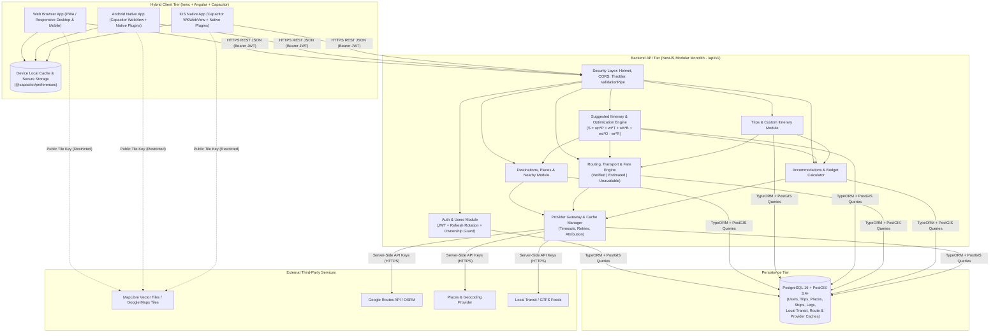
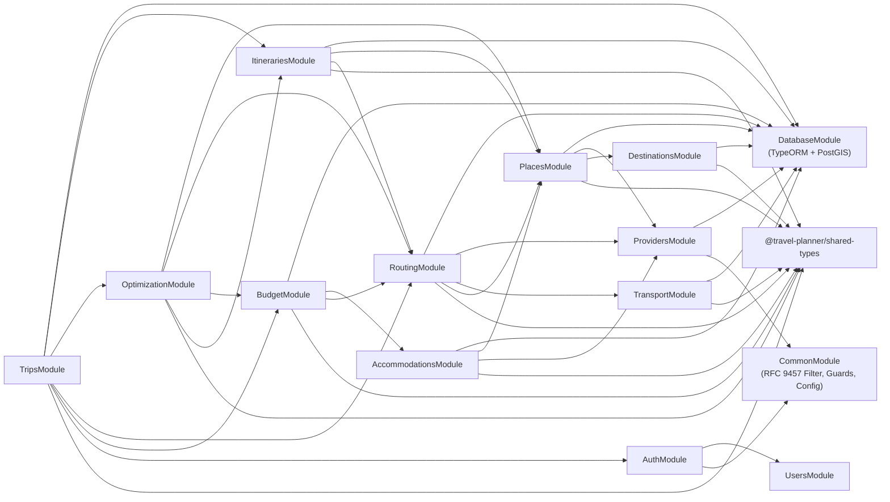
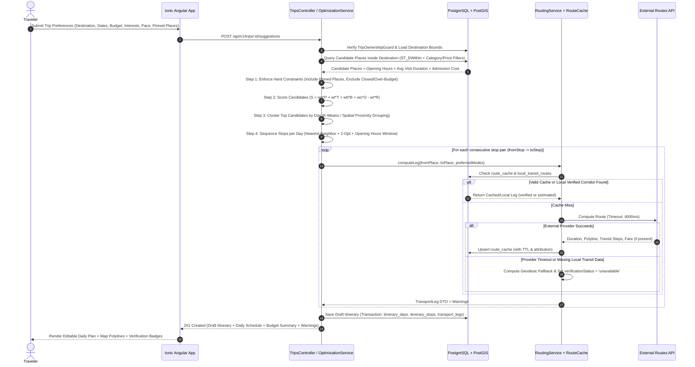
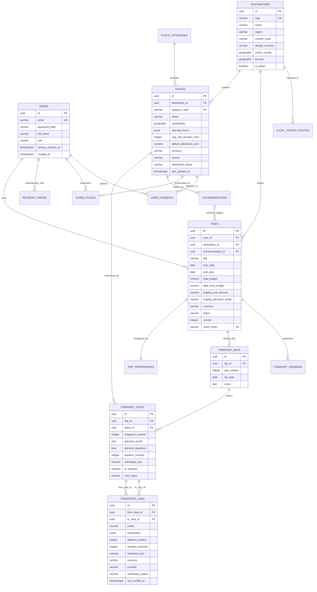
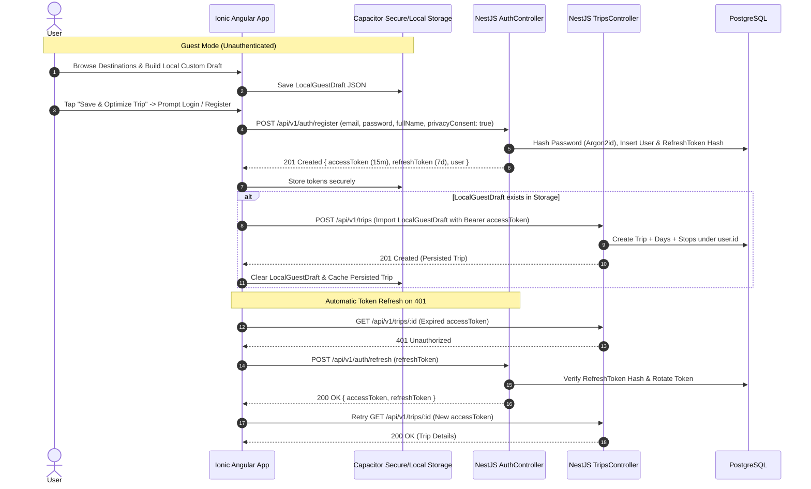
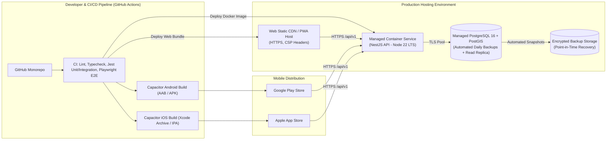

# Hybrid Travel Itinerary Application: System Architecture Analysis and End-to-End Development Plan

**Source Blueprint Analyzed**: `Hybrid_Travel_Itinerary_App_System_Blueprint.docx`  
**Target Stack**: [Ionic Framework](https://www.google.com/search?q=https%3A%2F%2Fionicframework.com%2Fdocs) + [Angular](https://www.google.com/search?q=https%3A%2F%2Fangular.dev%2Foverview) + [TypeScript](https://www.google.com/search?q=https%3A%2F%2Fwww.typescriptlang.org%2Fdocs%2Fhandbook%2Fintro.html) + [Capacitor](https://www.google.com/search?q=https%3A%2F%2Fcapacitorjs.com%2Fdocs%2Fgetting-started%2Fwith-ionic) | [NestJS](https://www.google.com/search?q=https%3A%2F%2Fdocs.nestjs.com%2Fdata%2Foverview) REST API | [PostgreSQL](https://www.google.com/search?q=https%3A%2F%2Fwww.postgresql.org%2Fdocs%2Fcurrent%2Findex.html) + [PostGIS](https://www.google.com/search?q=https%3A%2F%2Fpostgis.net%2Fdocumentation%2Fmanual%2F)  
**Target Pilot Region**: Philippines (Single-Region Curated Pilot vs. Metro Manila Multi-Modal Pilot)  
**Compliance Standard**: [Republic Act No. 10173 (Philippines Data Privacy Act of 2012)](https://www.google.com/search?q=https%3A%2F%2Fprivacy.gov.ph%2Fdata-privacy-act%2F), [OWASP ASVS](https://www.google.com/search?q=https%3A%2F%2Fowasp.org%2Fprojects%2Fasvs), [W3C WCAG 2.2](https://www.google.com/search?q=https%3A%2F%2Fwww.w3.org%2FTR%2FWCAG22%2F)


## 1. Executive Summary

This technical manual provides a complete architectural review, gap remediation specification, and sequential end-to-end implementation plan for the **Hybrid Travel Itinerary Application** defined in `Hybrid_Travel_Itinerary_App_System_Blueprint.docx`.

### Key Architectural Verdict

The uploaded blueprint establishes a **sound, pragmatic foundational architecture**:
1. **Shared Hybrid Client with Server-Enforced Business Logic**: Using [Ionic Framework](https://www.google.com/search?q=https%3A%2F%2Fionicframework.com%2Fdocs) with [Angular](https://www.google.com/search?q=https%3A%2F%2Fangular.dev%2Foverview) standalone components and [Capacitor](https://www.google.com/search?q=https%3A%2F%2Fcapacitorjs.com%2Fdocs%2F) enables a single TypeScript codebase across Web, Android, and iOS while keeping API provider keys, route calculations, and itinerary scoring strictly behind a [NestJS](https://www.google.com/search?q=https%3A%2F%2Fdocs.nestjs.com%2Fdata%2Foverview) REST API.
2. **Deterministic Rule-Based Itinerary Engine**: Starting with a configurable, constraint-enforcing linear scoring model ($S = w_p P + w_t T + w_b B + w_o O - w_r R$) rather than an ungrounded generative AI model prevents hallucinated schedules and ensures hard constraints (opening hours, total budget, pinned stops) are respected.
3. **Truthful Transport & Fare Verification Labeling**: Explicitly distinguishing `verified`, `estimated`, and `unavailable` transport legs addresses a core reality of Philippine transit data, where commercial map APIs frequently lack complete jeepney, tricycle, local bus, and fare-matrix coverage.

### Summary of Critical & High-Priority Gaps Resolved in This Plan

While conceptually strong, the blueprint contains **16 architectural omissions and schema/API mismatches** (`GAP-001` through `GAP-016`) that would block implementation if left unresolved:
- **Database Schema Gaps (`GAP-001`, `GAP-004`, `GAP-005`)**: The blueprint references `trips.destination_id` and `GET /api/v1/destinations` without defining a `destinations` table; `transport_legs` references `from_stop_id`/`to_stop_id` in the schema but returns `fromPlaceId`/`toPlaceId` and `verificationStatus` in the API JSON; and `itinerary_stops`/`places` lack explicit columns for `is_required` (pinned stops) and `estimated_visit_minutes`.
- **API Contract Gaps (`GAP-002`, `GAP-003`)**: The API table omits token refresh/logout endpoints (`/api/v1/auth/refresh`, `/api/v1/auth/logout`) and omits single-stop modification/deletion endpoints (`PATCH /api/v1/trips/:id/stops/:stopId`, `DELETE /api/v1/trips/:id/stops/:stopId`) required for schedule editing, day reassignment, and marking `visit_status`.
- **Hybrid Workspace & Guest-Mode Gaps (`GAP-006`, `GAP-007`)**: The high-level diagram includes "Guests", whereas `trips.user_id` is a foreign key and every trip endpoint mandates ownership checks; furthermore, the folder structure proposes a monorepo (`apps/mobile`, `apps/api`) while the CLI commands initialize a single standalone Ionic folder.

All 16 gaps are resolved in Sections 5–12 and translated into **42 sequential, dependency-ordered development tasks (`TASK-001` through `TASK-042`)** in Section 13.


## 2. System Overview and Requirements Extracted from the DOCX

Every requirement extracted below is tagged with its provenance classification:
- **`[Documented]`**: Explicitly stated in `Hybrid_Travel_Itinerary_App_System_Blueprint.docx`.
- **`[Inferred]`**: Reasonably implied by the documented features, schemas, or endpoints.
- **`[Recommended]`**: Proposed engineering addition required to make the system implementation-ready, secure, and maintainable.
- **`[Unresolved]`**: Cannot be established from the source document alone and requires stakeholder confirmation (tracked in Section 6 Decision Register).

### 2.1 System Overview, Objectives, and Problems Solved

- **System Overview `[Documented]`**: A cross-platform hybrid travel itinerary application built with Ionic, Angular, TypeScript, and Capacitor, backed by a NestJS REST API and a PostgreSQL/PostGIS relational and spatial database.
- **Core Objectives `[Documented]`**:
  1. Help travelers plan efficient day-by-day trips to unfamiliar destinations (initial pilot in the Philippines).
  2. Support both automated **Suggested Itinerary Generation** (based on user preferences, geography, opening hours, visit duration, and budget) and manual **Custom Itinerary Building & Optimization** (preserving required/pinned stops).
  3. Provide realistic multi-modal **Route and Transportation Guidance** (walking, rail, bus, jeepney, etc.) with explicit `verified`, `estimated`, or `unavailable` data labels.
  4. Calculate transparent **Budget Estimates** across transport, admission fees, food, lodging, and other expenses without double-counting accommodation.
  5. Discover **Nearby Essential Services** (restaurants, hotels, pharmacies, convenience stores, ATMs) around planned stops.
  6. Persist trips across devices and cache saved itineraries locally on mobile/web for **limited offline access**.
- **Problems Solved `[Documented]`**:
  - Eliminates manual cross-referencing between scattered attraction blogs, map apps, and local transit guides.
  - Prevents unrealistic travel schedules caused by ignoring opening hours, visit durations, or geographic backtracking.
  - Prevents fabricated transit directions or fares in regions (such as Metro Manila or Philippine provincial destinations) where standard map APIs lack complete local transit coverage.

### 2.2 Target Users and User Roles

| Role | Provenance | Description and Permissions |
| :--- | :--- | :--- |
| **Registered Traveler (`user`)** | `[Documented]` | Authenticated user who can create, generate, customize, optimize, save, duplicate, share, and delete trips; bookmark places; and submit place/route feedback. |
| **Guest User (`guest`)** | `[Documented]` / `[Unresolved]` | Listed in Section 1 ("Travelers • Guests • Registered users"). Can browse destinations, search places, and view shared trips; creating persistent server-side trips requires either anonymous guest session tokens or local-only draft storage until registration (`DEC-002`). |
| **Data Curator / Admin (`admin`)** | `[Recommended]` | Internal administrative role required to seed and maintain verified local attractions, opening hours, and Philippine transit fare matrices (`users.role`). |

### 2.3 Functional Requirements Inventory (`FR-001` to `FR-018`)

| Req ID | Module | Requirement Description | Provenance |
| :--- | :--- | :--- | :--- |
| **FR-001** | Auth & Profile | Register accounts (`POST /api/v1/auth/register`), authenticate (`POST /api/v1/auth/login`), manage sessions/JWT refresh tokens, and manage profile/privacy settings. | `[Documented]` |
| **FR-002** | Destination Discovery | Search and browse destinations (`GET /api/v1/destinations`) by city, region, attraction, or interactive map bounding box/viewport. | `[Documented]` |
| **FR-003** | Place Discovery | Search tourist attractions and essential services (`GET /api/v1/places`, `GET /api/v1/places/:id`) with category filters, coordinates, opening hours, and admission price levels. | `[Documented]` |
| **FR-004** | Module 1: Trip Planning | Create, list, view, update, duplicate, and delete trips (`POST/GET/PATCH/DELETE /api/v1/trips`) capturing destination, dates/duration, budget, currency (`PHP`), traveler count, interests, pace, and transport preferences. | `[Documented]` |
| **FR-005** | Module 2: Suggested Itinerary | Generate an editable day-by-day draft itinerary (`POST /api/v1/trips/:id/suggestions`) using candidate filtering, geographic clustering by day/area, schedule feasibility validation, and the weighted scoring model $S = w_p P + w_t T + w_b B + w_o O - w_r R$. | `[Documented]` |
| **FR-006** | Module 3: Custom Itinerary | Search and add stops (`POST /api/v1/trips/:id/stops`), remove stops, assign stops to specific days, edit planned arrival/departure times, and reorder stops (`PATCH /api/v1/trips/:id/stops/reorder`). | `[Documented]` |
| **FR-007** | Module 3: Custom Optimization | Optimize stop order (`POST /api/v1/trips/:id/optimize`) while strictly preserving all user-required (`pinnedPlaceIds` / `is_required`) stops, allowing preview, acceptance, rejection, or manual adjustment. | `[Documented]` |
| **FR-008** | Module 4: Route & Transport | Calculate and retrieve consecutive stop-to-stop travel legs (`GET /api/v1/trips/:id/routes`) showing supported modes, walking segments, boarding/alighting points, transfers, duration, and estimated fare. | `[Documented]` |
| **FR-009** | Module 4: Truthful Labeling | Label every transport leg and fare as `verified`, `estimated`, or `unavailable` with provider attribution and `last_verified_at` timestamp; never fabricate boarding points, stations, transfers, or fares. | `[Documented]` |
| **FR-010** | Module 5: Nearby Essentials | Search nearby establishments (`GET /api/v1/places/:id/nearby`) including restaurants, hotels, pharmacies, convenience stores, and ATMs ranked by spatial proximity and relevance. | `[Documented]` |
| **FR-011** | Module 5: Accommodations | Search and compare accommodations (`GET /api/v1/accommodations`) near planned attraction clusters or destination centers with nightly price ranges and provider attribution. | `[Documented]` |
| **FR-012** | Budget Calculation | Calculate daily and total trip budget summaries (`GET /api/v1/trips/:id/budget`) summing transport, admission, food, and other expenses, allocating lodging separately (trip-level or prorated daily) and separating confirmed prices from estimates. | `[Documented]` |
| **FR-013** | Module 6: Visit Tracking | Track stop `visit_status` (`planned`, `visited`, `skipped`) during active trips and persist edits across sessions and devices. | `[Documented]` |
| **FR-014** | Module 6: Offline Access | Cache saved trips, selected place details, and essential route instructions on the device using local persistence and warn users via `@capacitor/network` when offline data may be stale. | `[Documented]` |
| **FR-015** | Module 6: Sharing & Deep Links | Share trips and open shared trips or destinations directly inside the app via Capacitor Deep Links / Universal Links / App Links. | `[Documented]` |
| **FR-016** | Bookmarks & Feedback | Allow users to bookmark `saved_places` and submit `user_feedback` reports on inaccurate place details, opening hours, or transport directions. | `[Documented]` |
| **FR-017** | Native Geolocation | Request device location permissions with clear purpose explanation (`@capacitor/geolocation`) only when needed to display user position and nearby places. | `[Documented]` |
| **FR-018** | Optional Push Notifications | Support optional visit reminders or itinerary change alerts via Capacitor Push Notifications (deferred to post-MVP unless enabled). | `[Documented]` |

### 2.4 Non-Functional Requirements Inventory (`NFR-001` to `NFR-012`)

| Req ID | Category | Requirement Specification | Provenance |
| :--- | :--- | :--- | :--- |
| **NFR-001** | Security & Auth | Enforce server-side ownership and permission checks on every user-specific record (`trips`, `itinerary_days`, `itinerary_stops`, `saved_places`), regardless of UI state. | `[Documented]` |
| **NFR-002** | Credential Isolation | Keep private map, routing, and place provider API keys strictly on the NestJS backend; restrict any browser/mobile public map tile keys by HTTP referer / Android package / iOS bundle ID. | `[Documented]` |
| **NFR-003** | Abuse & Rate Limiting | Enforce per-IP and per-user rate limiting on authentication and expensive itinerary generation, optimization, and routing endpoints. | `[Documented]` |
| **NFR-004** | Resilience & Fallbacks | Handle external provider timeouts, HTTP 429 rate limits, missing transit routes, and outages gracefully using bounded timeouts, cached responses, and fallback states. | `[Documented]` |
| **NFR-005** | Monetary Precision | Store all monetary values using decimal-safe types (`NUMERIC(12,2)`) paired with explicit ISO 4217 3-letter currency codes (default `PHP`). Never use floating-point types for currency. | `[Documented]` |
| **NFR-006** | Spatial Indexing | Store coordinates using PostGIS `geography(Point, 4326)` columns with GiST spatial indexes for sub-100ms radius (`ST_DWithin`) and nearest-neighbor (`<->`) queries. | `[Documented]` |
| **NFR-007** | Provider Compliance | Preserve data source attribution (`source`, `provider_place_id`, `last_updated_at`) and enforce provider-specific caching TTL and redistribution rules in `provider_cache` and `route_cache`. | `[Documented]` |
| **NFR-008** | Privacy & RA 10173 | Comply with the [Philippines Data Privacy Act of 2012 (RA 10173)](https://www.google.com/search?q=https%3A%2F%2Fprivacy.gov.ph%2Fdata-privacy-act%2F) and [IRR](https://www.google.com/search?q=https%3A%2F%2Fprivacy.gov.ph%2Fimplementing-rules-regulations-data-privacy-act-2012%2F): data minimization, explicit consent notice, retention policy, and user data export/deletion workflows. | `[Documented]` |
| **NFR-009** | Accessibility & Responsiveness | Meet [W3C WCAG 2.2 AA](https://www.google.com/search?q=https%3A%2F%2Fwww.w3.org%2FTR%2FWCAG22%2F) contrast, readable typography, screen-reader labels, and minimum $44 \times 44\text{ px}$ touch targets; adapt layout from mobile tabs to split-screen itinerary + map on desktop/tablet. | `[Documented]` |
| **NFR-010** | Architecture Modularity | Use Angular standalone components with lazy-loaded feature routes on the frontend and modular domain boundaries on the NestJS backend. | `[Documented]` |
| **NFR-011** | Backup & Recovery | Configure automated PostgreSQL/PostGIS database backups and verify point-in-time restoration procedures before production launch. | `[Documented]` |
| **NFR-012** | Performance Targets | Target $< 300\text{ ms}$ p95 latency for cached place/trip reads and $< 3,500\text{ ms}$ p95 latency for multi-stop rule-based itinerary generation and route calculation. | `[Recommended]` |

### 2.5 Constraints, Assumptions, and Limitations Extracted

- **Transit Data Limitation `[Documented]`**: Standard routing APIs (such as [Google Routes API](https://www.google.com/search?q=https%3A%2F%2Fdevelopers.google.com%2Fmaps%2Fdocumentation%2Froutes)) do not reliably cover informal or semi-formal Philippine public transit modes (jeepneys, UV Express, tricycles, provincial buses) or LTFRB fare matrices.
- **Offline Limitation `[Documented]`**: Saved itineraries and cached route instructions work offline, whereas generating new itineraries, computing live routes, and querying real-time place availability require active internet connectivity.
- **Platform Build Constraints `[Documented]`**: Web and Android builds can be produced on Linux, macOS, or Windows (with Android Studio/SDK), whereas native iOS builds require macOS with Xcode and an Apple Developer account.
- **Initial Pilot Constraint `[Documented]`**: Section 13 recommends launching with a single curated destination or region in the Philippines before expanding nationwide.


## 3. Existing Architecture Assessment

### A. Application Architecture

- **Suitability**: The 3-tier client-server architecture ([Ionic](https://www.google.com/search?q=https%3A%2F%2Fionicframework.com%2Fdocs) + [Angular](https://www.google.com/search?q=https%3A%2F%2Fangular.dev%2Foverview) + [Capacitor](https://www.google.com/search?q=https%3A%2F%2Fcapacitorjs.com%2Fdocs%2F) frontend, [NestJS](https://www.google.com/search?q=https%3A%2F%2Fdocs.nestjs.com%2Fdata%2Foverview) modular monolith API, [PostgreSQL](https://www.google.com/search?q=https%3A%2F%2Fwww.postgresql.org%2Fdocs%2Fcurrent%2Findex.html) + [PostGIS](https://www.google.com/search?q=https%3A%2F%2Fpostgis.net%2Fdocumentation%2Fmanual%2F) database) is well-suited for the system's workload. A modular monolith in NestJS avoids distributed-systems overhead while keeping `optimization`, `routing`, `transport`, and `providers` cleanly decoupled via Dependency Injection.
- **Identified Bottlenecks**: Calling external routing APIs sequentially for $N$ stops across $D$ days during suggested itinerary generation (`POST /api/v1/trips/:id/suggestions`) would trigger $O(N^2)$ external HTTP calls and exceed request timeouts. The itinerary engine must use PostGIS straight-line (`ST_Distance`) or route-matrix batching (`route_cache`) during candidate clustering and only query detailed step-by-step route instructions for the winning sequence of consecutive stops.

### B. Technology Stack

- **Compatibility**: TypeScript end-to-end across Angular, Capacitor, and NestJS allows 100% shared DTO interfaces, validation logic, and test tooling ([Jest](https://www.google.com/search?q=https%3A%2F%2Fjestjs.io%2Fdocs%2Fgetting-started) and [Playwright](https://www.google.com/search?q=https%3A%2F%2Fplaywright.dev%2Fdocs%2Fintro)).
- **Missing Stack Elements**:
  1. **ORM / Query Builder**: Not named in the blueprint. We recommend **TypeORM** or **Prisma** with raw SQL/spatial helpers (specifically **TypeORM** with `@nestjs/typeorm` because TypeORM natively supports PostGIS `geography(Point, 4326)` columns and spatial GiST index generation in migrations without workarounds).
  2. **Monorepo Workspace Manager**: The folder tree uses `apps/mobile` and `apps/api`, requiring `npm workspaces` or `pnpm workspaces` plus a shared `packages/shared-types` package.
  3. **Client Secure & Offline Storage**: Capacitor requires `@capacitor/preferences` (or `@capacitor-community/sqlite` / IndexedDB via `@ionic/storage-angular`) for offline itinerary caching and native Keychain/Keystore plugin support for refresh tokens.

### C. Database and Data Management

- **Entity Coverage**: The 6 core tables (`users`, `trips`, `itinerary_days`, `itinerary_stops`, `transport_legs`, `places`) and 8 production tables (`trip_preferences`, `place_categories`, `accommodations`, `saved_places`, `itinerary_versions`, `provider_cache`, `route_cache`, `user_feedback`) cover the domain well, **except** for the missing `destinations` table (`GAP-001`) and `refresh_tokens` table (`GAP-002`).
- **Concurrency & Transactions**: Reordering stops (`PATCH /api/v1/trips/:id/stops/reorder`) and regenerating suggested itineraries (`POST /api/v1/trips/:id/suggestions`) mutate multiple rows across `itinerary_days`, `itinerary_stops`, and `transport_legs`. These operations must execute inside single database transactions (`QueryRunner` / `DataSource.transaction`) with `UNIQUE (day_id, sequence_number) DEFERRABLE INITIALLY DEFERRED` constraints to prevent sequence collisions.

### D. API and Communication

- **Endpoint Completeness**: The 18 proposed REST endpoints cover discovery, trip CRUD, suggestion generation, optimization, routing, nearby search, accommodations, and budget calculation, but omit auth refresh/logout (`GAP-002`), individual stop update/delete (`GAP-003`), bookmark CRUD (`GAP-016`), feedback submission, and health checks (`GAP-015`).
- **Contract Consistency**: The blueprint's `transport_legs` table links legs to `from_stop_id` and `to_stop_id`, whereas the sample response JSON uses `fromPlaceId` and `toPlaceId` (`GAP-004`). Linking `transport_legs` to `from_stop_id` and `to_stop_id` (while also returning `fromPlaceId` and `toPlaceId` in the DTO) is superior because a user may visit or transit through the same place twice on different days or segments.

### E. Security

- **Authentication & Authorization**: JWT access tokens (short-lived, 15 minutes) paired with rotating refresh tokens (`HttpOnly` cookie on web, secure storage on native Capacitor) satisfy Section 3 and Section 10. Every `/api/v1/trips/:id/*` endpoint must verify `trip.user_id === currentUser.id` via a dedicated `TripOwnershipGuard`.
- **Input Validation & Rate Limiting**: NestJS `ValidationPipe` (`whitelist: true, forbidNonWhitelisted: true, transform: true`) and `@nestjs/throttler` are required to protect expensive optimization and routing endpoints from cost-exhaustion attacks.
- **Data Privacy (RA 10173)**: Location coordinates sent during "Nearby Services" queries must not be linked to persistent user audit logs unless explicitly saved as a trip stop.

### F. User Interface and User Experience

- **Navigation & Screen Coverage**: All 14 screens are well-defined and map cleanly to 4 primary Ionic tabs (`Home`, `Explore/Search`, `Saved Trips`, `Profile`) plus a shared `Itinerary Workspace` split-pane view.
- **State Requirements**: Every data-driven screen requires explicit `loading` (skeleton screens), `empty` (zero stops or zero search matches), `error` (provider timeout with retry button), `offline` (cached banner with `last_verified_at`), and `verificationStatus` badge (`Verified`, `Estimated`, `Unavailable`) states.

### G. External Integrations

- **Provider Abstraction**: Because the blueprint allows either [Google Maps Platform](https://www.google.com/search?q=https%3A%2F%2Fdevelopers.google.com%2Fmaps%2Fdocumentation%2Froutes) or [MapLibre GL JS](https://www.google.com/search?q=https%3A%2F%2Fmaplibre.org%2Fmaplibre-gl-js%2Fdocs%2F) for maps, and Google Routes API, [GTFS](https://www.google.com/search?q=https%3A%2F%2Fgtfs.org%2Fdocumentation%2Fschedule%2Freference%2F), or local curated datasets for transit, the NestJS `providers/` module must implement the **Adapter / Strategy pattern** (`IMapProvider`, `IRoutingProvider`, `ITransitProvider`, `IPlacesProvider`).

### H. Deployment and Operations

- **Target Environments**: Requires `development` (Docker Compose with PostGIS 16 + local seed data), `staging` (cloud container + managed PostGIS), and `production` (Web PWA + Google Play Android AAB + optional Apple App Store iOS IPA + cloud NestJS API).

### I. Testing and Quality Assurance

- **Test Pyramid**: Unit tests ([Jest](https://www.google.com/search?q=https%3A%2F%2Fjestjs.io%2Fdocs%2Fgetting-started)) must verify the scoring formula $S = w_p P + w_t T + w_b B + w_o O - w_r R$, hard-constraint filtering, and budget math; integration tests (Supertest + Testcontainers/PostGIS) must verify spatial queries, transactions, and BOLA/IDOR authorization; E2E tests ([Playwright](https://www.google.com/search?q=https%3A%2F%2Fplaywright.dev%2Fdocs%2Fintro)) must verify the 12 MVP Acceptance Criteria in Section 12 of the blueprint.


## 4. Architecture Strengths

The following architectural decisions in `Hybrid_Travel_Itinerary_App_System_Blueprint.docx` are technically sound and are strictly preserved in this implementation plan:

1. **Backend-Encapsulated Optimization and Provider Proxy**: Keeping itinerary generation, route optimization, and third-party API calls inside NestJS protects API keys, prevents client billing abuse, centralizes caching (`provider_cache`, `route_cache`), and keeps mobile battery/CPU usage low.
2. **Deterministic Rule-Based Scoring Engine First**: Using the explicit linear scoring function $S = w_p P + w_t T + w_b B + w_o O - w_r R$ with separate hard-constraint gates guarantees explainable, reproducible, and unit-testable itineraries without LLM latency or hallucination risks.
3. **Explicit Transport Verification States (`verified`, `estimated`, `unavailable`)**: Elevating data reliability into a first-class domain attribute prevents the app from misleading travelers with fabricated jeepney routes, boarding points, or fares.
4. **Separation of Entities (`places` vs. `itinerary_stops` vs. `transport_legs`)**: Normalizing places independently of trip stops allows curated attraction updates and spatial indexing while preserving per-trip customization and sequence-specific travel legs.
5. **Non-Destructive Custom Optimization Preview**: Requiring the optimizer (`POST /api/v1/trips/:id/optimize`) to preserve all user-pinned stops and return a preview before overwriting the user's schedule respects user agency.
6. **Lodging Cost Separation in Budget Engine**: Calculating accommodation costs at the trip level (or explicitly prorating across nights) prevents double-counting hotel rates inside daily attraction/transit totals.


## 5. Missing Components and Gap Analysis

The table below catalogs every missing component, schema contradiction, and ambiguity identified across the blueprint (`GAP-001` through `GAP-016`), ordered by priority (`Critical` -> `High` -> `Medium` -> `Low`).

| Issue ID | Component / Area | Current State in DOCX | Missing Component or Defect | Reason It Matters | Recommended Solution | Dependencies | Priority | Required Before | Class |
| :--- | :--- | :--- | :--- | :--- | :--- | :--- | :--- | :--- | :--- |
| **GAP-001** | Database (`destinations` table) | `trips.destination_id` and `GET /api/v1/destinations` are specified, but Section 6 omits a `destinations` table. | Missing `destinations` entity schema (regions/cities, bounding boxes, center coordinates, default currency, timezone). | `trips.destination_id` FK cannot be created and destination search cannot function without a backing table. | Add `destinations` table with PostGIS `center_coords geography(Point, 4326)`, `bounds geography(Polygon, 4326)`, `country_code`, `default_currency`, and `is_active`. | None | **Critical** | Phase 5 (DB Design) | Mandatory |
| **GAP-002** | Auth API & Token Persistence | Section 3 specifies "Backend-managed sessions or JWT with refresh tokens"; Section 8 only lists `/auth/register` and `/auth/login`. | Missing `/api/v1/auth/refresh`, `/api/v1/auth/logout`, `/api/v1/auth/me` endpoints and `refresh_tokens` table. | Short-lived JWTs will expire mid-session with no way to refresh or revoke compromised tokens on mobile devices. | Add `refresh_tokens` table (storing SHA-256 token hashes, expiry, device info, revocation timestamp) and `/refresh`, `/logout`, `/me` endpoints. | `users` table | **Critical** | Phase 6 (Auth & Security) | Mandatory |
| **GAP-003** | Custom Itinerary Stop CRUD API | Section 8 lists `POST /trips/:id/stops` and `PATCH /trips/:id/stops/reorder`, but no update or delete stop endpoints. | Missing `PATCH /api/v1/trips/:id/stops/:stopId` and `DELETE /api/v1/trips/:id/stops/:stopId`. | Users cannot remove a stop, move a stop to another day, edit arrival/departure times, or mark `visit_status` (`visited`/`skipped`). | Add `PATCH` and `DELETE /api/v1/trips/:id/stops/:stopId` endpoints that atomically re-sequence remaining stops and recalculate affected `transport_legs`. | `itinerary_stops` table | **Critical** | Phase 7 (Custom Itinerary) | Mandatory |
| **GAP-004** | `transport_legs` Schema vs. API DTO | Section 6 defines `from_stop_id` and `to_stop_id` on `transport_legs`, while Section 8 JSON returns `fromPlaceId`, `toPlaceId`, and `verificationStatus`. | `transport_legs` table omits `verification_status`, `distance_meters`, `walking_meters`, `transfers_count`, and `route_polyline`; API JSON omits `fromStopId`/`toStopId`. | Frontend cannot render route polylines on the map or persist the mandatory `verified`/`estimated`/`unavailable` badge in the database. | Add `verification_status`, `distance_meters`, `walking_meters`, `transfers_count`, `boarding_point`, `alighting_point`, `route_geojson` to `transport_legs` and include both stop IDs and place IDs in the DTO. | `GAP-003` | **High** | Phase 5 (DB Design) | Mandatory |
| **GAP-005** | `places` & `itinerary_stops` Columns | Section 7 & 8 require `estimatedVisitMinutes`, `estimatedAdmissionCost`, and `pinnedPlaceIds` (required vs. optional stops). | `places` table omits `avg_visit_duration_mins` and `default_admission_cost`; `itinerary_stops` omits `is_required` (`boolean`) and `duration_minutes`. | Suggested itinerary generator and custom optimizer cannot calculate schedule feasibility or distinguish required stops from optional ones. | Add `avg_visit_duration_mins`, `default_admission_cost`, `currency` to `places`, and `is_required`, `duration_minutes`, `notes` to `itinerary_stops`. | None | **High** | Phase 5 (DB Design) | Mandatory |
| **GAP-006** | Guest Mode Architecture | Section 1 includes "Guests" in the UI tier, but `trips.user_id` is a foreign key and Section 10 requires ownership checks on all trip requests. | Ambiguous behavior when an unauthenticated guest builds a trip vs. when a registered user saves a trip. | Either guests are blocked from trying the planner or unauthenticated endpoints become vulnerable to IDOR. | Support read-only public discovery (`GET /destinations`, `GET /places`) for guests + local device draft storage (`@capacitor/preferences`), with a "Claim Draft Trip on Login/Register" flow (`POST /api/v1/trips/import`). | `GAP-002` | **High** | Phase 6 & 8 | Mandatory |
| **GAP-007** | Monorepo vs. Standalone CLI Setup | Section 5 defines a monorepo (`travel-planner/apps/mobile`, `apps/api`), while Section 9 runs `ionic start travel-planner` as a standalone app. | Missing root `package.json` workspace configuration and `packages/shared-types` package. | Developers following Section 9 commands literally will create a flat project that does not match Section 5's folder tree. | Initialize a root npm/pnpm workspace monorepo (`apps/mobile`, `apps/api`, `packages/shared-types`) and run `ionic start` inside `apps/mobile`. | None | **High** | Phase 3 & 4 (Repo Setup) | Mandatory |
| **GAP-008** | Database ORM & Migration Tooling | Section 3 selects NestJS + PostgreSQL/PostGIS and Section 5 shows `database/migrations/`, but no ORM or migration tool is specified. | Unspecified database client, spatial query builder, and migration runner. | Inconsistent ad-hoc SQL queries risk SQL injection or broken PostGIS geometry serialization. | Standardize on TypeORM (`@nestjs/typeorm`, `pg`) with explicit SQL/TypeORM migrations in `database/migrations/` and parameterized PostGIS `ST_*` queries. | `GAP-007` | **High** | Phase 5 (DB Design) | Mandatory |
| **GAP-009** | Local Transit & Fare Fallback Schema | Section 3 & 7C note that map APIs lack Philippine jeepney/bus routes and fares, requiring multi-source transit data. | No schema table exists to store curated local transit corridors, boarding points, or LTFRB fare calculation rules. | Backend has no local data source to query when Google Routes API returns zero transit results or omits fares. | Add a `local_transit_routes` and `fare_rules` seedable table (or structured `transport` module table) with official base fare + per-km rules and `verification_status`. | `GAP-004` | **High** | Phase 9 (Routing Engine) | Mandatory |
| **GAP-010** | Offline Cache & Sync Conflict Resolution | Section 9 requires caching saved trips offline and warning when stale, but defines no sync/conflict strategy. | Missing offline versioning and conflict handling when a user edits a trip offline or marks stops `visited`. | Offline edits could be silently overwritten on reconnect or overwrite newer server edits. | Add `updated_at` and integer `version` column on `trips` (plus optional `itinerary_versions` snapshots) and implement optimistic concurrency check (`If-Match` / `version`) during sync. | `GAP-003` | **Medium** | Phase 12 (Offline & Native) | Mandatory |
| **GAP-011** | Budget Breakdown Persistence | Section 7C defines `Daily estimated cost = transport + admission + food + other expenses` plus separate lodging allocation. | `trips` and `itinerary_days` lack fields for daily food allowance, miscellaneous expenses, and selected accommodation cost. | `GET /api/v1/trips/:id/budget` cannot compute food, lodging, or custom expenses if only stop admissions and leg fares are stored. | Add `accommodation_id`, `lodging_cost_amount`, `lodging_allocation_mode` (`trip_level` vs `daily_prorated`), `daily_food_budget`, and `other_budget_amount` to `trips`/`itinerary_days`. | `GAP-005` | **Medium** | Phase 11 (Budget Module) | Mandatory |
| **GAP-012** | Trip Sharing & Deep Link Contract | Module 6 and Section 9 specify trip sharing and deep links, but Section 8 has no sharing endpoint. | Missing share-token generation and read-only shared trip retrieval endpoint. | Deep links cannot load a shared trip for another user without exposing private trip IDs (BOLA risk). | Add `share_token` (nullable unique random slug) and `is_public_shared` on `trips`, plus `POST /api/v1/trips/:id/share` and `GET /api/v1/shared/trips/:shareToken`. | `GAP-002` | **Medium** | Phase 12 (Sharing & Native) | Conditional |
| **GAP-013** | Rate Limiting & Provider Cache Policy | Section 6 & 10 require `provider_cache`, `route_cache`, and rate limiting, but TTLs and throttling tiers are undefined. | Missing concrete rate-limit windows and cache expiration rules per provider terms. | Unbounded external API calls could violate provider ToS or exhaust monthly quotas. | Configure `@nestjs/throttler` (strict tier: 10 req/min for `/suggestions` and `/optimize`; standard tier: 60 req/min) and set explicit `expires_at` TTLs on `provider_cache` and `route_cache`. | `GAP-008` | **Medium** | Phase 6 & 9 | Mandatory |
| **GAP-014** | RA 10173 Data Privacy Endpoints | Section 10 requires compliance with the Philippines Data Privacy Act of 2012 (privacy notice, retention, user data requests). | Missing user data export (`GET /api/v1/users/me/export`), account deletion (`DELETE /api/v1/users/me`), and consent timestamp fields. | Non-compliance with RA 10173 data subject rights (Right to Erasure and Right to Data Portability). | Add `privacy_consent_at` on `users` and implement `GET /api/v1/users/me/export` and `DELETE /api/v1/users/me` (cascading deletion of user trips and tokens). | `GAP-002` | **Medium** | Phase 6 & 14 | Mandatory |
| **GAP-015** | Operational Health & Readiness Endpoint | Section 10 requires handling provider failures and database backups, but no health check endpoint is listed. | Missing `GET /api/v1/health` endpoint (`@nestjs/terminus`). | Container orchestrators, load balancers, and smoke tests cannot verify API + PostGIS readiness automatically. | Add `GET /api/v1/health` checking PostgreSQL/PostGIS connectivity and memory health. | `GAP-008` | **Low** | Phase 6 (Backend Core) | Mandatory |
| **GAP-016** | Saved Places & User Feedback Endpoints | Section 6 defines `saved_places` and `user_feedback` tables, but Section 8 omits their REST endpoints. | Missing CRUD endpoints for bookmarked places and inaccurate transit/place feedback reports. | The `saved_places` and `user_feedback` tables cannot be populated or read by the Ionic app. | Add `GET/POST/DELETE /api/v1/users/me/saved-places` and `POST /api/v1/feedback`. | `GAP-002` | **Low** | Phase 11 | Conditional |


## 6. Unresolved Requirements and Technical Decisions

The following Decision Register (`DEC-001` through `DEC-008`) documents all architectural choices left open by the source blueprint, evaluates the options, and establishes the recommended baseline used throughout the development plan so engineering can proceed immediately without blocking.

| Decision ID | Unresolved Question | Available Options | Recommended Option | Technical Justification | Consequences & Trade-offs | Blocks Dev? | Needed By |
| :--- | :--- | :--- | :--- | :--- | :--- | :--- | :--- |
| **DEC-001** | **Initial Philippine Pilot Region** (Section 13 notes Metro Manila is a possible pilot but warns its multi-modal complexity is a major challenge). | **Option A**: Baguio City or Cebu/Bohol curated tourist corridor.<br>**Option B**: Intramuros–Ermita–Binondo–Bay Area (Heritage & Cultural Corridor, Metro Manila).<br>**Option C**: Full Metro Manila (all 16 cities + all jeepney routes). | **Option B (Curated Metro Manila Heritage & Cultural Corridor, ~60 verified places + LRT-1/MRT-3/EDSA Carousel + curated short-hop jeepney/walk legs)** or **Option A (Baguio City)**. | Exercises the blueprint's explicit requirement for Metro Manila multi-source transport labeling (`verified` rail/P2P vs. `estimated` jeepney vs. `unavailable`) while bounding the initial curated dataset to a verifiable geographic zone. | Requires seeding 50–80 verified attractions and ~30 curated transit corridors in `database/seeds/` before UAT. | No (DB schema is region-agnostic) | Milestone 2 (Data Seeding) |
| **DEC-002** | **Guest Mode vs. Authenticated Trip Persistence** (Section 1 lists Guests; Section 6/8 requires `user_id` ownership). | **Option A**: Strict login wall before any planning.<br>**Option B**: Guests browse destinations/places and build 1 local draft trip in Capacitor storage; saving/optimizing or syncing requires account registration/login.<br>**Option C**: Anonymous server-side guest accounts. | **Option B (Public Discovery + Local Guest Draft + Server Import on Login)** | Protects expensive backend `/suggestions` and `/optimize` endpoints from unauthenticated bot abuse while allowing new users to explore destinations and start a custom draft before registering. | Requires a `POST /api/v1/trips/import` or post-login sync hook in Angular `AuthService`. | No | Milestone 3 (Auth & Trips) |
| **DEC-003** | **Primary Map Rendering & Routing Provider** (Section 3 lists "Google Maps Platform or MapLibre" and "Google Routes API or compatible provider"). | **Option A**: MapLibre GL JS (frontend) + OpenStreetMap/OSRM + Google Routes API fallback (backend).<br>**Option B**: Google Maps JS SDK (frontend) + Google Routes API (backend). | **Option A for Map Rendering ([MapLibre GL JS](https://www.google.com/search?q=https%3A%2F%2Fmaplibre.org%2Fmaplibre-gl-js%2Fdocs%2F)) + Adapter Pattern for Backend Routing ([Google Routes API](https://www.google.com/search?q=https%3A%2F%2Fdevelopers.google.com%2Fmaps%2Fdocumentation%2Froutes) primary + Local Curated Transit/PostGIS fallback)** | MapLibre GL JS is open-source, renders smoothly in Capacitor WebViews without per-map-load billing spikes, and supports offline vector tile caching later; backend Google Routes API + local transit DB provides accurate walking/driving/transit legs. | Frontend renders GeoJSON polylines returned by the backend regardless of which routing provider computed them. | No | Milestone 2 (Map & Places) |
| **DEC-004** | **Authentication Mechanism** (Section 3 lists "Backend-managed sessions or JWT with refresh tokens"). | **Option A**: Stateful server sessions in Redis/DB.<br>**Option B**: Short-lived stateless JWT Access Token (15m) + Rotating Refresh Token (7d, stored hashed in PostgreSQL `refresh_tokens`). | **Option B (JWT Access Token + Rotating Refresh Token)** | Works seamlessly across Capacitor native apps (where third-party cookie policies in iOS `WKWebView` and Android `WebView` often break traditional session cookies) and web browsers. | Native clients store the refresh token via secure storage; web clients use an `HttpOnly; Secure; SameSite=Strict` cookie. | Yes (Blocks Auth tasks) | Milestone 2 (Auth Core) |
| **DEC-005** | **Database ORM / Query Layer** (Not specified in DOCX). | **Option A**: TypeORM (`@nestjs/typeorm`).<br>**Option B**: Prisma.<br>**Option C**: Raw `pg` pool + Knex. | **Option A (TypeORM + Migration CLI + parameterized PostGIS raw query helpers)** | TypeORM has first-class NestJS integration and native column support for `geography(Point, 4326)` and `GiST` spatial indexes without requiring unsupported preview flags. | Developers must write explicit migrations (`typeorm migration:generate`) and keep `synchronize: false` in all environments. | Yes (Blocks DB tasks) | Milestone 1 (Foundation) |
| **DEC-006** | **Custom Itinerary Optimization Algorithm** (Section 7B requires preserving all required stops and proposing a more efficient order). | **Option A**: Brute-force permutations.<br>**Option B**: Nearest-Neighbor + 2-Opt local search heuristic with time-window feasibility check.<br>**Option C**: External OR-Tools microservice. | **Option B (In-process TypeScript Nearest-Neighbor + 2-Opt Heuristic with Opening-Hours & Pinned-Sequence Constraints)** | A daily itinerary typically has $3 \le k \le 10$ stops per day. Nearest-Neighbor + 2-Opt runs in $< 15\text{ ms}$ inside NestJS without requiring a separate Python/C++ microservice. | Keeps deployment simple (single NestJS API service) while delivering optimal or near-optimal daily stop ordering. | No | Milestone 5 (Optimization) |
| **DEC-007** | **Client-Side State Management** (Section 1 mentions "State" in Ionic + Angular). | **Option A**: Angular Signals + RxJS Service Stores.<br>**Option B**: NgRx global Redux store. | **Option A (Angular Signals `signal()`, `computed()` + RxJS HTTP services)** | Modern Angular (v18/v19+) Signals provide reactive, boilerplate-free state management ideal for an MVP itinerary workspace without the ceremony of NgRx actions/reducers/effects. | State services remain lightweight, testable, and easy to persist to Capacitor local storage. | No | Milestone 3 (Frontend Core) |
| **DEC-008** | **Target Hosting Infrastructure** (Not specified in DOCX). | **Option A**: Managed Container Platform (Google Cloud Run / Render / Railway) + Managed PostgreSQL with PostGIS (Supabase / Cloud SQL / Neon) + Static Web Hosting (Firebase Hosting / Cloudflare Pages).<br>**Option B**: Self-managed VPS with Docker Compose. | **Option A (Managed Container + Managed PostgreSQL/PostGIS + Static CDN for Web + Capacitor Android AAB)** | Eliminates OS patching and manual database failover while supporting zero-downtime container rollouts and automated PostGIS backups. | Dockerfiles and `docker-compose.yml` are still provided so the exact same stack runs locally or on any VPS if preferred. | No | Milestone 7 (Deployment) |


## 7. Recommended Implementation-Ready Architecture

### 7.1 Final Component Inventory and Responsibilities

| Tier | Component Name | Assigned Technology | Core Responsibility | Dependencies & Integration Points |
| :--- | :--- | :--- | :--- | :--- |
| **Client (Hybrid UI)** | **Mobile & Web App (`apps/mobile`)** | [Ionic 8](https://www.google.com/search?q=https%3A%2F%2Fionicframework.com%2Fdocs) + [Angular 19](https://www.google.com/search?q=https%3A%2F%2Fangular.dev%2Foverview) + [TypeScript 5](https://www.google.com/search?q=https%3A%2F%2Fwww.typescriptlang.org%2Fdocs%2Fhandbook%2Fintro.html) | Renders all 14 screens, responsive split-pane workspace, interactive map ([MapLibre GL JS](https://www.google.com/search?q=https%3A%2F%2Fmaplibre.org%2Fmaplibre-gl-js%2Fdocs%2F)), drag-and-drop stop reordering, and reactive Signal state stores. | Calls `apps/api` over HTTPS REST (`/api/v1/*`); consumes `@travel-planner/shared-types`; invokes Capacitor native plugins. |
| **Client (Native Bridge)** | **Capacitor Runtime & Plugins** | [Capacitor 6/7](https://www.google.com/search?q=https%3A%2F%2Fcapacitorjs.com%2Fdocs%2F) (`@capacitor/geolocation`, `@capacitor/network`, `@capacitor/preferences`, `@capacitor/app`) | Bridges WebView to Android/iOS native APIs: GPS location with permission prompts, offline network detection, local itinerary cache persistence, and deep-link routing. | Hosted inside `apps/mobile/android` and `apps/mobile/ios`. |
| **Shared Contract** | **Shared DTO & Types (`packages/shared-types`)** | TypeScript Interfaces & Enums | Single source of truth for API request/response shapes, `VerificationStatus` (`verified` \| `estimated` \| `unavailable`), `TravelPace`, and budget models. | Imported by both `apps/mobile` and `apps/api`. |
| **Backend API** | **Auth & Users Module (`src/auth`, `src/users`)** | [NestJS](https://www.google.com/search?q=https%3A%2F%2Fdocs.nestjs.com%2Fdata%2Foverview), `@nestjs/jwt`, `argon2` | Handles registration, password hashing (`Argon2id`), JWT issuance, refresh token rotation, `TripOwnershipGuard`, saved places, and RA 10173 data export/erasure. | Persists to `users`, `refresh_tokens`, `saved_places`. |
| **Backend API** | **Destinations & Places Module (`src/destinations`, `src/places`)** | NestJS + TypeORM + PostGIS | Executes spatial bounding-box/radius searches (`ST_DWithin`), category filtering, place detail lookups, and nearby essentials discovery (`GET /places/:id/nearby`). | Queries `destinations`, `places`, `place_categories`, `provider_cache`; calls `ProvidersModule`. |
| **Backend API** | **Trips & Custom Itinerary Module (`src/trips`, `src/itineraries`)** | NestJS + TypeORM Transactions | Manages trip CRUD, day generation, adding/updating/deleting stops, atomic stop reordering, optimistic concurrency (`version`), and share tokens. | Persists to `trips`, `trip_preferences`, `itinerary_days`, `itinerary_stops`, `itinerary_versions`. |
| **Backend API** | **Optimization & Suggestion Engine (`src/optimization`)** | NestJS Domain Service | Implements the 6-step rule-based Suggested Itinerary Generator ($S = w_p P + w_t T + w_b B + w_o O - w_r R$), geographic day clustering, and Nearest-Neighbor + 2-Opt custom stop reordering. | Reads `places`, `local_transit_routes`; invokes `RoutingModule` and `BudgetModule`. |
| **Backend API** | **Routing & Transport Module (`src/routing`, `src/transport`)** | NestJS + Provider Adapters | Computes stop-to-stop travel legs, merges external route polylines with local Philippine transit/fare matrices, and assigns `verified`, `estimated`, or `unavailable` badges. | Persists to `transport_legs`, `route_cache`, `local_transit_routes`, `fare_rules`. |
| **Backend API** | **Accommodations & Budget Module (`src/accommodations`, `src/budget`)** | NestJS Domain Service | Searches lodging near attraction centroids and computes deterministic daily/trip cost breakdowns (separating confirmed costs from estimates and avoiding lodging double-counting). | Reads `accommodations`, `itinerary_stops`, `transport_legs`, `trips`. |
| **Backend API** | **External Provider Gateway (`src/providers`)** | NestJS `@nestjs/axios` + Circuit Breaker + Cache | Encapsulates outbound calls to [Google Routes API](https://www.google.com/search?q=https%3A%2F%2Fdevelopers.google.com%2Fmaps%2Fdocumentation%2Froutes), Places/Geocoding APIs, and [GTFS](https://www.google.com/search?q=https%3A%2F%2Fgtfs.org%2Fdocumentation%2Fschedule%2Freference%2F) feeds with timeouts (4,000 ms), exponential backoff, and TTL caching. | Reads/writes `provider_cache` and `route_cache`. |
| **Data Tier** | **Spatial Relational Database** | [PostgreSQL 16+](https://www.google.com/search?q=https%3A%2F%2Fwww.postgresql.org%2Fdocs%2Fcurrent%2Findex.html) + [PostGIS 3.4+](https://www.google.com/search?q=https%3A%2F%2Fpostgis.net%2Fdocumentation%2Fmanual%2F) | Stores relational entities, ACID transactions, and GiST-indexed `geography(Point, 4326)` and `geography(LineString, 4326)` spatial data. | Accessed exclusively by `apps/api` over TLS connection pool. |

### 7.2 Error Handling and Failure Recovery Strategy

1. **Standardized HTTP Error Contract**: All NestJS exceptions are formatted by a global `ProblemDetailsExceptionFilter` compliant with [IETF RFC 9457](https://www.google.com/search?q=https%3A%2F%2Fwww.rfc-editor.org%2Finfo%2Frfc9457%2F) (`type`, `title`, `status`, `detail`, `instance`, `errorCode`, `validationErrors`).
2. **External Provider Degradation**:
   - If the external routing provider times out or returns HTTP 429/5xx, `RoutingService` falls back to:
     1. Checking `route_cache` (returning cached leg with `lastVerifiedAt` timestamp),
     2. Checking `local_transit_routes` + `fare_rules` if the origin/destination match a known transit corridor (labeled `estimated`), or
     3. Calculating geodesic distance via PostGIS `ST_Distance` with conservative walking/transit speed heuristics and setting `verificationStatus: 'unavailable'` for fare/boarding details, appending a warning to the response `warnings[]` array.
3. **Offline Client Recovery**:
   - `OfflineCacheService` in `apps/mobile` intercepts `GET /api/v1/trips` and `GET /api/v1/trips/:id` responses, persisting encrypted/serialized snapshots in Capacitor Preferences/IndexedDB.
   - When `@capacitor/network` reports `connected: false`, the UI switches to **Offline Read/Check-off Mode**: users can view cached schedules, maps, and transport instructions and toggle `visit_status` (`visited`/`skipped`), which queues a lightweight sync mutation replayed when connectivity returns.


## 8. Architecture and Data-Flow Diagrams

### 8.1 High-Level System Architecture



### 8.2 Component Dependency Graph (Backend & Shared Packages)



### 8.3 Suggested Itinerary Generation & Scoring Data Flow



### 8.4 Database Entity-Relationship Diagram (ERD)



### 8.5 Authentication, Token Rotation, and Guest Draft Claim Flow



### 8.6 Deployment Architecture




## 9. Technology Stack and Development Environment

### 9.1 Standardized Stack and Version Matrix

| Layer | Technology / Package | Version Target | Justification & Official Reference |
| :--- | :--- | :--- | :--- |
| **Runtime & Workspace** | Node.js LTS + npm Workspaces | Node `>=22.11.0`, npm `>=10.9.0` | Long-term support runtime compatible with Angular 19, NestJS 11, and Capacitor 6/7. |
| **Language** | TypeScript | `~5.6.0` (`strict: true`) | Shared static typing across `apps/mobile`, `apps/api`, and `packages/shared-types` ([TypeScript Handbook](https://www.google.com/search?q=https%3A%2F%2Fwww.typescriptlang.org%2Fdocs%2Fhandbook%2Fintro.html)). |
| **Frontend Framework** | Angular (Standalone Components + Signals) | `^19.0.0` (or `^18.2.0`) | Matches Section 5 requirement for Angular standalone components and lazy-loaded routes ([Angular Overview](https://www.google.com/search?q=https%3A%2F%2Fangular.dev%2Foverview)). |
| **Hybrid UI Toolkit** | Ionic Framework (`@ionic/angular`) | `^8.4.0` | Provides adaptive iOS/Material Design components, tabs, modals, and `ion-reorder-group` ([Ionic Docs](https://www.google.com/search?q=https%3A%2F%2Fionicframework.com%2Fdocs)). |
| **Native Bridge** | Capacitor (`@capacitor/core`, `@capacitor/cli`, `@capacitor/android`, `@capacitor/ios`) | `^6.2.0` (or `^7.0.0`) | Compiles the shared web build into native Android and iOS packages ([Capacitor with Ionic](https://www.google.com/search?q=https%3A%2F%2Fcapacitorjs.com%2Fdocs%2Fgetting-started%2Fwith-ionic)). |
| **Capacitor Plugins** | `@capacitor/geolocation`, `@capacitor/network`, `@capacitor/preferences`, `@capacitor/app`, `@capacitor/share` | `^6.0.0` / `^7.0.0` | Implements location permissions, offline detection, local caching, and deep-link handling ([Capacitor Docs](https://www.google.com/search?q=https%3A%2F%2Fcapacitorjs.com%2Fdocs%2F)). |
| **Interactive Maps** | MapLibre GL JS (`maplibre-gl`) | `^4.7.0` | GPU-accelerated vector map rendering in browser and mobile WebViews ([MapLibre GL JS Docs](https://www.google.com/search?q=https%3A%2F%2Fmaplibre.org%2Fmaplibre-gl-js%2Fdocs%2F)). |
| **Backend Framework** | NestJS (`@nestjs/core`, `@nestjs/common`, `@nestjs/platform-express`) | `^10.4.0` / `^11.0.0` | Enforces modular architecture, dependency injection, guards, and pipes ([NestJS Docs](https://www.google.com/search?q=https%3A%2F%2Fdocs.nestjs.com%2Fdata%2Foverview)). |
| **API Documentation & Validation** | `@nestjs/swagger`, `class-validator`, `class-transformer` | `^8.0.0` / `^0.14.0` | Generates OpenAPI 3.1/3.2 specs automatically and validates DTOs on ingress ([OpenAPI v3.2.1](https://www.google.com/search?q=https%3A%2F%2Fspec.openapis.org%2Foas%2Fv3.2.1.html)). |
| **Database & Spatial Engine** | PostgreSQL + PostGIS (`postgis/postgis:16-3.4`) | PostgreSQL `16`, PostGIS `3.4` | Provides ACID transactions and `geography(Point, 4326)` spatial indexing ([PostgreSQL Docs](https://www.google.com/search?q=https%3A%2F%2Fwww.postgresql.org%2Fdocs%2Fcurrent%2Findex.html), [PostGIS Manual](https://www.google.com/search?q=https%3A%2F%2Fpostgis.net%2Fdocumentation%2Fmanual%2F)). |
| **ORM & Migrations** | TypeORM (`typeorm`, `@nestjs/typeorm`, `pg`) | `^0.3.20` | Native support for PostGIS `geography` columns and transactional `QueryRunner` ([NestJS Database Overview](https://www.google.com/search?q=https%3A%2F%2Fdocs.nestjs.com%2Fdata%2Foverview)). |
| **Security & Auth** | `@nestjs/jwt`, `@nestjs/passport`, `argon2`, `helmet`, `@nestjs/throttler` | Current stable | Implements `Argon2id` password hashing, JWT validation, HTTP security headers, and endpoint rate limiting ([OWASP Cheat Sheet Series](https://www.google.com/search?q=https%3A%2F%2Fowasp.org%2Fprojects%2Fcheat-sheet-series)). |
| **Testing Suite** | Jest (`jest`, `ts-jest`, `supertest`) + Playwright (`@playwright/test`) | Jest `^29.7.0`, Playwright `^1.48.0` | Covers unit, PostGIS integration, API contract, and cross-browser E2E testing ([Jest Docs](https://www.google.com/search?q=https%3A%2F%2Fjestjs.io%2Fdocs%2Fgetting-started), [Playwright Docs](https://www.google.com/search?q=https%3A%2F%2Fplaywright.dev%2Fdocs%2Fintro)). |

### 9.2 Workstation Prerequisites by Operating System

- **All Platforms (Linux, macOS, Windows 11 with WSL2)**:
  - Git `>=2.40`, Node.js `v22 LTS`, Docker Engine & Docker Compose v2 (for local PostgreSQL 16 + PostGIS 3.4 container).
- **Android Native Builds (Linux, macOS, Windows)**:
  - JDK 21 LTS, Android Studio Ladybug (or newer), Android SDK Platform 35, Android SDK Build-Tools, and Android Emulator or USB-debugged device.
- **iOS Native Builds (macOS only)**:
  - macOS Sequoia/Sonoma, Xcode `>=16.0`, Xcode Command Line Tools (`xcode-select --install`), CocoaPods (`>=1.15`), and iOS Simulator.


## 10. Proposed Project Directory Structure

This implementation-ready directory structure preserves every path in Section 5 of the DOCX blueprint while adding the root monorepo configuration, `packages/shared-types`, and native Capacitor directories needed to build and test the system end to end:

```text
travel-planner/
├── package.json                          # Root npm workspace manifest & orchestration scripts
├── tsconfig.base.json                    # Shared strict TypeScript compiler configuration
├── docker-compose.yml                    # Local PostgreSQL 16 + PostGIS 3.4 container
├── .env.example                          # Documented environment variable template (zero secrets)
├── .gitignore                            # Excludes node_modules, dist, .env, keystores
├── packages/
│   └── shared-types/                     # Shared TypeScript DTO interfaces & domain enums
│       ├── package.json
│       ├── tsconfig.json
│       └── src/
│           ├── index.ts
│           ├── enums.ts                  # VerificationStatus, TravelPace, TransportMode, VisitStatus
│           ├── trip.models.ts            # Trip, ItineraryDay, ItineraryStop, TransportLeg DTOs
│           └── api-error.models.ts       # RFC 9457 ProblemDetails interface
├── apps/
│   ├── mobile/                           # Ionic + Angular + Capacitor Hybrid Client
│   │   ├── package.json
│   │   ├── angular.json
│   │   ├── ionic.config.json
│   │   ├── capacitor.config.ts           # Capacitor appId, appName, webDir, plugins config
│   │   ├── android/                      # Generated Capacitor Android project (Gradle)
│   │   ├── ios/                          # Generated Capacitor iOS project (Xcode)
│   │   └── src/
│   │       ├── index.html
│   │       ├── main.ts
│   │       ├── theme/
│   │       │   └── variables.scss        # Accessible WCAG 2.2 AA color tokens & spacing
│   │       ├── assets/
│   │       │   └── icons/
│   │       ├── environments/
│   │       │   ├── environment.ts
│   │       │   └── environment.prod.ts
│   │       └── app/
│   │           ├── app.component.ts
│   │           ├── app.config.ts         # Standalone providers, HttpClient, Interceptors
│   │           ├── app.routes.ts         # Lazy-loaded feature routes & AuthGuards
│   │           ├── core/
│   │           │   ├── auth/             # AuthService, AuthGuard, JwtInterceptor
│   │           │   ├── network/          # NetworkStatusService (@capacitor/network)
│   │           │   ├── storage/          # OfflineCacheService (@capacitor/preferences)
│   │           │   ├── geolocation/      # GeolocationService (@capacitor/geolocation)
│   │           │   └── api/              # BaseApiService & RFC 9457 error handler
│   │           ├── shared/
│   │           │   ├── components/
│   │           │   │   ├── map-canvas/           # Reusable MapLibre GL JS component
│   │           │   │   ├── verification-badge/   # Verified | Estimated | Unavailable badge
│   │           │   │   ├── offline-banner/       # Stale cache & connectivity warning banner
│   │           │   │   └── cost-chip/            # Formatted PHP currency chip
│   │           │   └── pipes/
│   │           └── features/
│   │               ├── onboarding/               # Screen 1: Welcome / Onboarding
│   │               ├── home/                     # Screen 2: Home / Dashboard
│   │               ├── destinations/             # Screen 3: Destination Search
│   │               ├── trip-planning/            # Screen 4: Trip Preferences
│   │               ├── suggested-itinerary/      # Screen 5: Suggested Itinerary Results
│   │               ├── custom-itinerary/         # Screen 6 & 7: Place Search & Itinerary Editor
│   │               ├── day-details/              # Screen 8: Day Details Workspace
│   │               ├── route-planning/           # Screen 9: Route Details & Leg Instructions
│   │               ├── nearby-places/            # Screen 10: Nearby Services
│   │               ├── accommodations/           # Screen 11: Accommodation Search
│   │               ├── budget/                   # Screen 12: Budget Summary
│   │               ├── saved-trips/              # Screen 13: Saved Trips
│   │               └── profile/                  # Screen 14: Profile, Settings & RA 10173 Privacy
│   └── api/                              # NestJS + TypeScript Backend API
│       ├── package.json
│       ├── nest-cli.json
│       ├── tsconfig.json
│       └── src/
│           ├── main.ts                   # Bootstrap, Helmet, ValidationPipe, Swagger, CORS
│           ├── app.module.ts
│           ├── common/                   # RFC 9457 Filter, TripOwnershipGuard, Decorators
│           ├── config/                   # Validated Env Schema (Joi / Zod)
│           ├── database/                 # TypeORM DataSource & PostGIS spatial helpers
│           ├── auth/                     # Register, Login, Refresh, Logout, JWT Strategy
│           ├── users/                    # User Entity, Profile, RA 10173 Export/Erase, Saved Places
│           ├── destinations/             # Destination Entity & Search Controller
│           ├── places/                   # Place & Category Entities, Spatial Search, Feedback
│           ├── trips/                    # Trip & Preference Entities, Trip CRUD, Sharing
│           ├── itineraries/              # Day & Stop Entities, Stop CRUD, Atomic Reorder
│           ├── optimization/             # Rule-Based Scoring Engine & 2-Opt Optimizer
│           ├── routing/                  # TransportLeg Entity, Route Calculation & Fallback
│           ├── transport/                # Local Transit Corridors & Fare Matrix Calculator
│           ├── recommendations/          # Nearby Essentials Ranking Service
│           ├── accommodations/           # Accommodation Entity & Discovery Service
│           ├── budget/                   # Deterministic Trip & Daily Budget Service
│           ├── providers/                # External Maps, Routes & GTFS Adapters + Cache
│           └── health/                   # Terminus Readiness & PostGIS Health Check
├── database/
│   ├── migrations/
│   │   └── 1730000000000-InitialTravelPlannerSchema.ts
│   └── seeds/
│       ├── seed.ts
│       ├── destinations.seed.json
│       ├── places-manila-heritage.seed.json
│       └── local-transit-fares.seed.json
├── docs/
│   ├── architecture.md
│   ├── api-specification.md
│   ├── database-schema.md
│   └── privacy-notice-ra10173.md
├── tests/
│   ├── api-integration/                  # Supertest + PostGIS integration suites
│   └── e2e/                              # Playwright browser & mobile-viewport E2E suites
└── README.md
```


## 11. Database Specification

### 11.1 Entity Inventory and Confirmed vs. Proposed Design

All monetary columns use `NUMERIC(12, 2)` paired with a 3-letter ISO 4217 `currency` code (`CHAR(3)`, default `'PHP'`). All geographic coordinates use PostGIS `geography(Point, 4326)` (WGS 84 lon/lat) with `GiST` spatial indexes so distance calculations in `ST_DWithin` and `ST_Distance` operate in **meters** accurately across the Philippines.

#### Table 1: `users` (`[Documented]` + `[Recommended]` RA 10173 consent fields)
- **Purpose**: Stores registered traveler accounts, credentials, roles, and privacy consent timestamps.
- **Ownership & Access**: Users can read/update/delete only their own record (`id = currentUser.id`); admins can manage curated data.

| Column | Type | Key / Null / Default | Constraints & Validation Rules |
| :--- | :--- | :--- | :--- |
| `id` | `UUID` | `PK`, `NOT NULL`, `gen_random_uuid()` | Primary key. |
| `email` | `VARCHAR(255)` | `UNIQUE`, `NOT NULL` | Lowercase trimmed valid email (`CITEXT` or lowercase index). |
| `password_hash` | `VARCHAR(255)` | `NULL` | `Argon2id` hash; nullable only if `external_auth_id` is set. |
| `external_auth_id` | `VARCHAR(255)` | `UNIQUE`, `NULL` | OAuth subject identifier if federated login is used. |
| `full_name` | `VARCHAR(120)` | `NOT NULL` | 1–120 characters. |
| `role` | `VARCHAR(20)` | `NOT NULL`, `'traveler'` | `CHECK (role IN ('traveler', 'admin'))`. |
| `preferred_currency` | `CHAR(3)` | `NOT NULL`, `'PHP'` | ISO 4217 currency code. |
| `privacy_consent_at` | `TIMESTAMPTZ` | `NOT NULL` | Required under RA 10173 at registration. |
| `created_at` | `TIMESTAMPTZ` | `NOT NULL`, `NOW()` | Creation timestamp. |
| `updated_at` | `TIMESTAMPTZ` | `NOT NULL`, `NOW()` | Auto-updated timestamp. |

#### Table 2: `refresh_tokens` (`[Recommended]` — resolves `GAP-002`)
- **Purpose**: Tracks active, rotated, and revoked JWT refresh tokens per user device.
- **Columns**: `id UUID PK`, `user_id UUID FK -> users(id) ON DELETE CASCADE`, `token_hash CHAR(64) NOT NULL UNIQUE` (SHA-256 hash), `device_info VARCHAR(255) NULL`, `expires_at TIMESTAMPTZ NOT NULL`, `revoked_at TIMESTAMPTZ NULL`, `created_at TIMESTAMPTZ NOT NULL DEFAULT NOW()`.
- **Indexes**: `idx_refresh_tokens_user_id (user_id)`, `idx_refresh_tokens_expires_at (expires_at)`.

#### Table 3: `destinations` (`[Recommended]` — resolves `GAP-001`)
- **Purpose**: Defines searchable cities, regions, or tourist zones (such as Metro Manila Heritage Corridor, Baguio City, Cebu) referenced by `trips` and `places`.
- **Columns**:
  - `id UUID PK DEFAULT gen_random_uuid()`
  - `slug VARCHAR(100) UNIQUE NOT NULL`
  - `name VARCHAR(150) NOT NULL`
  - `region VARCHAR(150) NOT NULL` (e.g., `'NCR'`, `'CAR'`, `'Central Visayas'`)
  - `country_code CHAR(2) NOT NULL DEFAULT 'PH'`
  - `description TEXT NOT NULL`
  - `default_currency CHAR(3) NOT NULL DEFAULT 'PHP'`
  - `timezone VARCHAR(64) NOT NULL DEFAULT 'Asia/Manila'`
  - `center_coords geography(Point, 4326) NOT NULL`
  - `bounds geography(Polygon, 4326) NULL`
  - `is_active BOOLEAN NOT NULL DEFAULT TRUE`
  - `created_at TIMESTAMPTZ NOT NULL DEFAULT NOW()`
- **Indexes**: `GIST (center_coords)`, `GIST (bounds)`, `idx_destinations_name_trgm`.

#### Table 4: `place_categories` (`[Documented]` in Section 6)
- **Purpose**: Standardized taxonomy of attraction and essential service types.
- **Columns**: `code VARCHAR(50) PK` (e.g., `'historical'`, `'nature'`, `'museum'`, `'food'`, `'restaurant'`, `'hotel'`, `'pharmacy'`, `'convenience_store'`, `'atm'`, `'transit_hub'`), `display_name VARCHAR(100) NOT NULL`, `kind VARCHAR(30) NOT NULL CHECK (kind IN ('attraction', 'essential_service', 'accommodation', 'transit'))`, `icon_name VARCHAR(50) NOT NULL`.

#### Table 5: `places` (`[Documented]` + `[Recommended]` visit duration & admission columns for `GAP-005`)
- **Purpose**: Stores attractions, essential services, and landmarks with spatial coordinates, opening hours, and provider attribution.
- **Columns**:
  - `id UUID PK DEFAULT gen_random_uuid()`
  - `destination_id UUID NOT NULL FK -> destinations(id) ON DELETE RESTRICT`
  - `category_code VARCHAR(50) NOT NULL FK -> place_categories(code)`
  - `name VARCHAR(200) NOT NULL`
  - `description TEXT NULL`
  - `coordinates geography(Point, 4326) NOT NULL`
  - `address VARCHAR(300) NOT NULL`
  - `opening_hours JSONB NOT NULL DEFAULT '{}'::jsonb` (Structured weekly schedule: `{"mon": [{"open": "08:00", "close": "17:00"}], ...}`)
  - `avg_visit_duration_mins INTEGER NOT NULL DEFAULT 60 CHECK (avg_visit_duration_mins BETWEEN 5 AND 720)`
  - `price_level SMALLINT NOT NULL DEFAULT 1 CHECK (price_level BETWEEN 0 AND 4)`
  - `default_admission_cost NUMERIC(12, 2) NOT NULL DEFAULT 0.00 CHECK (default_admission_cost >= 0)`
  - `currency CHAR(3) NOT NULL DEFAULT 'PHP'`
  - `tags TEXT[] NOT NULL DEFAULT '{}'` (e.g., `ARRAY['nature', 'cultural_attractions', 'family_friendly']`)
  - `rating NUMERIC(3, 2) NULL CHECK (rating BETWEEN 0 AND 5)`
  - `source VARCHAR(100) NOT NULL` (e.g., `'curated_dot_ph'`, `'openstreetmap'`, `'google_places'`)
  - `provider_place_id VARCHAR(200) NULL`
  - `verification_status VARCHAR(20) NOT NULL DEFAULT 'verified' CHECK (verification_status IN ('verified', 'estimated', 'unavailable'))`
  - `last_updated_at TIMESTAMPTZ NOT NULL DEFAULT NOW()`
- **Indexes**: `GIST (coordinates)`, `idx_places_destination_category (destination_id, category_code)`, `GIN (tags)`.

#### Table 6: `accommodations` (`[Documented]` in Section 6)
- **Purpose**: Stores hotel/lodging metadata, nightly rate ranges, and provider attribution linked to a place or destination.
- **Columns**: `id UUID PK`, `place_id UUID NOT NULL UNIQUE FK -> places(id) ON DELETE CASCADE`, `destination_id UUID NOT NULL FK -> destinations(id) ON DELETE CASCADE`, `star_rating SMALLINT NULL CHECK (star_rating BETWEEN 1 AND 5)`, `nightly_rate_min NUMERIC(12, 2) NOT NULL CHECK (nightly_rate_min >= 0)`, `nightly_rate_max NUMERIC(12, 2) NOT NULL CHECK (nightly_rate_max >= nightly_rate_min)`, `currency CHAR(3) NOT NULL DEFAULT 'PHP'`, `amenities TEXT[] NOT NULL DEFAULT '{}'`, `booking_provider VARCHAR(100) NOT NULL`, `provider_reference VARCHAR(255) NULL`, `verification_status VARCHAR(20) NOT NULL DEFAULT 'estimated'`, `last_updated_at TIMESTAMPTZ NOT NULL DEFAULT NOW()`.

#### Table 7: `trips` (`[Documented]` + `[Recommended]` budget, concurrency, and sharing columns for `GAP-010`, `GAP-011`, `GAP-012`)
- **Purpose**: Aggregate root for a user's planned trip.
- **Columns**:
  - `id UUID PK DEFAULT gen_random_uuid()`
  - `user_id UUID NOT NULL FK -> users(id) ON DELETE CASCADE`
  - `destination_id UUID NOT NULL FK -> destinations(id) ON DELETE RESTRICT`
  - `accommodation_id UUID NULL FK -> accommodations(id) ON DELETE SET NULL`
  - `title VARCHAR(200) NOT NULL`
  - `start_date DATE NOT NULL`
  - `end_date DATE NOT NULL CHECK (end_date >= start_date)`
  - `traveler_count SMALLINT NOT NULL DEFAULT 1 CHECK (traveler_count BETWEEN 1 AND 50)`
  - `total_budget NUMERIC(12, 2) NOT NULL CHECK (total_budget >= 0)`
  - `daily_food_budget NUMERIC(12, 2) NOT NULL DEFAULT 0.00 CHECK (daily_food_budget >= 0)`
  - `other_budget_amount NUMERIC(12, 2) NOT NULL DEFAULT 0.00 CHECK (other_budget_amount >= 0)`
  - `lodging_cost_amount NUMERIC(12, 2) NOT NULL DEFAULT 0.00 CHECK (lodging_cost_amount >= 0)`
  - `lodging_allocation_mode VARCHAR(20) NOT NULL DEFAULT 'trip_level' CHECK (lodging_allocation_mode IN ('trip_level', 'daily_prorated'))`
  - `currency CHAR(3) NOT NULL DEFAULT 'PHP'`
  - `status VARCHAR(20) NOT NULL DEFAULT 'draft' CHECK (status IN ('draft', 'active', 'completed', 'archived'))`
  - `version INTEGER NOT NULL DEFAULT 1` (Optimistic concurrency counter)
  - `share_token VARCHAR(64) UNIQUE NULL`
  - `is_public_shared BOOLEAN NOT NULL DEFAULT FALSE`
  - `created_at TIMESTAMPTZ NOT NULL DEFAULT NOW()`
  - `updated_at TIMESTAMPTZ NOT NULL DEFAULT NOW()`

#### Table 8: `trip_preferences` (`[Documented]` in Section 6)
- **Purpose**: Normalized preference profile driving the Suggested Itinerary Generator and Custom Optimizer.
- **Columns**: `id UUID PK`, `trip_id UUID NOT NULL UNIQUE FK -> trips(id) ON DELETE CASCADE`, `interests TEXT[] NOT NULL DEFAULT '{}'`, `travel_pace VARCHAR(20) NOT NULL DEFAULT 'moderate' CHECK (travel_pace IN ('relaxed', 'moderate', 'packed'))`, `transport_preferences TEXT[] NOT NULL DEFAULT ARRAY['public_transport', 'walking']`, `allow_optional_stops BOOLEAN NOT NULL DEFAULT TRUE`, `max_walking_meters_per_leg INTEGER NOT NULL DEFAULT 1200`, `day_start_time TIME NOT NULL DEFAULT '08:30'`, `day_end_time TIME NOT NULL DEFAULT '19:30'`, `scoring_weights JSONB NOT NULL DEFAULT '{"wp": 0.35, "wt": 0.25, "wb": 0.20, "wo": 0.20, "wr": 0.25}'::jsonb`.

#### Table 9: `itinerary_days` (`[Documented]` in Section 6)
- **Purpose**: Represents a single calendar day within a trip (`day_number = 1..N`).
- **Columns**: `id UUID PK`, `trip_id UUID NOT NULL FK -> trips(id) ON DELETE CASCADE`, `day_number SMALLINT NOT NULL CHECK (day_number >= 1)`, `trip_date DATE NOT NULL`, `notes TEXT NULL`, `UNIQUE (trip_id, day_number)`, `UNIQUE (trip_id, trip_date)`.

#### Table 10: `itinerary_stops` (`[Documented]` + `[Recommended]` `is_required` & `duration_minutes` for `GAP-005`)
- **Purpose**: Ordered visit stops within an itinerary day.
- **Columns**:
  - `id UUID PK DEFAULT gen_random_uuid()`
  - `day_id UUID NOT NULL FK -> itinerary_days(id) ON DELETE CASCADE`
  - `place_id UUID NOT NULL FK -> places(id) ON DELETE RESTRICT`
  - `sequence_number SMALLINT NOT NULL CHECK (sequence_number >= 1)`
  - `planned_arrival TIME NOT NULL`
  - `planned_departure TIME NOT NULL CHECK (planned_departure >= planned_arrival)`
  - `duration_minutes INTEGER NOT NULL DEFAULT 60 CHECK (duration_minutes BETWEEN 5 AND 720)`
  - `estimated_cost NUMERIC(12, 2) NOT NULL DEFAULT 0.00 CHECK (estimated_cost >= 0)`
  - `cost_verification_status VARCHAR(20) NOT NULL DEFAULT 'estimated' CHECK (cost_verification_status IN ('verified', 'estimated', 'unavailable'))`
  - `is_required BOOLEAN NOT NULL DEFAULT TRUE` (`TRUE` for user-pinned/custom stops; `FALSE` for optional engine suggestions)
  - `visit_status VARCHAR(20) NOT NULL DEFAULT 'planned' CHECK (visit_status IN ('planned', 'visited', 'skipped'))`
  - `notes TEXT NULL`
  - `CONSTRAINT uq_day_sequence UNIQUE (day_id, sequence_number) DEFERRABLE INITIALLY DEFERRED`

#### Table 11: `transport_legs` (`[Documented]` + `[Recommended]` verification & route geometry fields for `GAP-004`)
- **Purpose**: Stores step-by-step travel guidance, fare estimates, and verification status between consecutive stops (`from_stop_id` -> `to_stop_id`).
- **Columns**:
  - `id UUID PK DEFAULT gen_random_uuid()`
  - `from_stop_id UUID NOT NULL FK -> itinerary_stops(id) ON DELETE CASCADE`
  - `to_stop_id UUID NOT NULL FK -> itinerary_stops(id) ON DELETE CASCADE`
  - `mode VARCHAR(40) NOT NULL` (`'walking'`, `'public_transport'`, `'lrt_mrt'`, `'bus'`, `'jeepney'`, `'tricycle'`, `'taxi_tnvs'`, `'mixed'`)
  - `instructions JSONB NOT NULL DEFAULT '[]'::jsonb` (Array of step objects: `[{"stepNumber": 1, "instruction": "Walk 250m to UN Ave LRT-1 Station", "mode": "walking", "distanceMeters": 250, "durationSeconds": 180}]`)
  - `boarding_point VARCHAR(200) NULL`
  - `alighting_point VARCHAR(200) NULL`
  - `transfers_count SMALLINT NOT NULL DEFAULT 0 CHECK (transfers_count >= 0)`
  - `distance_meters INTEGER NOT NULL DEFAULT 0 CHECK (distance_meters >= 0)`
  - `walking_meters INTEGER NOT NULL DEFAULT 0 CHECK (walking_meters >= 0)`
  - `duration_seconds INTEGER NOT NULL CHECK (duration_seconds >= 0)`
  - `estimated_fare NUMERIC(12, 2) NULL CHECK (estimated_fare >= 0)` (Nullable when `verification_status = 'unavailable'`)
  - `currency CHAR(3) NOT NULL DEFAULT 'PHP'`
  - `provider VARCHAR(100) NOT NULL` (`'curated_transit_ph'`, `'google_routes'`, `'gtfs_static'`, `'geodesic_fallback'`)
  - `verification_status VARCHAR(20) NOT NULL CHECK (verification_status IN ('verified', 'estimated', 'unavailable'))`
  - `route_geojson JSONB NULL` (GeoJSON LineString for map rendering)
  - `last_verified_at TIMESTAMPTZ NOT NULL DEFAULT NOW()`
  - `UNIQUE (from_stop_id, to_stop_id)`

#### Table 12: `local_transit_routes` & `fare_rules` (`[Recommended]` — resolves `GAP-009`)
- **Purpose**: Stores curated Philippine public transit corridors (LRT-1, LRT-2, MRT-3, EDSA Carousel, verified heritage jeepney/bus loops) and LTFRB fare formulas (`base_fare`, `base_distance_km`, `per_km_rate`) so the backend can return truthful `verified` or `estimated` transit legs where commercial APIs fail.
- **Columns (`local_transit_routes`)**: `id UUID PK`, `destination_id UUID NOT NULL FK -> destinations(id)`, `route_code VARCHAR(50) UNIQUE NOT NULL`, `route_name VARCHAR(200) NOT NULL`, `mode VARCHAR(40) NOT NULL`, `origin_name VARCHAR(150) NOT NULL`, `destination_name VARCHAR(150) NOT NULL`, `origin_coords geography(Point, 4326) NOT NULL`, `destination_coords geography(Point, 4326) NOT NULL`, `route_path geography(LineString, 4326) NULL`, `base_fare NUMERIC(12, 2) NOT NULL`, `base_km NUMERIC(6, 2) NOT NULL DEFAULT 4.00`, `per_km_rate NUMERIC(12, 2) NOT NULL DEFAULT 1.80`, `avg_speed_kmh NUMERIC(5, 2) NOT NULL DEFAULT 15.00`, `operating_hours VARCHAR(100) NOT NULL`, `source VARCHAR(100) NOT NULL`, `verification_status VARCHAR(20) NOT NULL DEFAULT 'verified'`, `last_verified_at TIMESTAMPTZ NOT NULL DEFAULT NOW()`.

#### Table 13: `provider_cache` and `route_cache` (`[Documented]` in Section 6)
- **Purpose**: Caches external place and route lookups with explicit expiry timestamps (`expires_at`) and provider attribution.
- **Columns (`route_cache`)**: `cache_key VARCHAR(255) PK`, `from_place_id UUID NULL FK -> places(id) ON DELETE CASCADE`, `to_place_id UUID NULL FK -> places(id) ON DELETE CASCADE`, `mode VARCHAR(40) NOT NULL`, `payload JSONB NOT NULL`, `provider VARCHAR(100) NOT NULL`, `verification_status VARCHAR(20) NOT NULL`, `created_at TIMESTAMPTZ NOT NULL DEFAULT NOW()`, `expires_at TIMESTAMPTZ NOT NULL`.

#### Table 14: `saved_places`, `itinerary_versions`, and `user_feedback` (`[Documented]` in Section 6)
- **`saved_places`**: `user_id UUID FK`, `place_id UUID FK`, `created_at TIMESTAMPTZ`, `PRIMARY KEY (user_id, place_id)`.
- **`itinerary_versions`**: `id UUID PK`, `trip_id UUID FK -> trips(id) ON DELETE CASCADE`, `version_number INTEGER NOT NULL`, `reason VARCHAR(100) NOT NULL` (e.g., `'pre_optimization_snapshot'`), `snapshot_json JSONB NOT NULL`, `created_at TIMESTAMPTZ NOT NULL DEFAULT NOW()`.
- **`user_feedback`**: `id UUID PK`, `user_id UUID FK -> users(id) ON DELETE SET NULL`, `place_id UUID NULL FK -> places(id) ON DELETE CASCADE`, `transport_leg_id UUID NULL FK -> transport_legs(id) ON DELETE SET NULL`, `issue_type VARCHAR(50) NOT NULL` (`'wrong_fare'`, `'wrong_hours'`, `'closed_place'`, `'wrong_boarding_point'`), `comment TEXT NOT NULL`, `status VARCHAR(20) NOT NULL DEFAULT 'open'`, `created_at TIMESTAMPTZ NOT NULL DEFAULT NOW()`.

### 11.2 Executable PostgreSQL 16 + PostGIS 3.4 DDL Schema (`database/migrations/001_initial_schema.sql`)

```sql
-- Enable required extensions
CREATE EXTENSION IF NOT EXISTS "pgcrypto";
CREATE EXTENSION IF NOT EXISTS "postgis";
CREATE EXTENSION IF NOT EXISTS "pg_trgm";

CREATE TABLE users (
    id UUID PRIMARY KEY DEFAULT gen_random_uuid(),
    email VARCHAR(255) NOT NULL UNIQUE,
    password_hash VARCHAR(255),
    external_auth_id VARCHAR(255) UNIQUE,
    full_name VARCHAR(120) NOT NULL,
    role VARCHAR(20) NOT NULL DEFAULT 'traveler' CHECK (role IN ('traveler', 'admin')),
    preferred_currency CHAR(3) NOT NULL DEFAULT 'PHP',
    privacy_consent_at TIMESTAMPTZ NOT NULL,
    created_at TIMESTAMPTZ NOT NULL DEFAULT NOW(),
    updated_at TIMESTAMPTZ NOT NULL DEFAULT NOW()
);

CREATE TABLE refresh_tokens (
    id UUID PRIMARY KEY DEFAULT gen_random_uuid(),
    user_id UUID NOT NULL REFERENCES users(id) ON DELETE CASCADE,
    token_hash CHAR(64) NOT NULL UNIQUE,
    device_info VARCHAR(255),
    expires_at TIMESTAMPTZ NOT NULL,
    revoked_at TIMESTAMPTZ,
    created_at TIMESTAMPTZ NOT NULL DEFAULT NOW()
);
CREATE INDEX idx_refresh_tokens_user_id ON refresh_tokens(user_id);

CREATE TABLE destinations (
    id UUID PRIMARY KEY DEFAULT gen_random_uuid(),
    slug VARCHAR(100) NOT NULL UNIQUE,
    name VARCHAR(150) NOT NULL,
    region VARCHAR(150) NOT NULL,
    country_code CHAR(2) NOT NULL DEFAULT 'PH',
    description TEXT NOT NULL,
    default_currency CHAR(3) NOT NULL DEFAULT 'PHP',
    timezone VARCHAR(64) NOT NULL DEFAULT 'Asia/Manila',
    center_coords geography(Point, 4326) NOT NULL,
    bounds geography(Polygon, 4326),
    is_active BOOLEAN NOT NULL DEFAULT TRUE,
    created_at TIMESTAMPTZ NOT NULL DEFAULT NOW()
);
CREATE INDEX idx_destinations_center_gist ON destinations USING GIST (center_coords);

CREATE TABLE place_categories (
    code VARCHAR(50) PRIMARY KEY,
    display_name VARCHAR(100) NOT NULL,
    kind VARCHAR(30) NOT NULL CHECK (kind IN ('attraction', 'essential_service', 'accommodation', 'transit')),
    icon_name VARCHAR(50) NOT NULL
);

CREATE TABLE places (
    id UUID PRIMARY KEY DEFAULT gen_random_uuid(),
    destination_id UUID NOT NULL REFERENCES destinations(id) ON DELETE RESTRICT,
    category_code VARCHAR(50) NOT NULL REFERENCES place_categories(code),
    name VARCHAR(200) NOT NULL,
    description TEXT,
    coordinates geography(Point, 4326) NOT NULL,
    address VARCHAR(300) NOT NULL,
    opening_hours JSONB NOT NULL DEFAULT '{}'::jsonb,
    avg_visit_duration_mins INTEGER NOT NULL DEFAULT 60 CHECK (avg_visit_duration_mins BETWEEN 5 AND 720),
    price_level SMALLINT NOT NULL DEFAULT 1 CHECK (price_level BETWEEN 0 AND 4),
    default_admission_cost NUMERIC(12, 2) NOT NULL DEFAULT 0.00 CHECK (default_admission_cost >= 0),
    currency CHAR(3) NOT NULL DEFAULT 'PHP',
    tags TEXT[] NOT NULL DEFAULT '{}',
    rating NUMERIC(3, 2) CHECK (rating BETWEEN 0 AND 5),
    source VARCHAR(100) NOT NULL,
    provider_place_id VARCHAR(200),
    verification_status VARCHAR(20) NOT NULL DEFAULT 'verified' CHECK (verification_status IN ('verified', 'estimated', 'unavailable')),
    last_updated_at TIMESTAMPTZ NOT NULL DEFAULT NOW()
);
CREATE INDEX idx_places_coords_gist ON places USING GIST (coordinates);
CREATE INDEX idx_places_dest_cat ON places(destination_id, category_code);
CREATE INDEX idx_places_tags_gin ON places USING GIN (tags);

CREATE TABLE accommodations (
    id UUID PRIMARY KEY DEFAULT gen_random_uuid(),
    place_id UUID NOT NULL UNIQUE REFERENCES places(id) ON DELETE CASCADE,
    destination_id UUID NOT NULL REFERENCES destinations(id) ON DELETE CASCADE,
    star_rating SMALLINT CHECK (star_rating BETWEEN 1 AND 5),
    nightly_rate_min NUMERIC(12, 2) NOT NULL CHECK (nightly_rate_min >= 0),
    nightly_rate_max NUMERIC(12, 2) NOT NULL CHECK (nightly_rate_max >= nightly_rate_min),
    currency CHAR(3) NOT NULL DEFAULT 'PHP',
    amenities TEXT[] NOT NULL DEFAULT '{}',
    booking_provider VARCHAR(100) NOT NULL,
    provider_reference VARCHAR(255),
    verification_status VARCHAR(20) NOT NULL DEFAULT 'estimated' CHECK (verification_status IN ('verified', 'estimated', 'unavailable')),
    last_updated_at TIMESTAMPTZ NOT NULL DEFAULT NOW()
);

CREATE TABLE trips (
    id UUID PRIMARY KEY DEFAULT gen_random_uuid(),
    user_id UUID NOT NULL REFERENCES users(id) ON DELETE CASCADE,
    destination_id UUID NOT NULL REFERENCES destinations(id) ON DELETE RESTRICT,
    accommodation_id UUID REFERENCES accommodations(id) ON DELETE SET NULL,
    title VARCHAR(200) NOT NULL,
    start_date DATE NOT NULL,
    end_date DATE NOT NULL CHECK (end_date >= start_date),
    traveler_count SMALLINT NOT NULL DEFAULT 1 CHECK (traveler_count BETWEEN 1 AND 50),
    total_budget NUMERIC(12, 2) NOT NULL CHECK (total_budget >= 0),
    daily_food_budget NUMERIC(12, 2) NOT NULL DEFAULT 0.00 CHECK (daily_food_budget >= 0),
    other_budget_amount NUMERIC(12, 2) NOT NULL DEFAULT 0.00 CHECK (other_budget_amount >= 0),
    lodging_cost_amount NUMERIC(12, 2) NOT NULL DEFAULT 0.00 CHECK (lodging_cost_amount >= 0),
    lodging_allocation_mode VARCHAR(20) NOT NULL DEFAULT 'trip_level' CHECK (lodging_allocation_mode IN ('trip_level', 'daily_prorated')),
    currency CHAR(3) NOT NULL DEFAULT 'PHP',
    status VARCHAR(20) NOT NULL DEFAULT 'draft' CHECK (status IN ('draft', 'active', 'completed', 'archived')),
    version INTEGER NOT NULL DEFAULT 1,
    share_token VARCHAR(64) UNIQUE,
    is_public_shared BOOLEAN NOT NULL DEFAULT FALSE,
    created_at TIMESTAMPTZ NOT NULL DEFAULT NOW(),
    updated_at TIMESTAMPTZ NOT NULL DEFAULT NOW()
);
CREATE INDEX idx_trips_user_id ON trips(user_id);

CREATE TABLE trip_preferences (
    id UUID PRIMARY KEY DEFAULT gen_random_uuid(),
    trip_id UUID NOT NULL UNIQUE REFERENCES trips(id) ON DELETE CASCADE,
    interests TEXT[] NOT NULL DEFAULT '{}',
    travel_pace VARCHAR(20) NOT NULL DEFAULT 'moderate' CHECK (travel_pace IN ('relaxed', 'moderate', 'packed')),
    transport_preferences TEXT[] NOT NULL DEFAULT ARRAY['public_transport', 'walking'],
    allow_optional_stops BOOLEAN NOT NULL DEFAULT TRUE,
    max_walking_meters_per_leg INTEGER NOT NULL DEFAULT 1200,
    day_start_time TIME NOT NULL DEFAULT '08:30',
    day_end_time TIME NOT NULL DEFAULT '19:30',
    scoring_weights JSONB NOT NULL DEFAULT '{"wp": 0.35, "wt": 0.25, "wb": 0.20, "wo": 0.20, "wr": 0.25}'::jsonb
);

CREATE TABLE itinerary_days (
    id UUID PRIMARY KEY DEFAULT gen_random_uuid(),
    trip_id UUID NOT NULL REFERENCES trips(id) ON DELETE CASCADE,
    day_number SMALLINT NOT NULL CHECK (day_number >= 1),
    trip_date DATE NOT NULL,
    notes TEXT,
    UNIQUE (trip_id, day_number),
    UNIQUE (trip_id, trip_date)
);

CREATE TABLE itinerary_stops (
    id UUID PRIMARY KEY DEFAULT gen_random_uuid(),
    day_id UUID NOT NULL REFERENCES itinerary_days(id) ON DELETE CASCADE,
    place_id UUID NOT NULL REFERENCES places(id) ON DELETE RESTRICT,
    sequence_number SMALLINT NOT NULL CHECK (sequence_number >= 1),
    planned_arrival TIME NOT NULL,
    planned_departure TIME NOT NULL CHECK (planned_departure >= planned_arrival),
    duration_minutes INTEGER NOT NULL DEFAULT 60 CHECK (duration_minutes BETWEEN 5 AND 720),
    estimated_cost NUMERIC(12, 2) NOT NULL DEFAULT 0.00 CHECK (estimated_cost >= 0),
    cost_verification_status VARCHAR(20) NOT NULL DEFAULT 'estimated' CHECK (cost_verification_status IN ('verified', 'estimated', 'unavailable')),
    is_required BOOLEAN NOT NULL DEFAULT TRUE,
    visit_status VARCHAR(20) NOT NULL DEFAULT 'planned' CHECK (visit_status IN ('planned', 'visited', 'skipped')),
    notes TEXT,
    CONSTRAINT uq_day_sequence UNIQUE (day_id, sequence_number) DEFERRABLE INITIALLY DEFERRED
);

CREATE TABLE transport_legs (
    id UUID PRIMARY KEY DEFAULT gen_random_uuid(),
    from_stop_id UUID NOT NULL REFERENCES itinerary_stops(id) ON DELETE CASCADE,
    to_stop_id UUID NOT NULL REFERENCES itinerary_stops(id) ON DELETE CASCADE,
    mode VARCHAR(40) NOT NULL,
    instructions JSONB NOT NULL DEFAULT '[]'::jsonb,
    boarding_point VARCHAR(200),
    alighting_point VARCHAR(200),
    transfers_count SMALLINT NOT NULL DEFAULT 0 CHECK (transfers_count >= 0),
    distance_meters INTEGER NOT NULL DEFAULT 0 CHECK (distance_meters >= 0),
    walking_meters INTEGER NOT NULL DEFAULT 0 CHECK (walking_meters >= 0),
    duration_seconds INTEGER NOT NULL CHECK (duration_seconds >= 0),
    estimated_fare NUMERIC(12, 2) CHECK (estimated_fare >= 0),
    currency CHAR(3) NOT NULL DEFAULT 'PHP',
    provider VARCHAR(100) NOT NULL,
    verification_status VARCHAR(20) NOT NULL CHECK (verification_status IN ('verified', 'estimated', 'unavailable')),
    route_geojson JSONB,
    last_verified_at TIMESTAMPTZ NOT NULL DEFAULT NOW(),
    UNIQUE (from_stop_id, to_stop_id)
);

CREATE TABLE local_transit_routes (
    id UUID PRIMARY KEY DEFAULT gen_random_uuid(),
    destination_id UUID NOT NULL REFERENCES destinations(id) ON DELETE CASCADE,
    route_code VARCHAR(50) NOT NULL UNIQUE,
    route_name VARCHAR(200) NOT NULL,
    mode VARCHAR(40) NOT NULL,
    origin_name VARCHAR(150) NOT NULL,
    destination_name VARCHAR(150) NOT NULL,
    origin_coords geography(Point, 4326) NOT NULL,
    destination_coords geography(Point, 4326) NOT NULL,
    route_path geography(LineString, 4326),
    base_fare NUMERIC(12, 2) NOT NULL CHECK (base_fare >= 0),
    base_km NUMERIC(6, 2) NOT NULL DEFAULT 4.00,
    per_km_rate NUMERIC(12, 2) NOT NULL DEFAULT 1.80,
    avg_speed_kmh NUMERIC(5, 2) NOT NULL DEFAULT 15.00,
    operating_hours VARCHAR(100) NOT NULL DEFAULT '05:00-22:00',
    source VARCHAR(100) NOT NULL,
    verification_status VARCHAR(20) NOT NULL DEFAULT 'verified' CHECK (verification_status IN ('verified', 'estimated', 'unavailable')),
    last_verified_at TIMESTAMPTZ NOT NULL DEFAULT NOW()
);
CREATE INDEX idx_local_transit_origin_gist ON local_transit_routes USING GIST (origin_coords);
CREATE INDEX idx_local_transit_dest_gist ON local_transit_routes USING GIST (destination_coords);

CREATE TABLE route_cache (
    cache_key VARCHAR(255) PRIMARY KEY,
    from_place_id UUID REFERENCES places(id) ON DELETE CASCADE,
    to_place_id UUID REFERENCES places(id) ON DELETE CASCADE,
    mode VARCHAR(40) NOT NULL,
    payload JSONB NOT NULL,
    provider VARCHAR(100) NOT NULL,
    verification_status VARCHAR(20) NOT NULL,
    created_at TIMESTAMPTZ NOT NULL DEFAULT NOW(),
    expires_at TIMESTAMPTZ NOT NULL
);

CREATE TABLE provider_cache (
    cache_key VARCHAR(255) PRIMARY KEY,
    provider VARCHAR(100) NOT NULL,
    payload JSONB NOT NULL,
    created_at TIMESTAMPTZ NOT NULL DEFAULT NOW(),
    expires_at TIMESTAMPTZ NOT NULL
);

CREATE TABLE saved_places (
    user_id UUID NOT NULL REFERENCES users(id) ON DELETE CASCADE,
    place_id UUID NOT NULL REFERENCES places(id) ON DELETE CASCADE,
    created_at TIMESTAMPTZ NOT NULL DEFAULT NOW(),
    PRIMARY KEY (user_id, place_id)
);

CREATE TABLE itinerary_versions (
    id UUID PRIMARY KEY DEFAULT gen_random_uuid(),
    trip_id UUID NOT NULL REFERENCES trips(id) ON DELETE CASCADE,
    version_number INTEGER NOT NULL,
    reason VARCHAR(100) NOT NULL,
    snapshot_json JSONB NOT NULL,
    created_at TIMESTAMPTZ NOT NULL DEFAULT NOW()
);

CREATE TABLE user_feedback (
    id UUID PRIMARY KEY DEFAULT gen_random_uuid(),
    user_id UUID REFERENCES users(id) ON DELETE SET NULL,
    place_id UUID REFERENCES places(id) ON DELETE CASCADE,
    transport_leg_id UUID REFERENCES transport_legs(id) ON DELETE SET NULL,
    issue_type VARCHAR(50) NOT NULL CHECK (issue_type IN ('wrong_fare', 'wrong_hours', 'closed_place', 'wrong_boarding_point', 'other')),
    comment TEXT NOT NULL,
    status VARCHAR(20) NOT NULL DEFAULT 'open' CHECK (status IN ('open', 'reviewed', 'resolved')),
    created_at TIMESTAMPTZ NOT NULL DEFAULT NOW()
);
```


## 12. API and Interface Specification

### 12.1 REST API Endpoint Inventory and Contracts (`/api/v1`)

All endpoints return JSON. Error responses adhere to [IETF RFC 9457 Problem Details](https://www.google.com/search?q=https%3A%2F%2Fwww.rfc-editor.org%2Finfo%2Frfc9457%2F):
```json
{
  "type": "https://travelplanner.ph/errors/validation-error",
  "title": "Unprocessable Content",
  "status": 422,
  "detail": "endDate (2026-11-08) must be greater than or equal to startDate (2026-11-10).",
  "instance": "/api/v1/trips",
  "errorCode": "INVALID_DATE_RANGE",
  "validationErrors": [{ "field": "endDate", "message": "endDate must not precede startDate" }]
}
```

| # | Method & Path | Provenance | Auth & Authz | Query / Path / Body Input & Validation Rules | Success Response & Business Rules | Error Codes |
| :--- | :--- | :--- | :--- | :--- | :--- | :--- |
| **1** | `GET /api/v1/health` | `[Recommended]` (`GAP-015`) | Public | None | `200 OK`: `{"status": "ok", "db": "up", "postgis": "3.4"}` | `503` DB Down |
| **2** | `POST /api/v1/auth/register` | `[Documented]` | Public (Rate limit: 5/min) | Body: `{ email, password (min 10 chars), fullName, privacyConsent: true }` | `201 Created`: `{ accessToken, refreshToken, user }`. Hashes password with `Argon2id`. | `400`, `409` Email Exists, `422` |
| **3** | `POST /api/v1/auth/login` | `[Documented]` | Public (Rate limit: 10/min) | Body: `{ email, password, deviceInfo? }` | `200 OK`: `{ accessToken, refreshToken, user }`. Issues 15m JWT + 7d refresh token. | `401` Invalid Credentials, `429` |
| **4** | `POST /api/v1/auth/refresh` | `[Recommended]` (`GAP-002`) | Public (Refresh Token) | Body: `{ refreshToken }` (or `HttpOnly` cookie on web) | `200 OK`: `{ accessToken, refreshToken }`. Rotates refresh token hash atomically. | `401` Expired or Revoked Token |
| **5** | `POST /api/v1/auth/logout` | `[Recommended]` (`GAP-002`) | Bearer JWT | Body: `{ refreshToken? }` | `204 No Content`. Marks `refresh_tokens.revoked_at = NOW()`. | `401` |
| **6** | `GET /api/v1/users/me` | `[Recommended]` (`GAP-002`) | Bearer JWT | None | `200 OK`: `{ id, email, fullName, preferredCurrency, privacyConsentAt }`. | `401` |
| **7** | `GET /api/v1/users/me/export` | `[Recommended]` (`GAP-014`) | Bearer JWT | None | `200 OK`: Complete JSON export of user profile, saved places, and trips (RA 10173). | `401` |
| **8** | `DELETE /api/v1/users/me` | `[Recommended]` (`GAP-014`) | Bearer JWT | Body: `{ confirmEmail }` | `204 No Content`. Cascades deletion of trips, tokens, and bookmarks (RA 10173). | `400`, `401` |
| **9** | `GET /api/v1/destinations` | `[Documented]` | Public | Query: `q?` (search text), `region?`, `lat?`, `lng?`, `limit=20`, `offset=0` | `200 OK`: `{ items: DestinationDto[], total }`. Uses trigram & spatial proximity sort. | `400` |
| **10** | `GET /api/v1/places` | `[Documented]` | Public | Query: `destinationId` (UUID), `q?`, `category?`, `tags?`, `maxPriceLevel?`, `lat?`, `lng?`, `radiusMeters=5000`, `limit=30`, `offset=0` | `200 OK`: `{ items: PlaceDto[], total }`. Executes PostGIS `ST_DWithin` when `lat`/`lng` provided. | `400`, `422` |
| **11** | `GET /api/v1/places/:id` | `[Documented]` | Public | Path: `id` (UUID) | `200 OK`: Full `PlaceDetailDto` including `openingHours`, `avgVisitDurationMins`, `defaultAdmissionCost`, `source`, `verificationStatus`. | `404` |
| **12** | `GET /api/v1/places/:id/nearby` | `[Documented]` | Public | Path: `id` (UUID); Query: `categories?` (`restaurant,pharmacy,atm,convenience_store,hotel`), `radiusMeters=1500`, `limit=15` | `200 OK`: `{ originPlaceId, items: NearbyPlaceDto[] }` with `distanceMeters` and `walkingDurationMinutes`. | `404`, `422` |
| **13** | `GET /api/v1/accommodations` | `[Documented]` | Public | Query: `destinationId` (UUID), `nearPlaceId?`, `maxNightlyRate?`, `minStarRating?`, `radiusMeters=3000`, `limit=20` | `200 OK`: `{ items: AccommodationDto[] }` ranked by proximity to attraction centroid and budget fit. | `400`, `422` |
| **14** | `POST /api/v1/trips` | `[Documented]` | Bearer JWT | Body: `{ destinationId, title, startDate, endDate, travelerCount, budget: { amount, currency }, dailyFoodBudget?, lodgingAllocationMode?, preferences: { interests, travelPace, transportPreferences, allowOptionalStops } }` | `201 Created`: Creates `trips`, `trip_preferences`, and empty `itinerary_days` ($1 \dots D$). | `401`, `404`, `422` |
| **15** | `GET /api/v1/trips` | `[Documented]` | Bearer JWT | Query: `status?`, `limit=20`, `offset=0` | `200 OK`: Lists trips where `user_id = currentUser.id` ordered by `start_date DESC`. | `401` |
| **16** | `GET /api/v1/trips/:id` | `[Documented]` | Bearer JWT + `TripOwnershipGuard` | Path: `id` (UUID) | `200 OK`: Complete `TripWorkspaceDto` with `days[]`, `stops[]`, `travelLegs[]`, `preferences`, `version`. | `401`, `403`, `404` |
| **17** | `PATCH /api/v1/trips/:id` | `[Documented]` | Bearer JWT + `TripOwnershipGuard` | Path: `id`; Body: `{ title?, startDate?, endDate?, budget?, accommodationId?, lodgingCostAmount?, lodgingAllocationMode?, dailyFoodBudget?, status?, expectedVersion? }` | `200 OK`: Updates trip metadata, syncs `itinerary_days` if date range changed, increments `version`. | `401`, `403`, `409` Version Conflict, `422` |
| **18** | `DELETE /api/v1/trips/:id` | `[Documented]` | Bearer JWT + `TripOwnershipGuard` | Path: `id` (UUID) | `204 No Content`. Deletes trip and cascades days, stops, legs, and snapshots. | `401`, `403`, `404` |
| **19** | `POST /api/v1/trips/:id/suggestions` | `[Documented]` | Bearer JWT + `TripOwnershipGuard` (Rate limit: 10/min) | Body: `{ destinationId, startDate, endDate, budget: { amount, currency }, interests[], travelPace, transportPreferences[], pinnedPlaceIds[], allowOptionalStops }` | `201 Created`: Executes 6-step rule-based generator ($S = w_p P + w_t T + w_b B + w_o O - w_r R$), saves draft stops & legs, returns `SuggestedItineraryResponseDto` with `warnings[]`. | `401`, `403`, `422`, `429` |
| **20** | `POST /api/v1/trips/:id/stops` | `[Documented]` | Bearer JWT + `TripOwnershipGuard` | Body: `{ dayNumber, placeId, plannedArrival?, durationMinutes?, isRequired: true, notes? }` | `201 Created`: Appends stop to target day, computes incoming/outgoing `transport_legs`, returns updated day. | `401`, `403`, `404`, `422` |
| **21** | `PATCH /api/v1/trips/:id/stops/reorder` | `[Documented]` | Bearer JWT + `TripOwnershipGuard` | Body: `{ dayNumber, orderedStopIds: UUID[] }` | `200 OK`: Atomically updates `sequence_number`, shifts arrival/departure times, recomputes `transport_legs`. | `401`, `403`, `409`, `422` |
| **22** | `PATCH /api/v1/trips/:id/stops/:stopId` | `[Recommended]` (`GAP-003`) | Bearer JWT + `TripOwnershipGuard` | Body: `{ dayNumber?, plannedArrival?, plannedDeparture?, durationMinutes?, estimatedCost?, isRequired?, visitStatus?, notes? }` | `200 OK`: Updates stop schedule or `visit_status` (`planned` \| `visited` \| `skipped`) and updates adjacent legs if day/time changed. | `401`, `403`, `404`, `422` |
| **23** | `DELETE /api/v1/trips/:id/stops/:stopId` | `[Recommended]` (`GAP-003`) | Bearer JWT + `TripOwnershipGuard` | Path: `id`, `stopId` | `200 OK`: Deletes stop, compacts `sequence_number` on that day, and bridges `transport_leg` between predecessor and successor. | `401`, `403`, `404` |
| **24** | `POST /api/v1/trips/:id/optimize` | `[Documented]` | Bearer JWT + `TripOwnershipGuard` (Rate limit: 10/min) | Body: `{ dayNumber?, applyImmediately: false }` | `200 OK`: Preserves all `is_required = true` stops, runs Nearest-Neighbor + 2-Opt, returns preview `{ currentOrder, proposedOrder, timeSavedMinutes, distanceSavedMeters, warnings[] }` (commits if `applyImmediately: true`). | `401`, `403`, `422`, `429` |
| **25** | `GET /api/v1/trips/:id/routes` | `[Documented]` | Bearer JWT + `TripOwnershipGuard` | Query: `dayNumber?`, `refresh?` | `200 OK`: Returns all `transport_legs` with `fromStopId`, `toStopId`, `fromPlaceId`, `toPlaceId`, `instructions[]`, `estimatedFare`, `verificationStatus`, `routeGeojson`. | `401`, `403`, `404` |
| **26** | `GET /api/v1/trips/:id/budget` | `[Documented]` | Bearer JWT + `TripOwnershipGuard` | Path: `id` | `200 OK`: Returns deterministic `BudgetSummaryDto`: daily breakdown (`transport`, `admission`, `food`, `other`, `lodgingProrated`), trip totals (`confirmedTotal`, `estimatedTotal`, `unavailableLegsCount`, `withinBudget: boolean`). | `401`, `403`, `404` |
| **27** | `POST /api/v1/trips/:id/share` & `GET /api/v1/shared/trips/:token` | `[Recommended]` (`GAP-012`) | `POST`: Owner JWT; `GET`: Public | `POST`: Generates `share_token`; `GET`: Reads shared trip by token | `200 OK`: Enables deep-link trip sharing without exposing private user IDs. | `401`, `403`, `404` |
| **28** | `GET/POST/DELETE /api/v1/users/me/saved-places` & `POST /api/v1/feedback` | `[Recommended]` (`GAP-016`) | Bearer JWT | Body (`POST saved-places`): `{ placeId }`; Body (`POST feedback`): `{ placeId?, transportLegId?, issueType, comment }` | `200/201/204`: Manages bookmarked attractions and crowd-sourced transit/place accuracy reports. | `401`, `404`, `422` |

### 12.2 Frontend Screen-by-Screen Specification (All 14 Blueprint Screens)

All screens are implemented as standalone Angular components under `apps/mobile/src/app/features/`, using [Ionic UI Components](https://www.google.com/search?q=https%3A%2F%2Fionicframework.com%2Fdocs) and meeting [W3C WCAG 2.2 AA](https://www.google.com/search?q=https%3A%2F%2Fwww.w3.org%2FTR%2FWCAG22%2F) contrast and $44 \times 44\text{ px}$ minimum touch target standards.

| # | Screen Name | Route Path | Required UI Components | Data Displayed & State Signals | User Actions | Backend Endpoints / Native Services | States (`Loading`, `Empty`, `Error`, `Offline`) |
| :--- | :--- | :--- | :--- | :--- | :--- | :--- | :--- |
| **1** | **Welcome / Onboarding** | `/onboarding` | `ion-slides` / stepper cards, permission explanation callouts, CTA buttons | App value proposition, transparent explanation of location & network usage, RA 10173 privacy notice link | Grant/defer location permission, continue as Guest, or Login/Register | `@capacitor/geolocation`, `@capacitor/preferences` | Skips automatically if `onboarding_completed = true` in local storage. |
| **2** | **Home / Dashboard** | `/tabs/home` | Hero trip-starter card, active/saved trip carousel, featured Philippine destinations grid, `OfflineBannerComponent` | Active trip summary, recent saved trips, pilot destinations (`Metro Manila Heritage`, `Baguio`) | Start Suggested Trip, Start Custom Trip, Resume Saved Trip, open Destination | `GET /api/v1/destinations`, `GET /api/v1/trips`, `NetworkStatusService` | Skeleton cards while loading; offline badge shows cached trips from `OfflineCacheService`. |
| **3** | **Destination Search** | `/tabs/destinations` | `ion-searchbar` (debounced 300ms), region filter chips, `MapCanvasComponent`, destination cards | Destination name, region, description, attraction count, map bounding box | Search by city/region, pan map, select destination to start planning | `GET /api/v1/destinations` | Empty state with clear filter reset if no region matches query. |
| **4** | **Trip Preferences** | `/trips/new/preferences` | `ion-datetime-button` (start/end dates), PHP budget input (`ion-input type="number"`), interest chips, pace radio (`relaxed`, `moderate`, `packed`), transport mode toggles | Selected destination, calculated trip days ($1 \dots D$), budget validation warnings | Configure trip profile and click "Generate Suggested Itinerary" or "Build Custom Itinerary" | `POST /api/v1/trips`, `POST /api/v1/trips/:id/suggestions` | Inline validation (`endDate >= startDate`, `budget >= 0`); disables "Generate" when offline with explanation. |
| **5** | **Suggested Itinerary Results** | `/trips/:id/suggestions` | Day selector segment (`Day 1..N`), score/warning banner, stop timeline cards, `VerificationBadgeComponent`, `MapCanvasComponent` | Generated daily stops, admission costs, travel legs, `warnings[]` array, budget comparison bar | Accept draft, remove optional stops, pin stops, regenerate, or open in Itinerary Editor | `POST /api/v1/trips/:id/suggestions`, `PATCH /api/v1/trips/:id` | Spinner with progress steps during calculation; warning callout if any leg is `estimated` or `unavailable`. |
| **6** | **Place Search** | `/trips/:id/places-search` | `ion-searchbar`, category filter (`historical`, `nature`, `food`, `museum`), price filter, map/list toggle, "Add to Day X" modal | Attraction cards with opening hours, avg visit duration, admission cost in PHP, `VerificationBadgeComponent` | Search attractions, view place details modal, bookmark place, add stop to a specific trip day | `GET /api/v1/places`, `GET /api/v1/places/:id`, `POST /api/v1/trips/:id/stops` | Shows cached destination places if offline; prevents adding duplicate stop on same day without confirmation. |
| **7** | **Itinerary Editor** | `/trips/:id/edit` | Responsive split-pane (`ion-split-pane`: left itinerary list, right `MapCanvasComponent`), `ion-reorder-group`, day reassignment select, "Optimize Order" button & preview modal | Ordered stops per day, required (`Pin` icon) vs. optional badge, arrival/departure times, optimization diff preview | Drag-and-drop reorder stops, toggle `isRequired`, move stop to another day, remove stop, preview & accept/reject optimization | `PATCH /trips/:id/stops/reorder`, `PATCH /trips/:id/stops/:stopId`, `DELETE /trips/:id/stops/:stopId`, `POST /trips/:id/optimize` | Side-by-side preview modal before applying optimizer changes; preserves all `isRequired` stops. |
| **8** | **Day Details** | `/trips/:id/days/:dayNumber` | Timeline view interleaving Stop cards and Transport Leg connectors, `visit_status` check-off buttons (`Planned`, `Visited`, `Skipped`), daily cost bar | Full daily schedule, opening-hours conflict warnings, leg duration/fare, daily total in PHP | Mark stop `Visited`/`Skipped`, edit arrival/duration, tap leg to open Route Details, tap "Nearby" on any stop | `GET /api/v1/trips/:id`, `PATCH /api/v1/trips/:id/stops/:stopId`, `OfflineCacheService` | Fully functional offline for viewing cached schedule and toggling `visit_status` (queued sync). |
| **9** | **Route Details** | `/trips/:id/routes/:legId` | `MapCanvasComponent` with highlighted leg polyline, step-by-step instruction list, boarding/alighting callout, `VerificationBadgeComponent`, "Report Inaccurate Route" button | Mode icon (`LRT/MRT`, `Jeepney`, `Bus`, `Walk`), distance, duration, fare in PHP, `provider`, `lastVerifiedAt` | Inspect step-by-step transfers, view boarding/alighting points, submit accuracy feedback | `GET /api/v1/trips/:id/routes`, `POST /api/v1/feedback` | When `verificationStatus === 'unavailable'`, renders explicit callout: *"Verified public transit route/fare is unavailable for this leg; showing straight-line/walking estimate only."* |
| **10** | **Nearby Services** | `/places/:id/nearby` | Category tabs (`Restaurants`, `Pharmacies`, `Convenience Stores`, `ATMs`, `Hotels`), radius selector (`500m`, `1.5km`, `3km`), `MapCanvasComponent` | Establishments ranked by distance (`meters`) and walking time from the selected attraction or user GPS | Filter by essential service type, view walking path on map, add restaurant/stop to itinerary | `GET /api/v1/places/:id/nearby`, `@capacitor/geolocation` | Handles location permission denial gracefully by centering search on the selected attraction's coordinates instead of user GPS. |
| **11** | **Accommodation Search** | `/trips/:id/accommodations` | Lodging cards with nightly PHP price range, star rating, distance to day-1 attraction centroid, "Select for Trip Budget" button | Hotels/hostels, nightly min/max rate in PHP, amenities, provider attribution, `verificationStatus` | Compare accommodations, select lodging for the trip, choose `trip_level` vs. `daily_prorated` budget allocation | `GET /api/v1/accommodations`, `PATCH /api/v1/trips/:id` | Clearly labels nightly rate ranges as estimates with provider timestamp. |
| **12** | **Budget Summary** | `/trips/:id/budget` | Total budget progress gauge, Confirmed vs. Estimated breakdown card, Lodging allocation toggle (`Trip-Level` vs. `Daily Prorated`), per-day stacked table | Transport fares, admission fees, daily food allowance, other expenses, lodging total, remaining budget, count of `unavailable` fare legs | Toggle lodging allocation mode, adjust daily food/other allowance, inspect over-budget warnings | `GET /api/v1/trips/:id/budget`, `PATCH /api/v1/trips/:id` | Separates confirmed prices from estimated costs; highlights any legs with `unavailable` fares so totals are never misleading. |
| **13** | **Saved Trips** | `/tabs/saved-trips` | Trip cards with status badges (`Draft`, `Active`, `Completed`), offline-cached indicator icon, action sheet (`Open`, `Duplicate`, `Share`, `Delete`) | User's saved trips, date ranges, destination, total budget, offline availability status | Open trip workspace, duplicate trip, generate share link (`@capacitor/share`), delete trip with confirmation alert | `GET /api/v1/trips`, `POST /api/v1/trips/:id/share`, `DELETE /api/v1/trips/:id` | Works offline using `OfflineCacheService` snapshots; displays last-synced timestamp. |
| **14** | **Profile / Settings** | `/tabs/profile` | Account card, currency selector (`PHP`), offline cache manager ("Clear Cache"), RA 10173 Privacy & Data Rights section ("Export My Data", "Delete Account") | User email, name, cached storage size, location permission status, privacy consent date | Login/Logout, export personal data JSON, request account deletion, view RA 10173 Privacy Notice | `GET /api/v1/users/me`, `GET /api/v1/users/me/export`, `DELETE /api/v1/users/me`, `POST /api/v1/auth/logout` | Requires confirmation dialog before account deletion or cache purge. |


## 13. Complete Step-by-Step Development Plan

### 13.1 Lifecycle Sequencing and Dependency Strategy

We adapt the 18-stage lifecycle so that **shared data contracts and database schemas (`Phase 1`–`Phase 5`)** are locked in before backend domain engines (`Phase 6`–`Phase 11`) and frontend feature modules (`Phase 8`–`Phase 12`) are built against them:
- **Sequential Backbone**: `TASK-001` (Requirements & Decisions) $\rightarrow$ `TASK-002`–`TASK-005` (Monorepo, Docker PostGIS, Shared Types) $\rightarrow$ `TASK-006`–`TASK-009` (Database Migrations & Seed Data) $\rightarrow$ `TASK-010`–`TASK-012` (NestJS Core, Auth, Guards).
- **Parallel Execution Tracks**: Once `TASK-005` (`@travel-planner/shared-types`) and `TASK-012` (`AuthModule` + `TripOwnershipGuard`) are complete:
  - **Backend Track (`TASK-013`–`TASK-022`)** and **Frontend Foundation Track (`TASK-023`–`TASK-026`)** can execute **in parallel**.
  - **Frontend Feature Track (`TASK-027`–`TASK-033`)** integrates progressively as each corresponding backend endpoint is completed.
  - **Native Capacitor, Offline Sync, QA, and Deployment (`TASK-034`–`TASK-042`)** run sequentially after feature integration.


### Phase 1 & 2: Requirements Clarification, Architecture Validation, and Technical Decisions

#### TASK-001: Finalize Pilot Scope, Scoring Weights, and Architecture Decision Records
- **Task ID**: `TASK-001`
- **Phase and milestone**: Phase 1 & 2 — Milestone 1: Scope & Architecture Lock
- **Task title**: Document Architecture Decision Records (ADRs), Pilot Region Scope, and RA 10173 Privacy Notice
- **Objective**: Lock in the 8 technical decisions (`DEC-001`–`DEC-008`), define the initial Philippine pilot region boundary (Metro Manila Heritage Corridor), and establish the repository documentation baseline.
- **Reason**: Prevents mid-sprint rework on authentication tokens, PostGIS coordinate types, and transit verification states.
- **Prerequisites**: Access to `Hybrid_Travel_Itinerary_App_System_Blueprint.docx`.
- **Dependencies**: None.
- **Tools and technologies**: Markdown, Git, Mermaid.
- **Files and directories**:
  - `docs/architecture.md` (proposed)
  - `docs/privacy-notice-ra10173.md` (proposed)
- **Step-by-step instructions**:
  1. Create the root project directory `travel-planner/` and `docs/` subdirectory.
  2. Author `docs/architecture.md` recording `DEC-001` through `DEC-008`, the 3-tier component model, and the rule-based scoring formula $S = w_p P + w_t T + w_b B + w_o O - w_r R$.
  3. Author `docs/privacy-notice-ra10173.md` documenting personal data collected (email, name, saved trips, ephemeral GPS coordinates for nearby searches), purpose of processing, retention period, and user rights under Republic Act No. 10173.
- **Implementation details**: Define default normalized scoring weights (`wp = 0.35`, `wt = 0.25`, `wb = 0.20`, `wo = 0.20`, `wr = 0.25`) and hard constraints (place must be open during `[planned_arrival, planned_departure]`, cumulative confirmed + estimated cost $\le$ `total_budget`, and all `is_required = true` stops preserved).
- **Code examples**: N/A (Documentation artifact).
- **Validation procedure**: Inspect `docs/architecture.md` and `docs/privacy-notice-ra10173.md` to verify all 8 decisions from Section 6 are recorded.
- **Acceptance criteria**: Both documentation files exist and explicitly define `verified`, `estimated`, and `unavailable` transport data states.
- **Expected deliverables**: `docs/architecture.md`, `docs/privacy-notice-ra10173.md`.
- **Common failure points**: Leaving transit provider behavior ambiguous—ensure the fallback order (`route_cache` $\rightarrow$ `local_transit_routes` $\rightarrow$ external API $\rightarrow$ geodesic fallback with `unavailable` fare) is explicitly written down.
- **Completion status**: `[ ]`


### Phase 3 & 4: Development Environment Preparation, Project Initialization, and Monorepo Setup

#### TASK-002: Initialize Root Monorepo Workspace, Git Configuration, and Shared TypeScript Config
- **Task ID**: `TASK-002`
- **Phase and milestone**: Phase 3 & 4 — Milestone 1: Foundation & Repository Setup
- **Task title**: Initialize npm Workspace Monorepo (`apps/mobile`, `apps/api`, `packages/shared-types`)
- **Objective**: Create the root monorepo structure reconciling Section 5 and Section 9 of the blueprint (`GAP-007`).
- **Reason**: Enables sharing TypeScript DTOs between the Ionic Angular app and NestJS API without duplicating interfaces.
- **Prerequisites**: Node.js `>=22.11.0`, npm `>=10.9.0`, Git `>=2.40`.
- **Dependencies**: `TASK-001`.
- **Tools and technologies**: Node.js, npm workspaces, TypeScript `~5.6.0`, Prettier, ESLint.
- **Files and directories**:
  - `package.json` (proposed)
  - `tsconfig.base.json` (proposed)
  - `.gitignore` (proposed)
  - `.env.example` (proposed)
- **Step-by-step instructions**:
  1. Run `git init` inside `travel-planner/`.
  2. Create the root `package.json` with `"workspaces": ["packages/*", "apps/*"]`.
  3. Create `tsconfig.base.json` with `"strict": true`, `"noImplicitAny": true`, `"strictNullChecks": true`, and path alias `"@travel-planner/shared-types": ["packages/shared-types/src/index.ts"]`.
  4. Create `.gitignore` excluding `node_modules/`, `dist/`, `www/`, `.angular/`, `.env`, `*.keystore`, `*.jks`, and `coverage/`.
  5. Create `.env.example` listing all required environment variables with safe local defaults.
- **Implementation details**: Root scripts orchestrate building shared types, starting the local PostGIS container, running migrations, and launching both `apps/api` and `apps/mobile`.
- **Code examples**:
```json
// File: package.json
{
  "name": "travel-planner-monorepo",
  "version": "1.0.0",
  "private": true,
  "workspaces": [
    "packages/*",
    "apps/*"
  ],
  "scripts": {
    "build:shared": "npm --workspace=@travel-planner/shared-types run build",
    "dev:api": "npm --workspace=@travel-planner/api run start:dev",
    "dev:mobile": "npm --workspace=@travel-planner/mobile run start",
    "db:up": "docker compose up -d postgres",
    "db:migrate": "npm --workspace=@travel-planner/api run migration:run",
    "db:seed": "npm --workspace=@travel-planner/api run seed",
    "lint": "npm run lint --workspaces --if-present",
    "test": "npm run test --workspaces --if-present",
    "test:e2e": "npx playwright test"
  }
}
```
```ini
# File: .env.example
NODE_ENV=development
PORT=3000
DATABASE_HOST=localhost
DATABASE_PORT=5432
DATABASE_USER=travel_user
DATABASE_PASSWORD=travel_local_dev_pw
DATABASE_NAME=travel_planner_db
JWT_ACCESS_SECRET=replace_with_32_byte_random_hex_in_local_env
JWT_REFRESH_SECRET=replace_with_32_byte_random_hex_in_local_env
JWT_ACCESS_EXPIRES_IN=15m
JWT_REFRESH_EXPIRES_IN=7d
CORS_ALLOWED_ORIGINS=http://localhost:8100,http://localhost:4200,capacitor://localhost,http://localhost
GOOGLE_ROUTES_API_KEY=
PROVIDER_HTTP_TIMEOUT_MS=4000
```
- **Validation procedure**: Run `node -v && npm -v` and `git status` to verify repository initialization and clean `.gitignore` rules.
- **Acceptance criteria**: Root `package.json`, `tsconfig.base.json`, `.gitignore`, and `.env.example` are valid and contain zero hardcoded secrets.
- **Expected deliverables**: Root monorepo configuration files.
- **Common failure points**: Omitting `capacitor://localhost` and `http://localhost` from `CORS_ALLOWED_ORIGINS`, which causes CORS failures on iOS and Android Capacitor WebViews.
- **Completion status**: `[ ]`

#### TASK-003: Provision Local PostgreSQL 16 + PostGIS 3.4 Environment via Docker Compose
- **Task ID**: `TASK-003`
- **Phase and milestone**: Phase 3 — Milestone 1: Foundation & Repository Setup
- **Task title**: Configure `docker-compose.yml` for PostgreSQL 16 + PostGIS 3.4 with Health Checks
- **Objective**: Provide a reproducible local database environment with `postgis`, `pgcrypto`, and `pg_trgm` extensions pre-enabled.
- **Reason**: Section 3 and Section 6 mandate PostgreSQL + PostGIS geographic types and spatial indexes.
- **Prerequisites**: Docker Engine & Docker Compose v2 installed.
- **Dependencies**: `TASK-002`.
- **Tools and technologies**: Docker Compose, `postgis/postgis:16-3.4-alpine`.
- **Files and directories**:
  - `docker-compose.yml` (proposed)
  - `database/init-extensions.sql` (proposed)
- **Step-by-step instructions**:
  1. Create `database/init-extensions.sql` to enable `pgcrypto`, `postgis`, and `pg_trgm`.
  2. Create `docker-compose.yml` defining the `postgres` service on port `5432` with a persistent named volume `pgdata` and a `pg_isready` health check.
  3. Copy `.env.example` to `.env` and start the container via `npm run db:up`.
- **Implementation details**: Mount `database/init-extensions.sql` into `/docker-entrypoint-initdb.d/01-extensions.sql`.
- **Code examples**:
```yaml
# File: docker-compose.yml
services:
  postgres:
    image: postgis/postgis:16-3.4-alpine
    container_name: travel_planner_postgis
    restart: unless-stopped
    env_file: .env
    environment:
      POSTGRES_USER: ${DATABASE_USER:-travel_user}
      POSTGRES_PASSWORD: ${DATABASE_PASSWORD:-travel_local_dev_pw}
      POSTGRES_DB: ${DATABASE_NAME:-travel_planner_db}
    ports:
      - "${DATABASE_PORT:-5432}:5432"
    volumes:
      - pgdata:/var/lib/postgresql/data
      - ./database/init-extensions.sql:/docker-entrypoint-initdb.d/01-extensions.sql:ro
    healthcheck:
      test: ["CMD-SHELL", "pg_isready -U ${DATABASE_USER:-travel_user} -d ${DATABASE_NAME:-travel_planner_db}"]
      interval: 5s
      timeout: 5s
      retries: 5

volumes:
  pgdata:
```
- **Validation procedure**:
  - Run `docker compose up -d postgres`
  - Run `docker exec travel_planner_postgis psql -U travel_user -d travel_planner_db -c "SELECT PostGIS_Full_Version();"`
- **Acceptance criteria**: Container reaches `healthy` status and `PostGIS_Full_Version()` returns PostGIS `3.4.x`.
- **Expected deliverables**: `docker-compose.yml`, `database/init-extensions.sql`.
- **Common failure points**: Host port `5432` already in use by a local PostgreSQL service—change `DATABASE_PORT=5433` in `.env` if needed.
- **Completion status**: `[ ]`

#### TASK-004: Create `@travel-planner/shared-types` Package for Cross-Stack Contract Safety
- **Task ID**: `TASK-004`
- **Phase and milestone**: Phase 4 — Milestone 1: Foundation & Repository Setup
- **Task title**: Implement Shared TypeScript Domain Enums, DTO Contracts, and RFC 9457 Error Interfaces
- **Objective**: Define shared TypeScript interfaces consumed by both `apps/api` and `apps/mobile`.
- **Reason**: Prevents frontend-backend drift on `VerificationStatus` (`verified | estimated | unavailable`), `TransportLegDto` (`GAP-004`), and `ProblemDetails` error payloads.
- **Prerequisites**: `TASK-002`.
- **Dependencies**: `TASK-002`.
- **Tools and technologies**: TypeScript `~5.6.0`.
- **Files and directories**:
  - `packages/shared-types/package.json` (proposed)
  - `packages/shared-types/tsconfig.json` (proposed)
  - `packages/shared-types/src/enums.ts` (proposed)
  - `packages/shared-types/src/trip.models.ts` (proposed)
  - `packages/shared-types/src/api-error.models.ts` (proposed)
  - `packages/shared-types/src/index.ts` (proposed)
- **Step-by-step instructions**:
  1. Create `packages/shared-types/package.json` with `"name": "@travel-planner/shared-types"`, `"main": "./dist/index.js"`, `"types": "./dist/index.d.ts"`.
  2. Define all domain enums in `src/enums.ts`: `VerificationStatus`, `TravelPace`, `TransportMode`, `VisitStatus`, `TripStatus`, and `LodgingAllocationMode`.
  3. Define request/response interfaces in `src/trip.models.ts` matching Section 8 of the blueprint while resolving `GAP-004` and `GAP-005`.
  4. Build the package via `npm run build:shared`.
- **Implementation details**: Include both `fromStopId`/`toStopId` and `fromPlaceId`/`toPlaceId` on `TransportLegDto` so both the database foreign keys and the Section 8 JSON contract are satisfied.
- **Code examples**:
```typescript
// File: packages/shared-types/src/enums.ts
export type VerificationStatus = 'verified' | 'estimated' | 'unavailable';
export type TravelPace = 'relaxed' | 'moderate' | 'packed';
export type TransportMode =
  | 'walking'
  | 'public_transport'
  | 'lrt_mrt'
  | 'bus'
  | 'jeepney'
  | 'tricycle'
  | 'taxi_tnvs'
  | 'mixed';
export type VisitStatus = 'planned' | 'visited' | 'skipped';
export type TripStatus = 'draft' | 'active' | 'completed' | 'archived';
export type LodgingAllocationMode = 'trip_level' | 'daily_prorated';

// File: packages/shared-types/src/trip.models.ts
import {
  LodgingAllocationMode,
  TransportMode,
  TravelPace,
  TripStatus,
  VerificationStatus,
  VisitStatus,
} from './enums';

export interface MoneyAmountDto {
  amount: number;
  currency: string; // Default 'PHP'
}

export interface GenerateSuggestionsRequestDto {
  destinationId: string;
  startDate: string; // YYYY-MM-DD
  endDate: string;   // YYYY-MM-DD
  budget: MoneyAmountDto;
  interests: string[];
  travelPace: TravelPace;
  transportPreferences: TransportMode[];
  pinnedPlaceIds: string[];
  allowOptionalStops: boolean;
}

export interface ItineraryStopDto {
  id: string;
  dayId: string;
  placeId: string;
  placeName: string;
  categoryCode: string;
  coordinates: { lat: number; lng: number };
  sequence: number;
  plannedArrival: string;   // HH:mm
  plannedDeparture: string; // HH:mm
  estimatedVisitMinutes: number;
  estimatedAdmissionCost: number;
  costVerificationStatus: VerificationStatus;
  isRequired: boolean;
  visitStatus: VisitStatus;
  notes?: string;
}

export interface TransportStepDto {
  stepNumber: number;
  instruction: string;
  mode: TransportMode;
  distanceMeters: number;
  durationSeconds: number;
}

export interface TransportLegDto {
  id: string;
  fromStopId: string;
  toStopId: string;
  fromPlaceId: string;
  toPlaceId: string;
  mode: TransportMode;
  instructions: TransportStepDto[];
  boardingPoint?: string | null;
  alightingPoint?: string | null;
  transfersCount: number;
  distanceMeters: number;
  walkingMeters: number;
  estimatedDurationMinutes: number;
  estimatedFare: number | null;
  currency: string;
  provider: string;
  verificationStatus: VerificationStatus;
  routeGeojson?: { type: 'LineString'; coordinates: [number, number][] } | null;
  lastVerifiedAt: string;
}

export interface ItineraryDayDto {
  id: string;
  dayNumber: number;
  date: string;
  notes?: string;
  stops: ItineraryStopDto[];
  travelLegs: TransportLegDto[];
}

export interface SuggestedItineraryResponseDto {
  tripId: string;
  status: TripStatus;
  version: number;
  currency: string;
  days: ItineraryDayDto[];
  warnings: string[];
}
```
- **Validation procedure**: Run `npm --workspace=@travel-planner/shared-types run build` and verify `packages/shared-types/dist/index.d.ts` is emitted with zero compiler errors.
- **Acceptance criteria**: Shared types compile cleanly and export all enums and DTOs required by Section 8 of the blueprint.
- **Expected deliverables**: `packages/shared-types/` compiled package.
- **Common failure points**: Circular imports between model files—keep `enums.ts` leaf-level with zero internal imports.
- **Completion status**: `[ ]`

#### TASK-005: Initialize NestJS Backend (`apps/api`) and Ionic Angular Hybrid Client (`apps/mobile`)
- **Task ID**: `TASK-005`
- **Phase and milestone**: Phase 4 — Milestone 1: Foundation & Repository Setup
- **Task title**: Scaffold `apps/api` (NestJS) and `apps/mobile` (Ionic + Angular + Capacitor) inside Monorepo
- **Objective**: Initialize both application workspaces and configure Capacitor for Android and iOS.
- **Reason**: Establishes the executable frontend and backend project skeletons defined in Section 5 and Section 9.
- **Prerequisites**: `TASK-004`.
- **Dependencies**: `TASK-002`, `TASK-004`.
- **Tools and technologies**: `@nestjs/cli`, `@ionic/cli`, `@capacitor/core`, `@capacitor/cli`, `@capacitor/geolocation`, `@capacitor/network`, `@capacitor/preferences`, `@capacitor/app`, `@capacitor/share`.
- **Files and directories**:
  - `apps/api/package.json`, `apps/api/src/main.ts`, `apps/api/src/app.module.ts`
  - `apps/mobile/package.json`, `apps/mobile/capacitor.config.ts`, `apps/mobile/src/app/app.config.ts`, `apps/mobile/src/app/app.routes.ts`
- **Step-by-step instructions**:
  1. Initialize `apps/api` using NestJS (`npx @nestjs/cli new api --package-manager npm --skip-git` inside `apps/`) and install core packages: `@nestjs/config`, `@nestjs/typeorm`, `typeorm`, `pg`, `@nestjs/jwt`, `@nestjs/passport`, `passport`, `passport-jwt`, `argon2`, `class-validator`, `class-transformer`, `@nestjs/swagger`, `@nestjs/throttler`, `@nestjs/axios`, `@nestjs/terminus`, `helmet`.
  2. Initialize `apps/mobile` using Ionic Angular standalone template (`ionic start mobile blank --type=angular --capacitor --no-git` inside `apps/`).
  3. Install Capacitor plugins and MapLibre in `apps/mobile`:
     `npm --workspace=@travel-planner/mobile install @capacitor/geolocation @capacitor/network @capacitor/preferences @capacitor/app @capacitor/share maplibre-gl`
  4. Configure `apps/mobile/capacitor.config.ts` with `appId: 'ph.travelplanner.app'`, `appName: 'TravelPlannerPH'`, `webDir: 'www'`.
- **Implementation details**: Enable Angular `provideHttpClient(withInterceptors([authInterceptor, errorInterceptor]))` and `provideRouter(routes, withComponentInputBinding())` in `apps/mobile/src/app/app.config.ts`.
- **Code examples**:
```typescript
// File: apps/mobile/capacitor.config.ts
import type { CapacitorConfig } from '@capacitor/cli';

const config: CapacitorConfig = {
  appId: 'ph.travelplanner.app',
  appName: 'TravelPlannerPH',
  webDir: 'www',
  server: {
    androidScheme: 'https',
  },
  plugins: {
    Geolocation: {
      permissions: ['location'],
    },
  },
};

export default config;
```
- **Validation procedure**:
  - Run `npm --workspace=@travel-planner/api run build`
  - Run `npm --workspace=@travel-planner/mobile run build`
- **Acceptance criteria**: Both `apps/api` and `apps/mobile` compile with zero TypeScript errors and can import `@travel-planner/shared-types`.
- **Expected deliverables**: Scaffolded `apps/api` and `apps/mobile` workspaces.
- **Common failure points**: Mismatched Angular/Ionic peer dependencies—use `--legacy-peer-deps` only if necessary and lock exact versions in root `package-lock.json`.
- **Completion status**: `[ ]`


### Phase 5: Database Design, Migrations, and Philippine Pilot Seed Data

#### TASK-006: Configure TypeORM DataSource and PostGIS Spatial Helpers in `apps/api`
- **Task ID**: `TASK-006`
- **Phase and milestone**: Phase 5 — Milestone 2: Database & Spatial Foundation
- **Task title**: Implement TypeORM Configuration, Environment Validation, and PostGIS Geometry/Geography Transformers
- **Objective**: Connect NestJS to PostgreSQL/PostGIS safely with `synchronize: false` and reusable WKT/GeoJSON spatial helpers (`GAP-008`).
- **Reason**: Prevents accidental schema drops and standardizes conversion between `{ lat, lng }` DTOs and PostGIS `geography(Point, 4326)` columns.
- **Prerequisites**: `TASK-003`, `TASK-005`.
- **Dependencies**: `TASK-003`, `TASK-005`.
- **Tools and technologies**: `@nestjs/typeorm`, `typeorm`, `pg`, `geojson`.
- **Files and directories**:
  - `apps/api/src/database/data-source.ts` (proposed)
  - `apps/api/src/database/spatial.transformer.ts` (proposed)
  - `apps/api/src/database/database.module.ts` (proposed)
- **Step-by-step instructions**:
  1. Create `spatial.transformer.ts` providing a TypeORM `ValueTransformer` and helper functions to convert `{ lat: number, lng: number }` to GeoJSON `{ type: 'Point', coordinates: [lng, lat] }` (note GeoJSON uses `[longitude, latitude]` order!).
  2. Configure `data-source.ts` reading connection credentials from environment variables and pointing `migrations` to `../../database/migrations/*{.ts,.js}`.
  3. Register `TypeOrmModule.forRootAsync` in `apps/api/src/database/database.module.ts`.
- **Implementation details**: Always enforce `[lng, lat]` order when serializing to PostGIS GeoJSON/WKT (`SRID=4326;POINT(lng lat)`) and validate `-90 <= lat <= 90` and `-180 <= lng <= 180`.
- **Code examples**:
```typescript
// File: apps/api/src/database/spatial.transformer.ts
import { ValueTransformer } from 'typeorm';

export interface LatLngLiteral {
  lat: number;
  lng: number;
}

export const PointGeographyTransformer: ValueTransformer = {
  to(value: LatLngLiteral | null | undefined): object | null {
    if (!value || typeof value.lat !== 'number' || typeof value.lng !== 'number') {
      return null;
    }
    return {
      type: 'Point',
      coordinates: [value.lng, value.lat], // GeoJSON order: [longitude, latitude]
    };
  },
  from(value: { type: string; coordinates: [number, number] } | null): LatLngLiteral | null {
    if (!value || !Array.isArray(value.coordinates) || value.coordinates.length < 2) {
      return null;
    }
    return {
      lng: Number(value.coordinates[0]),
      lat: Number(value.coordinates[1]),
    };
  },
};
```
- **Validation procedure**: Run a unit test verifying `PointGeographyTransformer.to({ lat: 14.5896, lng: 120.9747 })` outputs `{ type: 'Point', coordinates: [120.9747, 14.5896] }` and round-trips accurately.
- **Acceptance criteria**: `DatabaseModule` connects to the `travel_planner_postgis` container and transforms coordinates without swapping latitude and longitude.
- **Expected deliverables**: `data-source.ts`, `spatial.transformer.ts`, `database.module.ts`.
- **Common failure points**: Swapping `[lat, lng]` vs. `[lng, lat]` in PostGIS—PostGIS `ST_MakePoint(lon, lat)` and GeoJSON always take **longitude first, latitude second**.
- **Completion status**: `[ ]`

#### TASK-007: Implement All 14 TypeORM Entities Matching the Database Specification
- **Task ID**: `TASK-007`
- **Phase and milestone**: Phase 5 — Milestone 2: Database & Spatial Foundation
- **Task title**: Create TypeORM Entity Classes for Users, Auth, Destinations, Places, Trips, Itineraries, Transport, and Caches
- **Objective**: Implement the TypeORM entity classes for all 14 tables defined in Section 11 (`GAP-001`, `GAP-002`, `GAP-004`, `GAP-005`, `GAP-009`, `GAP-011`).
- **Reason**: Provides strongly typed repository access and relation mappings across all backend modules.
- **Prerequisites**: `TASK-006`.
- **Dependencies**: `TASK-004`, `TASK-006`.
- **Tools and technologies**: TypeORM decorators (`@Entity`, `@Column`, `@Index`, `@ManyToOne`, `@OneToMany`, `@OneToOne`).
- **Files and directories**:
  - `apps/api/src/users/entities/user.entity.ts`, `refresh-token.entity.ts`, `saved-place.entity.ts`
  - `apps/api/src/destinations/entities/destination.entity.ts`
  - `apps/api/src/places/entities/place-category.entity.ts`, `place.entity.ts`, `user-feedback.entity.ts`
  - `apps/api/src/accommodations/entities/accommodation.entity.ts`
  - `apps/api/src/trips/entities/trip.entity.ts`, `trip-preference.entity.ts`, `itinerary-version.entity.ts`
  - `apps/api/src/itineraries/entities/itinerary-day.entity.ts`, `itinerary-stop.entity.ts`
  - `apps/api/src/routing/entities/transport-leg.entity.ts`, `route-cache.entity.ts`
  - `apps/api/src/transport/entities/local-transit-route.entity.ts`
  - `apps/api/src/providers/entities/provider-cache.entity.ts`
- **Step-by-step instructions**:
  1. Create each entity class with explicit column types (`type: 'numeric', precision: 12, scale: 2` for money; `type: 'geography', spatialFeatureType: 'Point', srid: 4326` for coordinates).
  2. Attach a `NumericColumnTransformer` on `numeric(12,2)` columns because PostgreSQL driver `pg` returns `NUMERIC` as strings by default; convert to `number` on read while preserving 2-decimal precision on write.
  3. Register entities in their respective feature modules and in `data-source.ts`.
- **Implementation details**: Ensure `TripEntity` uses `@VersionColumn() version: number;` for optimistic locking (`GAP-010`).
- **Code examples**:
```typescript
// File: apps/api/src/common/transformers/numeric.transformer.ts
import { ValueTransformer } from 'typeorm';

export const NumericColumnTransformer: ValueTransformer = {
  to(value: number | null | undefined): string | null {
    return typeof value === 'number' && !Number.isNaN(value) ? value.toFixed(2) : null;
  },
  from(value: string | null | undefined): number | null {
    return value !== null && value !== undefined ? parseFloat(value) : null;
  },
};
```
- **Validation procedure**: Compile `apps/api` (`npm --workspace=@travel-planner/api run build`) and verify all entity imports resolve cleanly.
- **Acceptance criteria**: All 14 entities compile and map 1-to-1 with the columns and constraints in Section 11.
- **Expected deliverables**: Entity files across domain modules.
- **Common failure points**: Forgetting `NumericColumnTransformer` on PostgreSQL `NUMERIC` columns, which causes `100 + "25.00"` string concatenation bugs in JavaScript budget calculations.
- **Completion status**: `[ ]`

#### TASK-008: Create and Execute the Initial Database Migration (`1730000000000-InitialTravelPlannerSchema.ts`)
- **Task ID**: `TASK-008`
- **Phase and milestone**: Phase 5 — Milestone 2: Database & Spatial Foundation
- **Task title**: Author Reversible `up` and `down` SQL Migration for the Complete Schema and Spatial GiST Indexes
- **Objective**: Create and run the initial database migration creating all tables, foreign keys, `DEFERRABLE` constraints, and PostGIS `GiST` indexes.
- **Reason**: Ensures deterministic, version-controlled database provisioning across dev, CI, staging, and production.
- **Prerequisites**: `TASK-003`, `TASK-007`.
- **Dependencies**: `TASK-007`.
- **Tools and technologies**: TypeORM Migration CLI, PostgreSQL 16 + PostGIS 3.4.
- **Files and directories**:
  - `database/migrations/1730000000000-InitialTravelPlannerSchema.ts` (proposed)
- **Step-by-step instructions**:
  1. Write `database/migrations/1730000000000-InitialTravelPlannerSchema.ts` executing the DDL statements from Section 11.2 in `up(queryRunner)` and dropping tables in reverse dependency order in `down(queryRunner)`.
  2. Run `npm run db:migrate` to apply the migration.
  3. Test rollback (`migration:revert`) and re-application (`migration:run`) to verify reversibility.
- **Implementation details**: Include `CONSTRAINT uq_day_sequence UNIQUE (day_id, sequence_number) DEFERRABLE INITIALLY DEFERRED` on `itinerary_stops` so stop reordering within a transaction does not fail on intermediate sequence swaps.
- **Code examples**: See Section 11.2 for the complete SQL DDL executed by `queryRunner.query(...)`.
- **Validation procedure**:
  - Run `npm --workspace=@travel-planner/api run migration:run`
  - Run `docker exec travel_planner_postgis psql -U travel_user -d travel_planner_db -c "\dt"` and verify all tables and `GiST` indexes exist.
- **Acceptance criteria**: Migration runs cleanly (`up`), reverts cleanly (`down`), and re-applies (`up`) with zero errors.
- **Expected deliverables**: `database/migrations/1730000000000-InitialTravelPlannerSchema.ts`.
- **Common failure points**: Dropping tables in the wrong order during `down()`—drop `user_feedback`, `itinerary_versions`, `saved_places`, `route_cache`, `provider_cache`, `local_transit_routes`, `transport_legs`, `itinerary_stops`, `itinerary_days`, `trip_preferences`, `trips`, `accommodations`, `places`, `place_categories`, `destinations`, `refresh_tokens`, `users`.
- **Completion status**: `[ ]`

#### TASK-009: Create Idempotent Seed Script for Pilot Philippine Destinations, Curated Places, and Transit Fares
- **Task ID**: `TASK-009`
- **Phase and milestone**: Phase 5 — Milestone 2: Database & Spatial Foundation
- **Task title**: Implement Idempotent Database Seeder (`database/seeds/seed.ts`) with Curated Philippine Pilot Data
- **Objective**: Populate `place_categories`, pilot `destinations` (`Metro Manila Heritage & Cultural Corridor` and `Baguio City`), verified `places` (attractions + essential services: restaurants, pharmacies, 7-Eleven/convenience stores, ATMs), `accommodations`, and `local_transit_routes` (LRT-1, MRT-3, EDSA Carousel, and heritage jeepney loops with official PHP fares).
- **Reason**: Section 3, 7C, and 13 require curated attractions and local Philippine transport/fare records so the itinerary generator and routing engine can be tested immediately without fabricating data.
- **Prerequisites**: `TASK-008`.
- **Dependencies**: `TASK-008`.
- **Tools and technologies**: TypeScript (`ts-node`), TypeORM `DataSource`.
- **Files and directories**:
  - `database/seeds/destinations.seed.json` (proposed)
  - `database/seeds/places-manila-heritage.seed.json` (proposed)
  - `database/seeds/local-transit-fares.seed.json` (proposed)
  - `database/seeds/seed.ts` (proposed)
- **Step-by-step instructions**:
  1. Populate `destinations.seed.json` with `metro-manila-heritage` (`center: 14.5896, 120.9747`) and `baguio-city` (`center: 16.4120, 120.5933`).
  2. Populate `places-manila-heritage.seed.json` with real coordinates, opening hours, visit durations, and PHP admission costs for key attractions (e.g., Fort Santiago, San Agustin Museum, Casa Manila, National Museum of Fine Arts, National Museum of Anthropology, Rizal Park, Binondo Chinatown, Manila Ocean Park) plus nearby pharmacies, ATMs, restaurants, and hotels.
  3. Populate `local-transit-fares.seed.json` with verified LRT-1 (United Nations $\leftrightarrow$ Central Terminal), jeepney corridors (Intramuros/Pier $\leftrightarrow$ Mabini/Ermita, Taft Ave, Divisoria/Binondo), base fares in `PHP`, and `verification_status` (`verified` or `estimated`).
  4. Write `database/seeds/seed.ts` using `ON CONFLICT DO UPDATE` so running `npm run db:seed` multiple times is idempotent.
- **Implementation details**: Tag every seeded record with its real `source` (`'curated_dot_ph'`, `'lrta_fare_matrix'`, `'ltfrb_puj_matrix'`) and `last_updated_at` timestamp.
- **Code examples**:
```typescript
// File: database/seeds/seed.ts (excerpt)
import AppDataSource from '../../apps/api/src/database/data-source';
import destinationsSeed from './destinations.seed.json';

async function runSeed() {
  await AppDataSource.initialize();
  const queryRunner = AppDataSource.createQueryRunner();
  await queryRunner.connect();
  await queryRunner.startTransaction();
  try {
    for (const dest of destinationsSeed) {
      await queryRunner.query(
        `INSERT INTO destinations (slug, name, region, country_code, description, default_currency, timezone, center_coords, is_active)
         VALUES ($1, $2, $3, $4, $5, $6, $7, ST_SetSRID(ST_MakePoint($8, $9), 4326)::geography, true)
         ON CONFLICT (slug) DO UPDATE SET
           name = EXCLUDED.name,
           description = EXCLUDED.description,
           center_coords = EXCLUDED.center_coords;`,
        [
          dest.slug,
          dest.name,
          dest.region,
          dest.countryCode,
          dest.description,
          dest.defaultCurrency,
          dest.timezone,
          dest.lng,
          dest.lat,
        ],
      );
    }
    await queryRunner.commitTransaction();
    console.log('Seed completed successfully.');
  } catch (err) {
    await queryRunner.rollbackTransaction();
    throw err;
  } finally {
    await queryRunner.release();
    await AppDataSource.destroy();
  }
}
runSeed();
```
- **Validation procedure**: Run `npm run db:seed` twice in a row and query `SELECT slug, ST_AsText(center_coords) FROM destinations;` in `psql`.
- **Acceptance criteria**: Seed runs idempotently with zero duplicate errors and populates categories, destinations, places, accommodations, and local transit corridors.
- **Expected deliverables**: `database/seeds/*.json` and `database/seeds/seed.ts`.
- **Common failure points**: Passing `(lat, lng)` instead of `(lng, lat)` into `ST_MakePoint($8, $9)`—verify that Manila's longitude (`120.9747`) is first and latitude (`14.5896`) is second.
- **Completion status**: `[ ]`


### Phase 6: Backend Foundation, Security Hardening, and Authentication

#### TASK-010: Configure NestJS Security Bootstrap, Global ValidationPipe, Throttler, Swagger, and RFC 9457 Error Filter
- **Task ID**: `TASK-010`
- **Phase and milestone**: Phase 6 — Milestone 2: Backend Foundation & Auth
- **Task title**: Implement Global `ProblemDetailsExceptionFilter`, `ValidationPipe`, Helmet, CORS, OpenAPI Swagger, and `GET /api/v1/health`
- **Objective**: Establish the backend API security envelope, standardized [IETF RFC 9457](https://www.google.com/search?q=https%3A%2F%2Fwww.rfc-editor.org%2Finfo%2Frfc9457%2F) error responses, rate limiting (`GAP-013`), and health checks (`GAP-015`).
- **Reason**: Ensures every endpoint validates untrusted input, hides internal stack traces, and exposes an OpenAPI specification as required by Section 8 and Section 10.
- **Prerequisites**: `TASK-006`.
- **Dependencies**: `TASK-005`, `TASK-006`.
- **Tools and technologies**: `@nestjs/common`, `helmet`, `@nestjs/throttler`, `@nestjs/swagger`, `@nestjs/terminus`.
- **Files and directories**:
  - `apps/api/src/main.ts`
  - `apps/api/src/common/filters/problem-details-exception.filter.ts` (proposed)
  - `apps/api/src/health/health.controller.ts` (proposed)
- **Step-by-step instructions**:
  1. Implement `ProblemDetailsExceptionFilter` catching `HttpException` and unhandled errors, formatting them as RFC 9457 JSON (`application/problem+json` / `application/json`) and redacting sensitive stack traces in production.
  2. Configure `app.setGlobalPrefix('api/v1')` and `app.useGlobalPipes(new ValidationPipe({ whitelist: true, forbidNonWhitelisted: true, transform: true }))` in `main.ts`.
  3. Enable `helmet()`, configure `app.enableCors({ origin: allowedOrigins, credentials: true })`, and mount Swagger UI at `/api/docs` (exporting `/api/docs-json` to `docs/api-specification.md` / `openapi.json`).
  4. Implement `GET /api/v1/health` verifying PostGIS connectivity via `TypeOrmHealthIndicator`.
- **Implementation details**: Configure `@nestjs/throttler` with two named throttlers: `default` (60 requests / 60s) and `compute_heavy` (10 requests / 60s for `/suggestions` and `/optimize`).
- **Code examples**:
```typescript
// File: apps/api/src/common/filters/problem-details-exception.filter.ts
import { ArgumentsHost, Catch, ExceptionFilter, HttpException, HttpStatus, Logger } from '@nestjs/common';
import { Request, Response } from 'express';

@Catch()
export class ProblemDetailsExceptionFilter implements ExceptionFilter {
  private readonly logger = new Logger(ProblemDetailsExceptionFilter.name);

  catch(exception: unknown, host: ArgumentsHost): void {
    const ctx = host.switchToHttp();
    const response = ctx.getResponse<Response>();
    const request = ctx.getRequest<Request>();

    const status =
      exception instanceof HttpException ? exception.getStatus() : HttpStatus.INTERNAL_SERVER_ERROR;

    const exceptionResponse =
      exception instanceof HttpException ? exception.getResponse() : null;

    let detail = 'An unexpected server error occurred.';
    let validationErrors: unknown = undefined;

    if (typeof exceptionResponse === 'string') {
      detail = exceptionResponse;
    } else if (exceptionResponse && typeof exceptionResponse === 'object') {
      const resObj = exceptionResponse as Record<string, unknown>;
      if (Array.isArray(resObj.message)) {
        detail = 'Request validation failed.';
        validationErrors = resObj.message;
      } else if (typeof resObj.message === 'string') {
        detail = resObj.message;
      }
    }

    if (status >= 500) {
      this.logger.error(`Unhandled exception on ${request.method} ${request.url}`, exception instanceof Error ? exception.stack : '');
    }

    response.status(status).json({
      type: `https://travelplanner.ph/errors/http-${status}`,
      title: HttpStatus[status] || 'Error',
      status,
      detail,
      instance: request.originalUrl,
      timestamp: new Date().toISOString(),
      ...(validationErrors ? { validationErrors } : {}),
    });
  }
}
```
- **Validation procedure**: Start `apps/api` and run `curl -i http://localhost:3000/api/v1/health`; verify HTTP `200 OK` and RFC 9457 JSON on `curl -i http://localhost:3000/api/v1/nonexistent`.
- **Acceptance criteria**: `/api/v1/health` returns `200 OK`, unknown routes return RFC 9457 `404`, and `/api/docs` renders the OpenAPI specification.
- **Expected deliverables**: `main.ts`, `problem-details-exception.filter.ts`, `health.controller.ts`.
- **Common failure points**: Omitting `whitelist: true` in `ValidationPipe`, which leaves DTOs vulnerable to mass-assignment attacks.
- **Completion status**: `[ ]`

#### TASK-011: Implement Authentication Module (`Register`, `Login`, `Refresh`, `Logout`, `Argon2id`)
- **Task ID**: `TASK-011`
- **Phase and milestone**: Phase 6 — Milestone 2: Backend Foundation & Auth
- **Task title**: Build `AuthModule` with `Argon2id` Password Hashing, JWT Access Tokens, and Rotating Refresh Tokens
- **Objective**: Implement `/api/v1/auth/register`, `/api/v1/auth/login`, `/api/v1/auth/refresh`, and `/api/v1/auth/logout` (`FR-001`, `GAP-002`).
- **Reason**: Secures user accounts and supports uninterrupted authentication across web and mobile Capacitor clients.
- **Prerequisites**: `TASK-008`, `TASK-010`.
- **Dependencies**: `TASK-008`, `TASK-010`.
- **Tools and technologies**: `argon2`, `@nestjs/jwt`, `@nestjs/passport`, `passport-jwt`, Node `crypto`.
- **Files and directories**:
  - `apps/api/src/auth/auth.module.ts`, `auth.service.ts`, `auth.controller.ts`
  - `apps/api/src/auth/strategies/jwt.strategy.ts`
  - `apps/api/src/auth/dto/register.dto.ts`, `login.dto.ts`, `refresh-token.dto.ts`
- **Step-by-step instructions**:
  1. Create `RegisterDto` requiring `email` (`@IsEmail()`), `password` (`@MinLength(10)`), `fullName` (`@IsNotEmpty()`), and `privacyConsent` (`@Equals(true)` for RA 10173 compliance).
  2. In `AuthService.register()`, normalize email to lowercase, check uniqueness (`409 Conflict` if taken), hash password with `argon2.hash(password, { type: argon2.argon2id })`, insert user with `privacy_consent_at = new Date()`, and issue token pair.
  3. Generate a 32-byte cryptographically random refresh token (`crypto.randomBytes(32).toString('hex')`), store only its SHA-256 hash (`crypto.createHash('sha256').update(token).digest('hex')`) in `refresh_tokens`, and return the raw token to the client.
  4. In `AuthService.refresh()`, verify the token hash exists, is not expired, and has `revoked_at IS NULL`; revoke the old token and insert a new rotated refresh token in a transaction.
- **Implementation details**: Never log plaintext passwords, JWTs, or refresh tokens.
- **Code examples**:
```typescript
// File: apps/api/src/auth/auth.service.ts (core token rotation excerpt)
import * as argon2 from 'argon2';
import { createHash, randomBytes } from 'crypto';
import { Injectable, UnauthorizedException, ConflictException } from '@nestjs/common';
import { JwtService } from '@nestjs/jwt';

@Injectable()
export class AuthService {
  private hashToken(rawToken: string): string {
    return createHash('sha256').update(rawToken).digest('hex');
  }

  async issueTokens(userId: string, email: string, role: string, deviceInfo?: string) {
    const payload = { sub: userId, email, role };
    const accessToken = await this.jwtService.signAsync(payload, {
      secret: process.env.JWT_ACCESS_SECRET,
      expiresIn: process.env.JWT_ACCESS_EXPIRES_IN || '15m',
    });
    const rawRefreshToken = randomBytes(32).toString('hex');
    const tokenHash = this.hashToken(rawRefreshToken);
    const expiresAt = new Date(Date.now() + 7 * 24 * 60 * 60 * 1000);

    await this.refreshTokenRepo.save({
      userId,
      tokenHash,
      deviceInfo: deviceInfo ?? null,
      expiresAt,
    });

    return { accessToken, refreshToken: rawRefreshToken };
  }
}
```
- **Validation procedure**: Run integration tests against `/api/v1/auth/register`, `/login`, `/refresh`, and `/logout`, verifying that reusing an already-rotated refresh token returns `401 Unauthorized`.
- **Acceptance criteria**: Password hashes start with `$argon2id$`, refresh tokens are stored as SHA-256 hashes, and token rotation works end to end.
- **Expected deliverables**: `apps/api/src/auth/*`.
- **Common failure points**: Storing raw refresh tokens in PostgreSQL—always hash with SHA-256 before persistence so a database read leak cannot mint access tokens.
- **Completion status**: `[ ]`

#### TASK-012: Implement `JwtAuthGuard`, `TripOwnershipGuard` (BOLA Defense), and RA 10173 User Data Rights Endpoints
- **Task ID**: `TASK-012`
- **Phase and milestone**: Phase 6 — Milestone 2: Backend Foundation & Auth
- **Task title**: Enforce Server-Side Ownership Authorization (`TripOwnershipGuard`) and User Profile / RA 10173 Endpoints
- **Objective**: Satisfy `NFR-001` ("The backend must authorize access to every user-specific record, even if the frontend hides inaccessible records") and `GAP-014` (`GET /api/v1/users/me/export`, `DELETE /api/v1/users/me`).
- **Reason**: Prevents Broken Object Level Authorization (BOLA / IDOR) across all `/api/v1/trips/:id/*` endpoints.
- **Prerequisites**: `TASK-011`.
- **Dependencies**: `TASK-011`.
- **Tools and technologies**: NestJS `CanActivate` Guard, TypeORM `Repository<TripEntity>`.
- **Files and directories**:
  - `apps/api/src/common/guards/jwt-auth.guard.ts` (proposed)
  - `apps/api/src/common/guards/trip-ownership.guard.ts` (proposed)
  - `apps/api/src/users/users.controller.ts`, `users.service.ts` (proposed)
- **Step-by-step instructions**:
  1. Implement `JwtAuthGuard` validating the `Authorization: Bearer <token>` header and attaching `request.user = { id, email, role }`.
  2. Implement `TripOwnershipGuard` reading `request.params.id` (trip UUID), querying `trips` by ID, returning `404 Not Found` if absent, and returning `403 Forbidden` if `trip.userId !== request.user.id`. Attach the loaded `trip` to `request.trip` to avoid duplicate DB queries in controllers.
  3. Implement `GET /api/v1/users/me`, `GET /api/v1/users/me/export`, and `DELETE /api/v1/users/me` in `UsersController`.
- **Implementation details**: Distinguishing `404` vs. `403` (or returning `403` consistently on unauthorized trip IDs) must be covered by automated BOLA security tests (User A attempting to read/modify User B's trip).
- **Code examples**:
```typescript
// File: apps/api/src/common/guards/trip-ownership.guard.ts
import { CanActivate, ExecutionContext, ForbiddenException, Injectable, NotFoundException } from '@nestjs/common';
import { InjectRepository } from '@nestjs/typeorm';
import { Repository } from 'typeorm';
import { TripEntity } from '../../trips/entities/trip.entity';

@Injectable()
export class TripOwnershipGuard implements CanActivate {
  constructor(
    @InjectRepository(TripEntity)
    private readonly tripRepo: Repository<TripEntity>,
  ) {}

  async canActivate(context: ExecutionContext): Promise<boolean> {
    const request = context.switchToHttp().getRequest();
    const user = request.user;
    const tripId = request.params.id || request.params.tripId;

    const trip = await this.tripRepo.findOne({ where: { id: tripId } });
    if (!trip) {
      throw new NotFoundException(`Trip ${tripId} not found.`);
    }
    if (trip.userId !== user?.id) {
      throw new ForbiddenException('You do not have permission to access or modify this trip.');
    }
    request.trip = trip;
    return true;
  }
}
```
- **Validation procedure**: Write an integration test where `userA` creates a trip and `userB` sends `GET`, `PATCH`, `DELETE`, and `POST /optimize` to `userA`'s trip ID; verify all return `403 Forbidden`.
- **Acceptance criteria**: Every `/api/v1/trips/:id/*` route enforces `TripOwnershipGuard` and rejects non-owners with `403 Forbidden`.
- **Expected deliverables**: `jwt-auth.guard.ts`, `trip-ownership.guard.ts`, `users.controller.ts`, `users.service.ts`.
- **Common failure points**: Checking ownership on `GET /trips/:id` but forgetting to check ownership on nested sub-resources like `PATCH /trips/:id/stops/:stopId`—also verify that `stop.day.tripId === trip.id`!
- **Completion status**: `[ ]`


### Phase 7: Backend Discovery, Trips, Custom Itinerary, and Optimization Modules

#### TASK-013: Implement Destinations and Places Spatial Discovery APIs (`/api/v1/destinations`, `/api/v1/places`)
- **Task ID**: `TASK-013`
- **Phase and milestone**: Phase 7 — Milestone 3: Core Backend APIs
- **Task title**: Build `DestinationsModule` and `PlacesModule` with PostGIS `ST_DWithin` Radius and Category Filtering
- **Objective**: Implement `GET /api/v1/destinations`, `GET /api/v1/places`, `GET /api/v1/places/:id`, `GET/POST/DELETE /api/v1/users/me/saved-places`, and `POST /api/v1/feedback` (`FR-002`, `FR-003`, `FR-016`).
- **Reason**: Powers Destination Search, Place Search, and candidate attraction retrieval for the itinerary engine.
- **Prerequisites**: `TASK-009`, `TASK-012`.
- **Dependencies**: `TASK-009`, `TASK-012`.
- **Tools and technologies**: NestJS, TypeORM `SelectQueryBuilder`, PostGIS `ST_DWithin`, `ST_Distance`, `ST_MakePoint`.
- **Files and directories**:
  - `apps/api/src/destinations/destinations.controller.ts`, `destinations.service.ts`
  - `apps/api/src/places/places.controller.ts`, `places.service.ts`, `dto/search-places.dto.ts`
- **Step-by-step instructions**:
  1. Implement `GET /api/v1/destinations` supporting text search (`ILIKE` / trigram similarity on `name` and `region`) and optional proximity sorting (`ST_Distance(center_coords, ST_SetSRID(ST_MakePoint(:lng, :lat), 4326)::geography)`).
  2. Implement `GET /api/v1/places` filtering by `destinationId`, `category`, `tags` (`tags && :tags`), `maxPriceLevel`, and optional spatial radius (`ST_DWithin(place.coordinates, ST_SetSRID(ST_MakePoint(:lng, :lat), 4326)::geography, :radiusMeters)`).
  3. Implement `GET /api/v1/places/:id` returning full place details including `openingHours`, `avgVisitDurationMins`, `defaultAdmissionCost`, `source`, and `verificationStatus`.
  4. Implement bookmark endpoints (`GET/POST/DELETE /api/v1/users/me/saved-places`) and `POST /api/v1/feedback`.
- **Implementation details**: Always pass coordinates as bound SQL parameters (`:lng`, `:lat`, `:radiusMeters`) to prevent SQL injection.
- **Code examples**:
```typescript
// File: apps/api/src/places/places.service.ts (spatial search excerpt)
qb.where('place.destination_id = :destinationId', { destinationId: dto.destinationId });

if (dto.lat !== undefined && dto.lng !== undefined) {
  qb.andWhere(
    `ST_DWithin(
       place.coordinates,
       ST_SetSRID(ST_MakePoint(:lng, :lat), 4326)::geography,
       :radiusMeters
     )`,
    { lng: dto.lng, lat: dto.lat, radiusMeters: dto.radiusMeters ?? 5000 },
  );
  qb.addSelect(
    `ROUND(ST_Distance(
       place.coordinates,
       ST_SetSRID(ST_MakePoint(:lng, :lat), 4326)::geography
     ))`,
    'distance_meters',
  );
  qb.orderBy('distance_meters', 'ASC');
}
```
- **Validation procedure**: Query `GET /api/v1/places?destinationId=<manila_uuid>&lat=14.5896&lng=120.9747&radiusMeters=2000` and verify returned places are within 2,000 meters of Intramuros sorted by ascending distance.
- **Acceptance criteria**: Spatial radius queries use the `idx_places_coords_gist` index and return accurate meter distances.
- **Expected deliverables**: `destinations` and `places` controllers, services, and DTOs.
- **Common failure points**: Casting to `::geometry` instead of `::geography` in `ST_DWithin`, which treats `radiusMeters` as degrees instead of meters! Always use `::geography`.
- **Completion status**: `[ ]`

#### TASK-014: Implement Trips CRUD, Day Generation, and Custom Stop Management (`POST/PATCH/DELETE /stops`)
- **Task ID**: `TASK-014`
- **Phase and milestone**: Phase 7 — Milestone 3: Core Backend APIs
- **Task title**: Build `TripsModule` and `ItinerariesModule` with Transactional Stop Addition, Editing, Deletion, and Reordering
- **Objective**: Implement `POST/GET/PATCH/DELETE /api/v1/trips`, `POST /api/v1/trips/:id/stops`, `PATCH /api/v1/trips/:id/stops/reorder`, `PATCH /api/v1/trips/:id/stops/:stopId`, and `DELETE /api/v1/trips/:id/stops/:stopId` (`FR-004`, `FR-006`, `FR-013`, `GAP-003`).
- **Reason**: Enables users to create trips, manage custom stops across days, reorder stops without sequence constraint failures, and track `visit_status`.
- **Prerequisites**: `TASK-012`, `TASK-013`.
- **Dependencies**: `TASK-012`, `TASK-013`.
- **Tools and technologies**: NestJS, TypeORM `DataSource.transaction`.
- **Files and directories**:
  - `apps/api/src/trips/trips.controller.ts`, `trips.service.ts`
  - `apps/api/src/itineraries/itineraries.controller.ts`, `itineraries.service.ts`
- **Step-by-step instructions**:
  1. When `POST /api/v1/trips` is called, validate `endDate >= startDate` and `endDate - startDate <= 30 days`. Inside a transaction, create `trips`, `trip_preferences`, and one `itinerary_days` row for each calendar date from `startDate` to `endDate` (`day_number = 1..D`).
  2. In `POST /api/v1/trips/:id/stops`, verify the target `dayNumber` belongs to `trip.id`, assign `sequence_number = max(sequence_number) + 1`, calculate default `planned_arrival` and `planned_departure` based on the previous stop's departure + travel leg duration + `place.avg_visit_duration_mins`, and trigger `RoutingService.recomputeDayLegs(dayId)`.
  3. In `PATCH /api/v1/trips/:id/stops/reorder`, validate that `orderedStopIds` contains the exact set of stop IDs currently in that day, execute `SET CONSTRAINTS uq_day_sequence DEFERRED`, update each `sequence_number = index + 1`, recalculate `planned_arrival`/`planned_departure` sequentially, and recompute consecutive `transport_legs`.
  4. In `PATCH` and `DELETE /api/v1/trips/:id/stops/:stopId`, verify `stop.day.tripId === trip.id` before modifying or deleting, compact remaining `sequence_number` values (`1..k`), and increment `trips.version`.
- **Implementation details**: Increment `trips.version` on every mutation to support offline sync conflict detection (`GAP-010`).
- **Code examples**:
```typescript
// File: apps/api/src/itineraries/itineraries.service.ts (transactional reorder excerpt)
async reorderStops(tripId: string, dayNumber: number, orderedStopIds: string[]) {
  return this.dataSource.transaction(async (manager) => {
    await manager.query('SET CONSTRAINTS uq_day_sequence DEFERRED');
    const day = await manager.findOneOrFail(ItineraryDayEntity, {
      where: { tripId, dayNumber },
      relations: ['stops', 'stops.place'],
    });

    if (day.stops.length !== orderedStopIds.length) {
      throw new UnprocessableEntityException('orderedStopIds must match all stops in the target day.');
    }

    const stopMap = new Map(day.stops.map((s) => [s.id, s]));
    for (let idx = 0; idx < orderedStopIds.length; idx++) {
      const stop = stopMap.get(orderedStopIds[idx]);
      if (!stop) {
        throw new UnprocessableEntityException(`Stop ${orderedStopIds[idx]} does not belong to day ${dayNumber}.`);
      }
      stop.sequenceNumber = idx + 1;
      await manager.save(ItineraryStopEntity, stop);
    }

    await manager.increment(TripEntity, { id: tripId }, 'version', 1);
    await this.routingService.recomputeDayLegsInTransaction(manager, day.id);
    return this.getDayDetails(manager, day.id);
  });
}
```
- **Validation procedure**: Create a 3-day trip, add 4 stops to Day 1, reorder `[s1, s2, s3, s4]` to `[s1, s4, s2, s3]`, delete `s4`, and verify sequences compact to `1, 2, 3` with updated travel legs.
- **Acceptance criteria**: All stop CRUD and reorder operations execute atomically with zero `uq_day_sequence` unique constraint violations.
- **Expected deliverables**: `trips` and `itineraries` controllers, services, and DTOs.
- **Common failure points**: Not deferring `uq_day_sequence` during in-place sequence updates, which causes PostgreSQL to throw a duplicate key error on `(day_id, 1)` during the first swap.
- **Completion status**: `[ ]`

#### TASK-015: Implement External Provider Gateway, Local Transit & Fare Engine, and Route Planner (`GET /trips/:id/routes`)
- **Task ID**: `TASK-015`
- **Phase and milestone**: Phase 7 — Milestone 4: Routing & Transportation Engine
- **Task title**: Build `ProvidersModule`, `TransportModule`, and `RoutingModule` with Truthful Verification Labeling (`verified | estimated | unavailable`)
- **Objective**: Implement stop-to-stop route calculation (`GET /api/v1/trips/:id/routes`) combining `route_cache`, curated `local_transit_routes`, external routing provider calls, and geodesic fallback (`FR-008`, `FR-009`, `GAP-004`, `GAP-009`).
- **Reason**: Enforces the blueprint's strict rule: *"The backend should label transport results as verified, estimated, or unavailable. It must not fabricate a boarding point, transfer, station, or fare when reliable data is missing."*
- **Prerequisites**: `TASK-009`, `TASK-014`.
- **Dependencies**: `TASK-009`, `TASK-014`.
- **Tools and technologies**: NestJS, `@nestjs/axios`, PostGIS `ST_Distance`, `ST_DWithin`.
- **Files and directories**:
  - `apps/api/src/providers/routing-provider.interface.ts`, `google-routes.adapter.ts`
  - `apps/api/src/transport/local-transit.service.ts`
  - `apps/api/src/routing/routing.service.ts`, `routing.controller.ts`
- **Step-by-step instructions**:
  1. In `RoutingService.computeLegBetweenStops(fromStop, toStop, preferredModes)`:
     - **Step A (Walking Threshold)**: Compute PostGIS distance $d = \text{ST\_Distance}(p_1, p_2)$ in meters. If $d \le 650\text{ m}$ (or user selected `'walking'` and $d \le \text{maxWalkingMeters}$), compute a walking leg (`estimatedFare: 0`, `verificationStatus: 'verified'` if path geometry comes from routing provider, or `'estimated'` if geodesic $\times 1.25$ tortuosity factor).
     - **Step B (Cache Lookup)**: Check `route_cache` where `cache_key = "${fromPlaceId}:${toPlaceId}:${mode}"` and `expires_at > NOW()`.
     - **Step C (Curated Philippine Local Transit Match)**: Query `local_transit_routes` where `ST_DWithin(origin_coords, fromPlace.coordinates, 500)` and `ST_DWithin(destination_coords, toPlace.coordinates, 500)`. If matched, calculate fare using `base_fare + GREATEST(0, CEIL(km - base_km)) * per_km_rate`, populate `boarding_point`, `alighting_point`, `provider = route.source`, and `verification_status = route.verification_status` (`'verified'` or `'estimated'`).
     - **Step D (External Routing API)**: If `GOOGLE_ROUTES_API_KEY` is configured, call Google Routes API (`computeRoutes`) with a 4,000 ms timeout and cache the result in `route_cache` (TTL: 24 hours). If the API returns route geometry and duration but omits local jeepney/bus fares, set `estimated_fare = null` (or local LTFRB matrix estimate clearly labeled `'estimated'`).
     - **Step E (Safe Unavailable Fallback)**: If no provider or local transit route covers the pair, set `verification_status = 'unavailable'`, `estimated_fare = null`, `boarding_point = null`, `alighting_point = null`, and `instructions = [{"stepNumber": 1, "instruction": "Verified public transit route and fare data are unavailable between these stops. Consider local transport inquiry on-site.", "mode": "public_transport", "distanceMeters": d, "durationSeconds": estimatedSeconds}]`.
- **Implementation details**: Never populate dummy station names or guessed fares when `verification_status === 'unavailable'`.
- **Code examples**:
```typescript
// File: apps/api/src/transport/local-transit.service.ts
export function calculateLtfrbFare(distanceMeters: number, baseFare = 13.0, baseKm = 4.0, perKmRate = 1.8): number {
  const distanceKm = distanceMeters / 1000;
  if (distanceKm <= baseKm) {
    return Number(baseFare.toFixed(2));
  }
  const extraKm = Math.ceil(distanceKm - baseKm);
  return Number((baseFare + extraKm * perKmRate).toFixed(2));
}
```
- **Validation procedure**: Test `computeLegBetweenStops` across 3 cases: (1) stops $< 500\text{ m}$ apart (Walking), (2) stops matching a seeded Intramuros $\rightarrow$ National Museum corridor (`verified`/`estimated`), and (3) unseeded remote coordinates with external API disabled (`verificationStatus === 'unavailable'`, `estimatedFare === null`).
- **Acceptance criteria**: Every consecutive stop pair receives a `TransportLegEntity` record with truthful `verification_status` and zero fabricated boarding points or fares.
- **Expected deliverables**: `providers/`, `transport/`, and `routing/` modules.
- **Common failure points**: Returning `estimatedFare: 0` when fare data is actually unknown—use `null` for unknown fares so the UI and budget calculator distinguish a free walk (`0.00 PHP`) from an unknown transit fare (`null`).
- **Completion status**: `[ ]`

#### TASK-016: Implement Rule-Based Suggested Itinerary Generator (`POST /api/v1/trips/:id/suggestions`)
- **Task ID**: `TASK-016`
- **Phase and milestone**: Phase 7 — Milestone 5: Suggested Itinerary & Optimization Engine
- **Task title**: Build the 6-Step Rule-Based Suggested Itinerary Engine and Weighted Scoring Model
- **Objective**: Implement `POST /api/v1/trips/:id/suggestions` executing the 6-step pipeline and scoring model $S = w_p P + w_t T + w_b B + w_o O - w_r R$ defined in Section 7A (`FR-005`).
- **Reason**: Generates realistic, geographically grouped day-by-day draft itineraries that respect opening hours, visit durations, pinned places, and budget constraints.
- **Prerequisites**: `TASK-014`, `TASK-015`.
- **Dependencies**: `TASK-014`, `TASK-015`.
- **Tools and technologies**: NestJS, TypeScript, PostGIS distance matrix.
- **Files and directories**:
  - `apps/api/src/optimization/scoring.engine.ts` (proposed)
  - `apps/api/src/optimization/suggested-itinerary.service.ts` (proposed)
- **Step-by-step instructions**:
  1. **Step 1 (Collect Preferences & Load Candidates)**: Fetch all attractions (`kind = 'attraction'`) in `destinationId`. Enforce hard inclusion of any place in `pinnedPlaceIds` (`is_required = true`).
  2. **Step 2 (Normalize Scoring Components $[0, 1]$)**:
     - $P$ (Preference Match): $\frac{|\text{place.tags} \cap \text{user.interests}|}{\max(1, |\text{user.interests}|)}$ boosted by +0.2 if `category_code` directly matches an interest.
     - $T$ (Travel Efficiency): $1 - \min\left(1, \frac{\text{distanceFromClusterCenterMeters}}{10000}\right)$.
     - $B$ (Budget Suitability): $1 - \min\left(1, \frac{\text{place.defaultAdmissionCost}}{\max(1, \text{dailyAttractionBudgetAllowance})}\right)$.
     - $O$ (Opening-Hours Feasibility): $1.0$ if place is open for at least `avg_visit_duration_mins` within the target day's window, $0.0$ if closed on that weekday (hard constraint gate: exclude if $O = 0$ unless pinned, in which case emit a warning).
     - $R$ (Route Burden / Backtracking Penalty): $\min\left(1, \frac{\text{detourMeters}}{5000}\right)$.
  3. **Step 3 (Geographic Day Clustering)**: Determine stops per day based on `travelPace` (`relaxed`: 2–3 stops/day, `moderate`: 4 stops/day, `packed`: 5–6 stops/day). Partition top-scoring + pinned candidates across $D$ days using spatial k-means / angular sector clustering around the destination centroid so each day stays within a compact geographic area.
  4. **Step 4 (Intra-Day Sequencing & Schedule Calculation)**: Order each day's stops starting from `day_start_time` (`08:30`), adding `duration_minutes` and inter-stop travel leg durations, and inserting a 60-minute lunch buffer around `12:00–13:00`.
  5. **Step 5 (Budget & Constraint Validation)**: Sum total estimated costs; if total exceeds `budget.amount`, either replace optional expensive stops with lower-cost high-scoring alternatives or append an explicit budget warning to `warnings[]`.
  6. **Step 6 (Transactional Draft Persistence)**: Save days, stops, and legs in PostgreSQL and return `SuggestedItineraryResponseDto`.
- **Implementation details**: Decorate `POST /api/v1/trips/:id/suggestions` with `@Throttle({ compute_heavy: { limit: 10, ttl: 60000 } })`.
- **Code examples**:
```typescript
// File: apps/api/src/optimization/scoring.engine.ts
export interface ScoringWeights {
  wp: number;
  wt: number;
  wb: number;
  wo: number;
  wr: number;
}

export interface NormalizedFactors {
  P: number; // [0, 1] Preference match
  T: number; // [0, 1] Travel efficiency
  B: number; // [0, 1] Budget suitability
  O: number; // [0, 1] Opening-hours feasibility (0 = impossible schedule)
  R: number; // [0, 1] Route burden / backtracking penalty
}

export function computeCandidateScore(
  factors: NormalizedFactors,
  weights: ScoringWeights = { wp: 0.35, wt: 0.25, wb: 0.20, wo: 0.20, wr: 0.25 },
): { feasible: boolean; score: number } {
  // Hard constraint gate: a high preference score cannot override an impossible schedule
  if (factors.O <= 0) {
    return { feasible: false, score: -Infinity };
  }
  const score =
    weights.wp * factors.P +
    weights.wt * factors.T +
    weights.wb * factors.B +
    weights.wo * factors.O -
    weights.wr * factors.R;

  return { feasible: true, score: Number(score.toFixed(4)) };
}
```
- **Validation procedure**: Run unit tests on `computeCandidateScore` verifying that $O = 0$ returns `feasible: false` even when $P = 1.0$, and run an integration test on `POST /api/v1/trips/:id/suggestions` with the sample payload from Section 8 of the DOCX.
- **Acceptance criteria**: Endpoint generates a valid multi-day itinerary grouped geographically, honors all `pinnedPlaceIds`, and returns structured `warnings[]`.
- **Expected deliverables**: `scoring.engine.ts`, `suggested-itinerary.service.ts`.
- **Common failure points**: Allowing a high preference weight $w_p P$ to schedule an attraction on a Monday when the museum is closed on Mondays—always enforce $O > 0$ as a hard filter before ranking.
- **Completion status**: `[ ]`

#### TASK-017: Implement Non-Destructive Custom Itinerary Optimizer (`POST /api/v1/trips/:id/optimize`)
- **Task ID**: `TASK-017`
- **Phase and milestone**: Phase 7 — Milestone 5: Suggested Itinerary & Optimization Engine
- **Task title**: Build Nearest-Neighbor + 2-Opt Custom Stop Optimizer with Required-Stop Preservation and Preview Mode
- **Objective**: Implement `POST /api/v1/trips/:id/optimize` (`FR-007`) following Section 7B: preserve all required destinations, propose a more efficient stop order, allow the user to preview changes (`applyImmediately: false`), and apply when accepted (`applyImmediately: true`).
- **Reason**: Users building custom itineraries often add stops in random discovery order, resulting in zig-zag backtracking across the city.
- **Prerequisites**: `TASK-016`.
- **Dependencies**: `TASK-015`, `TASK-016`.
- **Tools and technologies**: TypeScript Nearest-Neighbor + 2-Opt TSP heuristic with time-window validation.
- **Files and directories**:
  - `apps/api/src/optimization/custom-optimizer.service.ts` (proposed)
- **Step-by-step instructions**:
  1. Load all stops for the target day (or all days in the trip). Verify that every stop with `isRequired === true` is locked into the keep-set (zero stops may be dropped).
  2. Build the pairwise distance matrix $D[i][j]$ between stops on the same day.
  3. Construct an initial tour using Nearest-Neighbor starting from the day's first stop (or user's selected accommodation if set), then iteratively apply 2-Opt edge swaps whenever $D[a][c] + D[b][d] < D[a][b] + D[c][d]$ **and** the resulting arrival times satisfy every stop's `opening_hours`.
  4. When `applyImmediately === false`, return `{ currentStopOrder, proposedStopOrder, distanceSavedMeters, estimatedTimeSavedMinutes, warnings }` without mutating `itinerary_stops`.
  5. When `applyImmediately === true`, save a snapshot to `itinerary_versions` (`reason = 'pre_optimization_snapshot'`), apply the new `sequence_number` order in a transaction, recompute `transport_legs`, and return the updated itinerary.
- **Implementation details**: Creating an `itinerary_versions` snapshot before applying optimization allows 1-click undo if the user changes their mind.
- **Code examples**:
```typescript
// File: apps/api/src/optimization/custom-optimizer.service.ts (2-Opt swap loop excerpt)
export function twoOptOrder(
  stopIndices: number[],
  distMatrix: number[][],
  isScheduleValid: (candidateOrder: number[]) => boolean,
): number[] {
  let best = [...stopIndices];
  let improved = true;

  while (improved) {
    improved = false;
    for (let i = 1; i < best.length - 2; i++) {
      for (let k = i + 1; k < best.length - 1; k++) {
        const candidate = [
          ...best.slice(0, i),
          ...best.slice(i, k + 1).reverse(),
          ...best.slice(k + 1),
        ];
        if (
          tourDistance(candidate, distMatrix) + 1e-3 < tourDistance(best, distMatrix) &&
          isScheduleValid(candidate)
        ) {
          best = candidate;
          improved = true;
        }
      }
    }
  }
  return best;
}
```
- **Validation procedure**: Create a Day 1 itinerary with 4 stops ordered in a zig-zag (`Intramuros -> Binondo -> Rizal Park -> Fort Santiago`); call `POST /optimize` and verify it groups `Intramuros -> Fort Santiago -> Binondo -> Rizal Park` (or reverse), reducing total travel distance while preserving all 4 stops.
- **Acceptance criteria**: Optimizer never drops any `is_required` stop, reduces or maintains total travel distance, and supports both preview and commit modes.
- **Expected deliverables**: `custom-optimizer.service.ts`.
- **Common failure points**: Mutating database records during a preview request—only write to the database when `applyImmediately === true`.
- **Completion status**: `[ ]`

#### TASK-018: Implement Nearby Essentials, Accommodation Search, and Deterministic Budget Calculator
- **Task ID**: `TASK-018`
- **Phase and milestone**: Phase 7 — Milestone 6: Nearby Essentials, Accommodations & Budget Engine
- **Task title**: Build `RecommendationsModule`, `AccommodationsModule`, and `BudgetModule`
- **Objective**: Implement `GET /api/v1/places/:id/nearby`, `GET /api/v1/accommodations`, and `GET /api/v1/trips/:id/budget` (`FR-010`, `FR-011`, `FR-012`, `GAP-011`).
- **Reason**: Completes the backend domain logic for discovering nearby essentials, comparing lodging, and calculating accurate daily/trip costs without double-counting accommodation.
- **Prerequisites**: `TASK-013`, `TASK-015`.
- **Dependencies**: `TASK-013`, `TASK-015`.
- **Tools and technologies**: NestJS, PostGIS `ST_DWithin`, `ST_Centroid`, `ST_Collect`.
- **Files and directories**:
  - `apps/api/src/recommendations/recommendations.controller.ts`, `recommendations.service.ts`
  - `apps/api/src/accommodations/accommodations.controller.ts`, `accommodations.service.ts`
  - `apps/api/src/budget/budget.controller.ts`, `budget.service.ts`
- **Step-by-step instructions**:
  1. In `RecommendationsService.findNearby(placeId, categories, radiusMeters)`, lookup the origin place's `coordinates`, query `places` where `kind IN ('essential_service', 'accommodation')` and `ST_DWithin(coordinates, origin.coordinates, radiusMeters)`, and compute walking time (`Math.ceil(distanceMeters / 75)` minutes at $4.5\text{ km/h}$).
  2. In `AccommodationsService.search(dto)`, compute the geographic centroid of the trip's attractions (or destination center) using `ST_Centroid(ST_Collect(coordinates::geometry))::geography` and rank accommodations by distance to centroid and nightly rate suitability.
  3. In `BudgetService.calculateTripBudget(tripId)`:
     - For each day $d \in \{1 \dots D\}$:
       - `admissionTotal` = sum of `stop.estimatedCost` (where `visitStatus !== 'skipped'`).
       - `transportTotal` = sum of `leg.estimatedFare` (for legs with non-null `estimatedFare`).
       - `foodTotal` = `trip.dailyFoodBudget`.
       - `otherTotal` = `trip.otherBudgetAmount / D`.
       - `lodgingAllocated` = `trip.lodgingAllocationMode === 'daily_prorated' ? (trip.lodgingCostAmount / D) : 0`.
     - At the trip level:
       - `totalDailyCosts` = sum of daily `(admissionTotal + transportTotal + foodTotal + otherTotal)`.
       - `totalTripCost` = `totalDailyCosts + trip.lodgingCostAmount` (ensuring `lodgingCostAmount` is added **exactly once** whether viewed at trip level or prorated across days!).
       - Separate `confirmedAmount` (`verification_status === 'verified'`) from `estimatedAmount` (`verification_status === 'estimated'`) and count `unavailableFareLegsCount`.
- **Implementation details**: Explicitly test that switching `lodgingAllocationMode` between `'trip_level'` and `'daily_prorated'` produces the **exact same** `totalTripCost`.
- **Code examples**:
```typescript
// File: apps/api/src/budget/budget.service.ts (core budget math excerpt)
export function computeBudgetBreakdown(
  daysCount: number,
  dailyStopsCost: number[],
  dailyTransportCost: number[],
  dailyFoodBudget: number,
  otherTripBudget: number,
  totalLodgingCost: number,
  allocationMode: 'trip_level' | 'daily_prorated',
) {
  const safeDays = Math.max(1, daysCount);
  const dailyOther = otherTripBudget / safeDays;
  const dailyLodging = allocationMode === 'daily_prorated' ? totalLodgingCost / safeDays : 0;

  const days = Array.from({ length: safeDays }, (_, i) => {
    const admission = dailyStopsCost[i] ?? 0;
    const transport = dailyTransportCost[i] ?? 0;
    const subtotalExcludingLodging = admission + transport + dailyFoodBudget + dailyOther;
    return {
      dayNumber: i + 1,
      admission: Number(admission.toFixed(2)),
      transport: Number(transport.toFixed(2)),
      food: Number(dailyFoodBudget.toFixed(2)),
      other: Number(dailyOther.toFixed(2)),
      lodgingAllocated: Number(dailyLodging.toFixed(2)),
      dailyTotal: Number((subtotalExcludingLodging + dailyLodging).toFixed(2)),
    };
  });

  const nonLodgingSum = days.reduce(
    (acc, d) => acc + d.admission + d.transport + d.food + d.other,
    0,
  );
  // Lodging is added once to nonLodgingSum so it is never double-counted
  const grandTotal = Number((nonLodgingSum + totalLodgingCost).toFixed(2));
  return { days, totalLodgingCost: Number(totalLodgingCost.toFixed(2)), grandTotal };
}
```
- **Validation procedure**: Run unit tests verifying `computeBudgetBreakdown` with `totalLodgingCost = 4500` over 3 days returns `grandTotal` = non-lodging + `4500` in both `'trip_level'` and `'daily_prorated'` modes.
- **Acceptance criteria**: Nearby services, accommodations, and budget endpoints return accurate PHP totals, separate confirmed vs. estimated amounts, and never double-count lodging.
- **Expected deliverables**: `recommendations/`, `accommodations/`, and `budget/` modules.
- **Common failure points**: Summing `d.dailyTotal` when `dailyLodging` is already prorated AND adding `totalLodgingCost` again at the bottom—always sum `nonLodgingSum + totalLodgingCost`.
- **Completion status**: `[ ]`

#### TASK-019: Implement Trip Sharing Tokens and Public Read-Only Shared Trip Endpoint
- **Task ID**: `TASK-019`
- **Phase and milestone**: Phase 7 — Milestone 6: Sharing & Deep-Link Backend Support
- **Task title**: Implement `POST /api/v1/trips/:id/share` and `GET /api/v1/shared/trips/:shareToken`
- **Objective**: Enable secure, read-only trip sharing and Capacitor deep-link resolution without exposing private trip UUIDs (`FR-015`, `GAP-012`).
- **Reason**: Module 6 and Section 9 require sharing trips and opening shared trips via deep links while preserving server-side authorization on private records.
- **Prerequisites**: `TASK-014`.
- **Dependencies**: `TASK-012`, `TASK-014`.
- **Tools and technologies**: NestJS, Node `crypto.randomBytes(16).toString('base64url')`.
- **Files and directories**:
  - `apps/api/src/trips/shared-trips.controller.ts` (proposed)
  - `apps/api/src/trips/trips.service.ts`
- **Step-by-step instructions**:
  1. In `POST /api/v1/trips/:id/share` (protected by `JwtAuthGuard` + `TripOwnershipGuard`), generate a 128-bit URL-safe `share_token`, set `is_public_shared = true`, and return `{ shareUrl: "https://travelplanner.ph/shared/" + shareToken, shareToken }`.
  2. In `GET /api/v1/shared/trips/:shareToken` (public, rate-limited), lookup the trip where `share_token = :shareToken AND is_public_shared = true`, and return a sanitized read-only `SharedTripViewDto` (omitting `user_id` and owner email).
- **Implementation details**: Allow owners to revoke sharing via `DELETE /api/v1/trips/:id/share` (`is_public_shared = false, share_token = null`).
- **Code examples**:
```typescript
// File: apps/api/src/trips/trips.service.ts (share token generation excerpt)
async enableTripSharing(tripId: string): Promise<{ shareToken: string; shareUrl: string }> {
  const shareToken = randomBytes(16).toString('base64url');
  await this.tripRepo.update({ id: tripId }, { shareToken, isPublicShared: true });
  return {
    shareToken,
    shareUrl: `${process.env.PUBLIC_WEB_URL || 'http://localhost:8100'}/shared/${shareToken}`,
  };
}
```
- **Validation procedure**: Generate a share token for a trip, query `GET /api/v1/shared/trips/:shareToken` without an `Authorization` header, and verify `200 OK` with zero owner PII leaked.
- **Acceptance criteria**: Shared trips load via `shareToken` only when `is_public_shared = true` and return `404 Not Found` once revoked.
- **Expected deliverables**: `shared-trips.controller.ts`.
- **Common failure points**: Including the owner's email or internal `userId` in the public shared payload—strip all owner PII in `SharedTripViewDto`.
- **Completion status**: `[ ]`

#### TASK-020: Write Backend Unit and PostGIS Integration Test Suite
- **Task ID**: `TASK-020`
- **Phase and milestone**: Phase 7 & 13 — Milestone 6: Backend Verification Gate
- **Task title**: Implement Jest Unit Tests and Supertest + PostGIS API Integration Tests
- **Objective**: Verify all 28 backend endpoints, scoring rules, 2-Opt optimization, budget calculations, and BOLA security guards before frontend integration.
- **Reason**: Catches contract or SQL defects early and satisfies Section 12 MVP Acceptance Criteria on the server.
- **Prerequisites**: `TASK-010` through `TASK-019`.
- **Dependencies**: `TASK-010`–`TASK-019`.
- **Tools and technologies**: Jest, `ts-jest`, `supertest`, `@nestjs/testing`, PostgreSQL/PostGIS test database.
- **Files and directories**:
  - `apps/api/src/optimization/scoring.engine.spec.ts` (proposed)
  - `apps/api/src/budget/budget.service.spec.ts` (proposed)
  - `tests/api-integration/trips-bola.e2e-spec.ts` (proposed)
- **Step-by-step instructions**:
  1. Write unit tests for `computeCandidateScore`, `twoOptOrder`, `calculateLtfrbFare`, and `computeBudgetBreakdown`.
  2. Write Supertest integration tests covering registration, login, token rotation, destination/place spatial search, trip creation, suggested itinerary generation, stop reordering, custom optimization, and BOLA ownership rejection (`403 Forbidden`).
  3. Export the generated OpenAPI specification to `docs/api-specification.md`.
- **Implementation details**: Run integration tests against a dedicated test schema (`travel_planner_test`) seeded by `TASK-009`.
- **Code examples**:
```typescript
// File: apps/api/src/optimization/scoring.engine.spec.ts
import { computeCandidateScore } from './scoring.engine';

describe('ScoringEngine', () => {
  it('rejects candidates when opening-hours feasibility O is 0 regardless of preference match P', () => {
    const result = computeCandidateScore({ P: 1.0, T: 1.0, B: 1.0, O: 0, R: 0 });
    expect(result.feasible).toBe(false);
    expect(result.score).toBe(-Infinity);
  });

  it('computes weighted linear score S = wp*P + wt*T + wb*B + wo*O - wr*R', () => {
    const result = computeCandidateScore(
      { P: 0.8, T: 0.9, B: 0.7, O: 1.0, R: 0.2 },
      { wp: 0.35, wt: 0.25, wb: 0.20, wo: 0.20, wr: 0.25 },
    );
    expect(result.feasible).toBe(true);
    // 0.35(0.8) + 0.25(0.9) + 0.20(0.7) + 0.20(1.0) - 0.25(0.2) = 0.28 + 0.225 + 0.14 + 0.20 - 0.05 = 0.795
    expect(result.score).toBeCloseTo(0.795, 4);
  });
});
```
- **Validation procedure**: Run `npm --workspace=@travel-planner/api run test` and `npm --workspace=@travel-planner/api run test:e2e`.
- **Acceptance criteria**: 100% of unit and API integration tests pass with $\ge 80\%$ line coverage on `optimization`, `routing`, and `budget` modules.
- **Expected deliverables**: Backend unit and integration test suites + `docs/api-specification.md`.
- **Common failure points**: Open database connection handles preventing Jest from exiting—always call `await app.close()` in `afterAll()`.
- **Completion status**: `[ ]`


### Phase 8: Frontend Foundation, Navigation, State Management, and Reusable Map/UI Components

#### TASK-021: Implement Frontend Core Services (`AuthService`, `JwtInterceptor`, `NetworkStatusService`, `OfflineCacheService`)
- **Task ID**: `TASK-021`
- **Phase and milestone**: Phase 8 — Milestone 3: Frontend Foundation & Core Services
- **Task title**: Build Angular Signals Auth Store, HTTP Token Refresh Interceptor, Network Monitor, and Offline Cache Service
- **Objective**: Establish the core Angular services in `apps/mobile/src/app/core/` handling JWT attachment, automatic 401 token refresh, Guest Draft storage (`GAP-006`), and offline trip persistence (`FR-014`, `GAP-010`).
- **Reason**: Every feature screen depends on authenticated API calls, offline connectivity awareness, and local trip caching.
- **Prerequisites**: `TASK-005`, `TASK-011`.
- **Dependencies**: `TASK-004`, `TASK-005`.
- **Tools and technologies**: Angular 19 `HttpInterceptorFn`, Angular Signals (`signal`, `computed`), `@capacitor/network`, `@capacitor/preferences`.
- **Files and directories**:
  - `apps/mobile/src/app/core/auth/auth.service.ts`, `auth.interceptor.ts`, `auth.guard.ts`
  - `apps/mobile/src/app/core/network/network-status.service.ts`
  - `apps/mobile/src/app/core/storage/offline-cache.service.ts`
- **Step-by-step instructions**:
  1. In `NetworkStatusService`, initialize `Network.getStatus()` and subscribe to `Network.addListener('networkStatusChange', ...)` exposing an Angular Signal `isOnline = signal<boolean>(true)`.
  2. In `OfflineCacheService`, wrap `@capacitor/preferences` (`Preferences.set`, `Preferences.get`) to store and retrieve serialized `TripWorkspaceDto` objects keyed by `offline_trip_${tripId}` along with `cachedAt` timestamps and an `offline_mutation_queue` for offline `visit_status` updates.
  3. In `AuthService`, manage `currentUser = signal<UserDto | null>(null)`, token storage, login/register/logout methods, and automatic import of `guest_draft_trip` upon login.
  4. In `authInterceptor`, attach `Authorization: Bearer ${accessToken}` to `/api/v1/*` requests and intercept `401 Unauthorized` responses to call `/api/v1/auth/refresh` once before retrying the failed request.
- **Implementation details**: When `isOnline()` is `false`, `OfflineCacheService` serves cached `GET /api/v1/trips` and `GET /api/v1/trips/:id` snapshots transparently.
- **Code examples**:
```typescript
// File: apps/mobile/src/app/core/network/network-status.service.ts
import { Injectable, signal } from '@angular/core';
import { Network } from '@capacitor/network';

@Injectable({ providedIn: 'root' })
export class NetworkStatusService {
  readonly isOnline = signal<boolean>(true);

  constructor() {
    this.initNetworkListener();
  }

  private async initNetworkListener(): Promise<void> {
    const status = await Network.getStatus();
    this.isOnline.set(status.connected);
    Network.addListener('networkStatusChange', (change) => {
      this.isOnline.set(change.connected);
    });
  }
}
```
- **Validation procedure**: Run unit tests on `NetworkStatusService` and `OfflineCacheService` verifying that cached trips round-trip accurately when `isOnline()` is set to `false`.
- **Acceptance criteria**: Core services compile, handle token refresh transparently, and persist trips offline via `@capacitor/preferences`.
- **Expected deliverables**: `apps/mobile/src/app/core/*`.
- **Common failure points**: Infinite interceptor loops if `/api/v1/auth/refresh` itself returns `401`—bypass the refresh retry when `req.url.includes('/auth/refresh')` and trigger `authService.logout()`.
- **Completion status**: `[ ]`

#### TASK-022: Implement Shared UI Components (`MapCanvasComponent`, `VerificationBadgeComponent`, `OfflineBannerComponent`) and App Routing Shell
- **Task ID**: `TASK-022`
- **Phase and milestone**: Phase 8 — Milestone 3: Frontend Foundation & Core Services
- **Task title**: Build Reusable MapLibre GL JS Component, Transport Verification Status Badge, Offline Banner, and Lazy-Loaded Ionic Tabs Routing
- **Objective**: Build the shared visual components and responsive navigation shell required across all 14 screens.
- **Reason**: Centralizes interactive map marker/polyline rendering and enforces consistent `Verified` / `Estimated` / `Unavailable` transport badges (`FR-009`) and WCAG 2.2 AA accessibility (`NFR-009`).
- **Prerequisites**: `TASK-021`.
- **Dependencies**: `TASK-021`.
- **Tools and technologies**: `@ionic/angular/standalone`, `maplibre-gl`, Angular Signals `@Input()`.
- **Files and directories**:
  - `apps/mobile/src/app/shared/components/map-canvas/map-canvas.component.ts`
  - `apps/mobile/src/app/shared/components/verification-badge/verification-badge.component.ts`
  - `apps/mobile/src/app/shared/components/offline-banner/offline-banner.component.ts`
  - `apps/mobile/src/app/app.routes.ts`
- **Step-by-step instructions**:
  1. Build `VerificationBadgeComponent` taking `status: VerificationStatus` (`'verified' | 'estimated' | 'unavailable'`) and rendering high-contrast badges with icons and screen-reader `aria-label` attributes (`Verified Official Data`, `Estimated Fare/Time`, `Route/Fare Data Unavailable`).
  2. Build `MapCanvasComponent` wrapping `maplibre-gl.Map`, accepting reactive inputs `markers: MapMarker[]` and `routeGeojson: GeoJSON.LineString | null`, auto-fitting bounds (`map.fitBounds`) when stops change, and calling `map.resize()` inside an `ionViewDidEnter` / `ResizeObserver` hook so Capacitor WebViews never render blank gray tiles.
  3. Configure `app.routes.ts` with lazy-loaded standalone routes (`loadComponent`) for all 14 screens in Section 12.2.
- **Implementation details**: Calling `map.resize()` via `ResizeObserver` is essential in Ionic because page transition animations initially render the map container at `0x0` dimensions.
- **Code examples**:
```typescript
// File: apps/mobile/src/app/shared/components/verification-badge/verification-badge.component.ts
import { Component, Input } from '@angular/core';
import { CommonModule } from '@angular/common';
import { IonBadge, IonIcon } from '@ionic/angular/standalone';
import { VerificationStatus } from '@travel-planner/shared-types';

@Component({
  selector: 'app-verification-badge',
  standalone: true,
  imports: [CommonModule, IonBadge, IonIcon],
  template: `
    <ion-badge [color]="badgeColor" [attr.aria-label]="ariaText" class="verification-badge">
      {{ labelText }}
    </ion-badge>
  `,
})
export class VerificationBadgeComponent {
  @Input({ required: true }) status!: VerificationStatus;

  get badgeColor(): string {
    switch (this.status) {
      case 'verified':
        return 'success';
      case 'estimated':
        return 'warning';
      default:
        return 'medium';
    }
  }

  get labelText(): string {
    switch (this.status) {
      case 'verified':
        return 'Verified';
      case 'estimated':
        return 'Estimated';
      default:
        return 'Unavailable';
    }
  }

  get ariaText(): string {
    return `Transport or cost verification status: ${this.labelText}`;
  }
}
```
- **Validation procedure**: Run `npm --workspace=@travel-planner/mobile run build` and verify all lazy-loaded route chunks and shared components compile cleanly.
- **Acceptance criteria**: `MapCanvasComponent`, `VerificationBadgeComponent`, `OfflineBannerComponent`, and `app.routes.ts` build with zero warnings.
- **Expected deliverables**: Shared UI components and `app.routes.ts`.
- **Common failure points**: MapLibre canvas rendering blank inside `ion-content`—ensure the map container `div` has an explicit height (`min-height: 320px` on mobile, `100%` in desktop split-pane) and imports `maplibre-gl/dist/maplibre-gl.css`.
- **Completion status**: `[ ]`


### Phase 9: Feature-by-Feature Frontend Implementation (All 14 Screens)

#### TASK-023: Implement Welcome/Onboarding, Auth Screens, Home Dashboard, and Destination/Place Discovery Screens (Screens 1, 2, 3, 6)
- **Task ID**: `TASK-023`
- **Phase and milestone**: Phase 9 — Milestone 4: Discovery & Onboarding Screens
- **Task title**: Build Onboarding (`Screen 1`), Home (`Screen 2`), Destination Search (`Screen 3`), and Place Search (`Screen 6`)
- **Objective**: Implement the discovery and entry flows allowing users (and guests) to onboard, grant/defer permissions, search Philippine destinations, and browse/filter tourist attractions on the map (`FR-002`, `FR-003`, `FR-017`).
- **Reason**: Provides the entry point for both Suggested Itinerary and Custom Itinerary planning flows shown in Section 4 of the blueprint.
- **Prerequisites**: `TASK-013`, `TASK-022`.
- **Dependencies**: `TASK-013`, `TASK-022`.
- **Tools and technologies**: Ionic Angular standalone components, Reactive Forms, RxJS `debounceTime(300)`.
- **Files and directories**:
  - `apps/mobile/src/app/features/onboarding/onboarding.page.ts`
  - `apps/mobile/src/app/features/home/home.page.ts`
  - `apps/mobile/src/app/features/destinations/destinations.page.ts`
  - `apps/mobile/src/app/features/custom-itinerary/place-search.page.ts`
- **Step-by-step instructions**:
  1. In `OnboardingPage`, explain app features, display the purpose of location permissions before invoking `Geolocation.requestPermissions()`, link the RA 10173 privacy notice, and set `onboarding_completed = true`.
  2. In `HomePage`, display quick actions ("Plan Suggested Itinerary", "Build Custom Trip"), recent saved trips (with offline badge if disconnected), and featured pilot destinations.
  3. In `DestinationsPage`, connect `ion-searchbar` to `GET /api/v1/destinations`, render destination markers on `MapCanvasComponent`, and navigate to Trip Preferences or Custom Builder on selection.
  4. In `PlaceSearchPage`, implement category filter chips, price-level filter, attraction detail modal (showing opening hours, average visit duration, PHP admission cost, and `VerificationBadgeComponent`), and an "Add to Day X" action.
- **Implementation details**: Include skeleton loaders (`ion-skeleton-text`) for loading states and accessible empty states when filters match zero attractions.
- **Code examples**: N/A (Standard Angular standalone page components consuming `PlacesApiService`).
- **Validation procedure**: Launch `ionic serve` and verify searching `"Intramuros"` or filtering by `"historical"` renders the seeded attractions on both the list and MapLibre map.
- **Acceptance criteria**: Screens 1, 2, 3, and 6 render all required states (`loading`, `empty`, `error`, `offline`) and meet $44 \times 44\text{ px}$ touch target minimums.
- **Expected deliverables**: `onboarding.page.ts`, `home.page.ts`, `destinations.page.ts`, `place-search.page.ts`.
- **Common failure points**: Firing an HTTP request on every keystroke in `ion-searchbar`—set `[debounce]="300"` and use `switchMap` to cancel in-flight requests.
- **Completion status**: `[ ]`

#### TASK-024: Implement Trip Preferences, Suggested Itinerary Results, and Shared Itinerary Workspace (Screens 4, 5, 7, 8)
- **Task ID**: `TASK-024`
- **Phase and milestone**: Phase 9 — Milestone 5: Suggested & Custom Itinerary Workspace
- **Task title**: Build Trip Preferences (`Screen 4`), Suggested Itinerary Results (`Screen 5`), Itinerary Editor (`Screen 7`), and Day Details (`Screen 8`)
- **Objective**: Implement the two primary planning flows (Suggested Itinerary and Custom Itinerary) and the Shared Itinerary Workspace defined in Section 4 (`FR-004`, `FR-005`, `FR-006`, `FR-007`, `FR-013`).
- **Reason**: Core user journey of the application where travelers generate, customize, reorder, optimize, and track their daily itinerary.
- **Prerequisites**: `TASK-016`, `TASK-017`, `TASK-023`.
- **Dependencies**: `TASK-016`, `TASK-017`, `TASK-023`.
- **Tools and technologies**: Ionic `ion-reorder-group`, `ion-segment`, `ion-modal`, Angular Reactive Forms & Signals.
- **Files and directories**:
  - `apps/mobile/src/app/features/trip-planning/trip-preferences.page.ts`
  - `apps/mobile/src/app/features/suggested-itinerary/suggested-results.page.ts`
  - `apps/mobile/src/app/features/custom-itinerary/itinerary-editor.page.ts`
  - `apps/mobile/src/app/features/day-details/day-details.page.ts`
- **Step-by-step instructions**:
  1. In `TripPreferencesPage`, build a validated form capturing destination, `startDate`, `endDate`, `budget` in `PHP`, `travelerCount`, `interests[]` chips, `travelPace`, and `transportPreferences[]`, submitting to `POST /api/v1/trips` and `POST /api/v1/trips/:id/suggestions`.
  2. In `SuggestedResultsPage`, render day tabs (`Day 1..N`), engine warnings (`warnings[]`), daily stop cards, travel legs with `VerificationBadgeComponent`, and "Accept & Open in Editor" or "Regenerate" actions.
  3. In `ItineraryEditorPage`, implement a responsive layout (tabs/stacked on mobile; side-by-side itinerary + `MapCanvasComponent` on screens $\ge 992\text{ px}$ per Section 4), `ion-reorder-group` calling `PATCH /api/v1/trips/:id/stops/reorder`, a pin toggle (`isRequired`), and an **"Optimize Route"** button calling `POST /api/v1/trips/:id/optimize` (`applyImmediately: false`) to open a side-by-side diff preview modal with "Accept Optimization" (`applyImmediately: true`) and "Keep Current Order" buttons.
  4. In `DayDetailsPage`, display the interleaved timeline of stops and travel legs, allowing users to mark stops as `Planned`, `Visited`, or `Skipped` (persisting online or queueing in `OfflineCacheService` when offline).
- **Implementation details**: In `ItineraryEditorPage.onIonItemReorder(event)`, call `event.detail.complete()` immediately for smooth UI animation and roll back the signal array if the backend `PATCH /stops/reorder` call fails.
- **Code examples**:
```typescript
// File: apps/mobile/src/app/features/custom-itinerary/itinerary-editor.page.ts (reorder handler excerpt)
import { ItemReorderEventDetail } from '@ionic/angular';

async handleStopReorder(event: CustomEvent<ItemReorderEventDetail>, dayNumber: number) {
  const currentStops = [...this.activeDayStops()];
  const movedItem = currentStops.splice(event.detail.from, 1)[0];
  currentStops.splice(event.detail.to, 0, movedItem);
  event.detail.complete();

  // Optimistic UI update
  this.activeDayStops.set(currentStops);
  const orderedStopIds = currentStops.map((s) => s.id);

  this.itineraryApi.reorderStops(this.tripId(), dayNumber, orderedStopIds).subscribe({
    next: (updatedDay) => this.updateDayState(updatedDay),
    error: () => {
      this.presentToast('Failed to save new stop order. Restoring previous sequence.');
      this.reloadTrip();
    },
  });
}
```
- **Validation procedure**: Generate a 3-day Manila itinerary, drag Stop 3 to position 1 in `ItineraryEditorPage`, click "Optimize Route", preview the proposed order, accept it, and verify the map polylines and arrival times update immediately.
- **Acceptance criteria**: Both Suggested and Custom flows converge into the Shared Itinerary Workspace, preserve required stops during optimization, and persist stop reorderings.
- **Expected deliverables**: `trip-preferences.page.ts`, `suggested-results.page.ts`, `itinerary-editor.page.ts`, `day-details.page.ts`.
- **Common failure points**: Forgetting to call `event.detail.complete()` on `ionItemReorder`, which freezes the `ion-reorder-group` UI in Ionic.
- **Completion status**: `[ ]`

#### TASK-025: Implement Route Details, Nearby Services, Accommodation Search, Budget Summary, Saved Trips, and Profile Screens (Screens 9, 10, 11, 12, 13, 14)
- **Task ID**: `TASK-025`
- **Phase and milestone**: Phase 9 — Milestone 6: Routing, Nearby, Budget & Account Screens
- **Task title**: Build Route Details (`Screen 9`), Nearby Services (`Screen 10`), Accommodations (`Screen 11`), Budget Summary (`Screen 12`), Saved Trips (`Screen 13`), and Profile/Privacy (`Screen 14`)
- **Objective**: Complete the remaining 6 screens from Section 4 of the blueprint (`FR-008`–`FR-016`, `GAP-011`, `GAP-014`).
- **Reason**: Delivers step-by-step transport directions, nearby essentials discovery, accommodation comparison, budget breakdown, offline saved trips management, and RA 10173 user privacy controls.
- **Prerequisites**: `TASK-018`, `TASK-019`, `TASK-024`.
- **Dependencies**: `TASK-018`, `TASK-019`, `TASK-024`.
- **Tools and technologies**: Ionic Angular standalone components, `@capacitor/geolocation`, `@capacitor/share`.
- **Files and directories**:
  - `apps/mobile/src/app/features/route-planning/route-details.page.ts`
  - `apps/mobile/src/app/features/nearby-places/nearby-services.page.ts`
  - `apps/mobile/src/app/features/accommodations/accommodations.page.ts`
  - `apps/mobile/src/app/features/budget/budget-summary.page.ts`
  - `apps/mobile/src/app/features/saved-trips/saved-trips.page.ts`
  - `apps/mobile/src/app/features/profile/profile.page.ts`
- **Step-by-step instructions**:
  1. In `RouteDetailsPage`, render the leg polyline on `MapCanvasComponent`, boarding/alighting points, step-by-step instructions, `VerificationBadgeComponent`, provider attribution, `lastVerifiedAt` timestamp, and a clear fallback message whenever `verificationStatus === 'unavailable'`.
  2. In `NearbyServicesPage`, allow filtering by `Restaurant`, `Pharmacy`, `Convenience Store`, `ATM`, and `Hotel` around any selected stop (`GET /api/v1/places/:id/nearby`) and display walking distance/time.
  3. In `AccommodationsPage`, list nearby hotels (`GET /api/v1/accommodations`) and allow selecting one to attach its nightly rate to the trip budget (`PATCH /api/v1/trips/:id`).
  4. In `BudgetSummaryPage`, render the confirmed vs. estimated cost breakdown, the `Trip-Level` vs. `Daily Prorated` lodging toggle, daily cost table, and warning banner if any travel legs have `unavailable` fare data.
  5. In `SavedTripsPage`, list saved trips (from API when online or `OfflineCacheService` when offline), supporting Open, Duplicate, Share (`@capacitor/share`), and Delete.
  6. In `ProfilePage`, provide account settings, offline cache clear, RA 10173 Data Export download (`GET /api/v1/users/me/export`), and Account Deletion (`DELETE /api/v1/users/me`).
- **Implementation details**: Never display `$0.00` or `₱0.00` for a transport leg when `estimatedFare === null`; display `"Fare Unavailable"` so users are never misled.
- **Code examples**: N/A (Angular standalone page components consuming `BudgetApiService`, `PlacesApiService`, and `TripsApiService`).
- **Validation procedure**: Navigate through Screens 9–14 in browser and mobile viewport (`390x844`), verifying that toggling lodging allocation mode in `BudgetSummaryPage` updates daily rows while keeping the grand total unchanged.
- **Acceptance criteria**: All 14 screens in Section 4 are implemented, navigable, responsive, and truthful about estimated and unavailable data.
- **Expected deliverables**: Screens 9–14 page components.
- **Common failure points**: Formatting `estimatedFare: null` through a currency pipe as `₱0.00`—guard with `@if (leg.estimatedFare !== null) { {{ leg.estimatedFare | currency:leg.currency }} } @else { <span>Fare unavailable</span> }`.
- **Completion status**: `[ ]`


### Phase 10, 11 & 12: Native Capacitor Integration, Offline Synchronization, and Cross-Component Integration

#### TASK-026: Configure Native Android and iOS Capacitor Projects, Permissions, Deep Links, and Offline Sync Replay
- **Task ID**: `TASK-026`
- **Phase and milestone**: Phase 11 & 12 — Milestone 6: Hybrid Native & Offline Integration
- **Task title**: Configure Android (`AndroidManifest.xml`), iOS (`Info.plist`), Deep Links (`@capacitor/app`), and Offline Mutation Sync Queue
- **Objective**: Generate and configure the native Android and iOS Capacitor projects, platform permissions, deep-link listeners, and offline-to-online sync replay (`FR-014`, `FR-015`, `FR-017`, `GAP-010`).
- **Reason**: Ensures native device features (GPS permissions, network listeners, hardware back button, deep links, offline trip access) work properly on Android and iOS builds.
- **Prerequisites**: `TASK-025`.
- **Dependencies**: `TASK-021`, `TASK-025`.
- **Tools and technologies**: `@capacitor/cli`, `@capacitor/android`, `@capacitor/ios`, `@capacitor/app`.
- **Files and directories**:
  - `apps/mobile/android/app/src/main/AndroidManifest.xml` (generated & configured)
  - `apps/mobile/ios/App/App/Info.plist` (generated & configured)
  - `apps/mobile/src/app/app.component.ts`
- **Step-by-step instructions**:
  1. Run `npm --workspace=@travel-planner/mobile run build`, then inside `apps/mobile` run `npx cap add android`, `npx cap add ios`, and `npx cap sync`.
  2. Add `ACCESS_COARSE_LOCATION`, `ACCESS_FINE_LOCATION`, and `INTERNET` permissions to `AndroidManifest.xml`, and add `NSLocationWhenInUseUsageDescription` to `Info.plist` with a clear traveler-facing explanation: *"TravelPlannerPH uses your location only when you search for nearby attractions, restaurants, pharmacies, or transit stops."*
  3. Register `App.addListener('appUrlOpen', ...)` in `AppComponent` to route `/shared/:shareToken` and `/trips/:id` deep links inside the Angular `Router`, and register `App.addListener('backButton', ...)` for Android hardware back-button navigation.
  4. In `OfflineCacheService`, subscribe to `NetworkStatusService.isOnline`; when transitioning from `false -> true`, replay any queued `visit_status` updates (`PATCH /api/v1/trips/:id/stops/:stopId`) and refresh cached trips.
- **Implementation details**: Never request `ACCESS_BACKGROUND_LOCATION` (`NSLocationAlwaysUsageDescription`), as background tracking is unnecessary and violates Section 10 location privacy minimization.
- **Code examples**:
```typescript
// File: apps/mobile/src/app/app.component.ts (deep-link & back-button listener excerpt)
import { Component, NgZone, OnInit } from '@angular/core';
import { Router } from '@angular/router';
import { App, URLOpenListenerEvent } from '@capacitor/app';

@Component({
  selector: 'app-root',
  standalone: true,
  template: `<ion-app><ion-router-outlet></ion-router-outlet></ion-app>`,
})
export class AppComponent implements OnInit {
  constructor(private readonly router: Router, private readonly zone: NgZone) {}

  ngOnInit(): void {
    App.addListener('appUrlOpen', (event: URLOpenListenerEvent) => {
      this.zone.run(() => {
        const url = new URL(event.url);
        if (url.pathname.startsWith('/shared/') || url.pathname.startsWith('/trips/')) {
          this.router.navigateByUrl(url.pathname);
        }
      });
    });
  }
}
```
- **Validation procedure**: Run `npx cap doctor` and `npx cap sync` inside `apps/mobile`; simulate offline mode in browser DevTools, toggle a stop's `visit_status` to `visited`, re-enable network, and verify the queued `PATCH` request fires automatically.
- **Acceptance criteria**: Android and iOS Capacitor projects sync cleanly, manifest permissions follow least privilege, and offline trip caching + reconnect sync pass verification.
- **Expected deliverables**: Configured `apps/mobile/android/`, `apps/mobile/ios/`, and `app.component.ts`.
- **Common failure points**: Running `npx cap sync` before `npm run build` (`www/` folder missing)—always build the Angular web bundle before syncing Capacitor.
- **Completion status**: `[ ]`


### Phase 13 & 14: Automated End-to-End Testing, Security Auditing, and Performance Optimization

#### TASK-027: Implement Playwright End-to-End Test Suite Validating All 12 MVP Acceptance Criteria
- **Task ID**: `TASK-027`
- **Phase and milestone**: Phase 13 — Milestone 7: QA, E2E & Security Verification
- **Task title**: Write Automated Playwright E2E Tests Covering Suggested Flow, Custom Flow, Offline Access, and Security
- **Objective**: Verify all 12 MVP Acceptance Criteria from Section 12 of the blueprint using automated browser and mobile-viewport (`Pixel 7` / `iPhone 14`) E2E tests (`tests/e2e/`).
- **Reason**: Provides objective, reproducible verification evidence before release.
- **Prerequisites**: `TASK-020`, `TASK-026`.
- **Dependencies**: `TASK-020`, `TASK-026`.
- **Tools and technologies**: `@playwright/test` (`^1.48.0`).
- **Files and directories**:
  - `playwright.config.ts` (proposed)
  - `tests/e2e/mvp-acceptance.spec.ts` (proposed)
- **Step-by-step instructions**:
  1. Configure `playwright.config.ts` with `webServer` hooks launching both `apps/api` (`http://localhost:3000`) and `apps/mobile` (`http://localhost:8100`) and testing across `Desktop Chrome` (`1280x800`) and `Mobile Chrome (Pixel 7)` (`412x915`).
  2. Write E2E tests verifying:
     - User registration and login (`MVP-12`).
     - Selecting destination, duration, budget (`5000 PHP`), and preferences to generate a day-by-day suggested itinerary (`MVP-01`, `MVP-02`, `MVP-05`).
     - Creating a custom itinerary, searching/adding places, reordering stops, running optimization while preserving required stops (`MVP-03`, `MVP-04`).
     - Viewing route details with `Verified` / `Estimated` / `Unavailable` badges and confirming zero fabricated fares (`MVP-06`, `MVP-07`).
     - Reviewing the budget summary (`MVP-08`) and searching nearby pharmacies/restaurants (`MVP-09`).
     - Reloading the app and toggling `context.setOffline(true)` in Playwright to verify saved trips persist across reload and offline mode (`MVP-10`, `MVP-11`).
- **Implementation details**: Use Playwright's `await context.setOffline(true)` API to deterministically test the offline cached itinerary requirement (`MVP-10`).
- **Code examples**:
```typescript
// File: tests/e2e/mvp-acceptance.spec.ts (offline persistence test excerpt)
import { test, expect } from '@playwright/test';

test('MVP-10: Saved trips persist after reload and remain accessible offline', async ({ page, context }) => {
  await page.goto('/tabs/saved-trips');
  await expect(page.getByText('Manila Heritage 3-Day Trip')).toBeVisible();

  // Open trip while online so OfflineCacheService caches the snapshot
  await page.getByText('Manila Heritage 3-Day Trip').click();
  await expect(page.getByText('Fort Santiago')).toBeVisible();

  // Simulate closing/reloading app in offline mode
  await context.setOffline(true);
  await page.reload();

  await expect(page.locator('app-offline-banner')).toContainText('Offline mode');
  await expect(page.getByText('Fort Santiago')).toBeVisible();
  await context.setOffline(false);
});
```
- **Validation procedure**: Run `npx playwright test` and inspect the Playwright HTML report.
- **Acceptance criteria**: All 12 MVP acceptance scenarios pass on both desktop split-pane and mobile viewports.
- **Expected deliverables**: `playwright.config.ts`, `tests/e2e/mvp-acceptance.spec.ts`.
- **Common failure points**: Flaky map tile network waits in E2E tests—stub external vector tile requests in CI or wait on application DOM markers rather than third-party tile servers.
- **Completion status**: `[ ]`

#### TASK-028: Execute Performance Profiling, Query Plan Audit (`EXPLAIN ANALYZE`), and Security Hardening Check
- **Task ID**: `TASK-028`
- **Phase and milestone**: Phase 14 — Milestone 7: QA, E2E & Security Verification
- **Task title**: Verify PostGIS GiST Index Usage, Bundle Budgets, Dependency CVE Audit, and Rate Limiting
- **Objective**: Validate spatial query performance, frontend bundle sizes, and security controls (`NFR-001`–`NFR-012`).
- **Reason**: Prevents $N+1$ query regressions, bloated mobile WebView startup times, and vulnerable dependencies.
- **Prerequisites**: `TASK-027`.
- **Dependencies**: `TASK-027`.
- **Tools and technologies**: PostgreSQL `EXPLAIN (ANALYZE, BUFFERS)`, `npm audit`, Angular bundle analyzer.
- **Files and directories**:
  - `apps/api/src/optimization/suggested-itinerary.service.ts`
  - `apps/mobile/angular.json`
- **Step-by-step instructions**:
  1. Run `EXPLAIN (ANALYZE, BUFFERS)` on the `GET /api/v1/places` and `GET /api/v1/places/:id/nearby` spatial queries to verify `Index Scan using idx_places_coords_gist`.
  2. Verify `SuggestedItineraryService` batch-loads candidate places and `route_cache` entries in a single `WHERE from_place_id IN (...)` query rather than executing $N^2$ sequential DB queries.
  3. Run `npm audit --production` across the monorepo and verify zero high/critical CVEs.
  4. Verify lazy-loaded route chunks in `npm --workspace=@travel-planner/mobile run build -- --configuration production` so `maplibre-gl` is lazy-loaded only on map-bearing routes.
- **Implementation details**: Lazy-loading `MapCanvasComponent` keeps the initial onboarding/home bundle under `350 KB` gzipped.
- **Code examples**: N/A (Verification and optimization task).
- **Validation procedure**: Run `npm audit --omit=dev` and `npm --workspace=@travel-planner/mobile run build -- --configuration production`.
- **Acceptance criteria**: Spatial queries use `GiST` indexes, zero high/critical CVEs exist, and initial web bundle meets size budgets.
- **Expected deliverables**: Performance and security verification log.
- **Common failure points**: Importing `maplibre-gl` eagerly in `AppComponent`, which inflates the main entry bundle—keep `MapCanvasComponent` in lazy-loaded feature pages.
- **Completion status**: `[ ]`


### Phase 15, 16, 17 & 18: Deployment Preparation, Release Packaging, Post-Deployment Verification, and Handover Documentation

#### TASK-029: Create Production Multi-Stage Dockerfile for NestJS API, CI/CD Workflow, and Backup/Restore Scripts
- **Task ID**: `TASK-029`
- **Phase and milestone**: Phase 15 & 16 — Milestone 7: Deployment & Release Packaging
- **Task title**: Author Production `Dockerfile` (Non-Root User), GitHub Actions CI/CD Pipeline, and PostgreSQL/PostGIS Backup & Restore Scripts
- **Objective**: Package `apps/api` for container deployment, automate CI testing on every push/PR, and provide tested database backup/restore scripts (`NFR-011`).
- **Reason**: Ensures reproducible, least-privilege production deployments and verified disaster recovery.
- **Prerequisites**: `TASK-028`.
- **Dependencies**: `TASK-028`.
- **Tools and technologies**: Docker multi-stage build (`node:22-alpine`), GitHub Actions, `pg_dump` / `pg_restore`.
- **Files and directories**:
  - `apps/api/Dockerfile` (proposed)
  - `.github/workflows/ci.yml` (proposed)
  - `database/scripts/backup-db.sh`, `database/scripts/restore-db.sh` (proposed)
- **Step-by-step instructions**:
  1. Create a multi-stage `apps/api/Dockerfile` that builds `@travel-planner/shared-types` and `@travel-planner/api`, prunes devDependencies, and runs as the non-root `node` user (`USER node`) with a `HEALTHCHECK` hitting `http://localhost:3000/api/v1/health`.
  2. Create `.github/workflows/ci.yml` spinning up a `postgis/postgis:16-3.4-alpine` service container, running migrations, seeding test data, and executing `npm run lint`, `npm run test`, and `npx playwright test`.
  3. Create `database/scripts/backup-db.sh` (`pg_dump -Fc --no-acl --no-owner`) and `database/scripts/restore-db.sh` (`pg_restore --clean --if-exists`) and test a full backup-and-restore cycle against a scratch database.
- **Implementation details**: Always use custom format (`pg_dump -Fc`) with PostGIS so spatial extensions, schemas, and GiST indexes restore cleanly.
- **Code examples**:
```dockerfile
# File: apps/api/Dockerfile
FROM node:22-alpine AS builder
WORKDIR /workspace
COPY package*.json tsconfig.base.json ./
COPY packages/shared-types/package.json ./packages/shared-types/
COPY apps/api/package.json ./apps/api/
RUN npm ci
COPY packages/shared-types ./packages/shared-types
COPY apps/api ./apps/api
RUN npm --workspace=@travel-planner/shared-types run build && \
    npm --workspace=@travel-planner/api run build && \
    npm prune --omit=dev

FROM node:22-alpine AS runner
WORKDIR /workspace
ENV NODE_ENV=production
USER node
COPY --from=builder --chown=node:node /workspace/node_modules ./node_modules
COPY --from=builder --chown=node:node /workspace/packages/shared-types/dist ./packages/shared-types/dist
COPY --from=builder --chown=node:node /workspace/packages/shared-types/package.json ./packages/shared-types/package.json
COPY --from=builder --chown=node:node /workspace/apps/api/dist ./apps/api/dist
COPY --from=builder --chown=node:node /workspace/apps/api/package.json ./apps/api/package.json
EXPOSE 3000
HEALTHCHECK --interval=30s --timeout=5s --start-period=10s --retries=3 \
  CMD wget -qO- http://localhost:3000/api/v1/health || exit 1
CMD ["node", "apps/api/dist/main.js"]
```
- **Validation procedure**: Build the image (`docker build -f apps/api/Dockerfile -t travel-planner-api:latest .`), run it against local PostGIS, and test `database/scripts/backup-db.sh` + `restore-db.sh`.
- **Acceptance criteria**: Docker container runs as non-root `node`, passes `HEALTHCHECK`, and backup/restore scripts restore all 14 tables and PostGIS geometries accurately.
- **Expected deliverables**: `apps/api/Dockerfile`, `.github/workflows/ci.yml`, `database/scripts/backup-db.sh`, `database/scripts/restore-db.sh`.
- **Common failure points**: Running container as `root` or baking `.env` into the Docker image—pass runtime secrets exclusively via platform environment variables.
- **Completion status**: `[ ]`

#### TASK-030: Build Production Web Bundle, Signed Android Release (`AAB`/`APK`), and Complete Handover Documentation
- **Task ID**: `TASK-030`
- **Phase and milestone**: Phase 16, 17 & 18 — Milestone 7: Release, Smoke Verification & Handover
- **Task title**: Package Web PWA and Capacitor Android/iOS Builds, Execute Post-Deployment Smoke Checks, and Finalize Documentation
- **Objective**: Produce the production web build and installable Android build (`MVP-11`), execute the deployment smoke test suite, and complete `README.md` and `docs/database-schema.md`.
- **Reason**: Satisfies Section 5, Section 11 (Phase 7 deliverable), and Section 12 (`The application runs in a browser and can be built for Android`).
- **Prerequisites**: `TASK-026`, `TASK-029`.
- **Dependencies**: `TASK-026`, `TASK-029`.
- **Tools and technologies**: Angular CLI, Capacitor CLI, Gradle (`./gradlew bundleRelease` / `assembleDebug`), Xcode (on macOS).
- **Files and directories**:
  - `apps/mobile/android/app/build.gradle`
  - `README.md`
  - `docs/database-schema.md`
- **Step-by-step instructions**:
  1. Configure `apps/mobile/src/environments/environment.prod.ts` with the production HTTPS API base URL (`https://api.travelplanner.ph/api/v1`).
  2. Build the production web bundle (`npm --workspace=@travel-planner/mobile run build -- --configuration production`) and sync Capacitor (`npx cap sync`).
  3. Build the Android APK/AAB inside `apps/mobile/android`:
     - Debug/test APK: `./gradlew assembleDebug`
     - Signed Play Store bundle: `./gradlew bundleRelease` (reading keystore path and credentials from environment variables `ANDROID_KEYSTORE_PATH`, `ANDROID_KEYSTORE_PASSWORD`, never committed to Git).
  4. On macOS with Xcode (if iOS distribution is in scope), run `npx cap open ios`, configure signing team, and archive IPA.
  5. Complete root `README.md` and `docs/database-schema.md` with setup, environment variable reference, seeding, testing, Android/iOS build steps, and rollback procedures.
- **Implementation details**: Verify `networkSecurityConfig` in Android disallows cleartext HTTP traffic (`cleartextTrafficPermitted="false"`) in production builds.
- **Code examples**:
```bash
# Production Web + Capacitor Android Build Commands (Linux / macOS / Windows WSL)
npm run build:shared
npm --workspace=@travel-planner/mobile run build -- --configuration production
cd apps/mobile && npx cap sync android
cd android && ./gradlew assembleDebug
```
- **Validation procedure**: Install `app-debug.apk` on an Android device/emulator (or run production web bundle), execute the 6-step smoke test checklist in Section 16.3, and verify all 12 MVP Acceptance Criteria in Section 12.
- **Acceptance criteria**: Production web bundle and Android APK/AAB build cleanly, smoke tests pass, and handover documentation matches the implemented system.
- **Expected deliverables**: Production Web bundle (`apps/mobile/www/`), Android APK/AAB, `README.md`, `docs/database-schema.md`.
- **Common failure points**: Hardcoding `http://localhost:3000` in Angular services instead of reading `environment.apiBaseUrl`, which causes connection refused errors on Android devices.
- **Completion status**: `[ ]`


## 14. Testing and Quality Assurance Plan

### 14.1 Multi-Layer Testing Strategy

| Test Layer | Scope & Target Modules | Tooling | Execution Trigger | Pass / Release Gate Criteria |
| :--- | :--- | :--- | :--- | :--- |
| **1. Unit Tests** | `ScoringEngine` ($S = w_p P + w_t T + w_b B + w_o O - w_r R$), `CustomOptimizerService` (2-Opt + pinned stops), `BudgetService` (lodging allocation math), `LocalTransitService` (LTFRB fare formula), Angular Signals stores | [Jest](https://www.google.com/search?q=https%3A%2F%2Fjestjs.io%2Fdocs%2Fgetting-started) (`ts-jest`), Angular TestBed | Pre-commit & every CI push | $100\%$ pass rate; $\ge 85\%$ branch coverage on `optimization`, `routing`, and `budget`. |
| **2. Database & Spatial Tests** | PostGIS `ST_DWithin` radius accuracy, `ST_Distance` meter calculations, `uq_day_sequence` deferred constraint reordering, transaction rollbacks, migration `up`/`down` reversibility | Jest + PostgreSQL 16 / PostGIS 3.4 container | Every CI push | $100\%$ pass rate; `EXPLAIN` confirms `GiST` index scan on `places.coordinates`. |
| **3. API & Contract Tests** | All 28 `/api/v1/*` endpoints: DTO input validation (`400`/`422`), RFC 9457 error formatting, pagination bounds, optimistic concurrency (`409 Conflict`) | Jest + Supertest | Every CI push | $100\%$ pass rate; OpenAPI schema matches response payloads. |
| **4. Auth & Security Tests** | `Argon2id` hashing, JWT expiry, refresh token rotation & reuse detection (`401`), `TripOwnershipGuard` BOLA/IDOR rejection (`403`), rate limiting (`429`) | Jest + Supertest + `npm audit` | Every CI push | Zero BOLA bypasses; zero high/critical CVEs; rate limiter blocks burst $> 10\text{ req/min}$ on `/suggestions`. |
| **5. Frontend Component Tests** | `VerificationBadgeComponent` (`verified`/`estimated`/`unavailable`), `MapCanvasComponent` marker/polyline inputs, `ItineraryEditorPage` reorder rollback | Angular TestBed + Jest/Karma | Every CI push | $100\%$ pass rate; zero accessibility label omissions. |
| **6. End-to-End (E2E) Tests** | Complete user journeys across Suggested Itinerary, Custom Itinerary, Route Details, Nearby Services, Budget Summary, and Offline Mode (`MVP-01`–`MVP-12`) | [Playwright](https://www.google.com/search?q=https%3A%2F%2Fplaywright.dev%2Fdocs%2Fintro) (Desktop & Mobile viewports) | Pull Request & Pre-release | $100\%$ pass rate across Desktop (`1280x800`) and Mobile (`Pixel 7` / `iPhone 14`). |
| **7. Hybrid Device & Platform Tests** | Android APK installation, GPS permission prompt/denial fallback, `@capacitor/network` airplane-mode transition, hardware back button, deep links | Android Emulator / Physical Android Device | Pre-release milestone | App launches cleanly, caches saved trips in airplane mode, and never crashes on permission denial. |

### 14.2 Feature-by-Feature Test Case Matrix (Including Negative & Boundary Cases)

| Test ID | Feature Under Test | Test Procedure | Expected Result | Negative & Boundary Cases Tested | Validates |
| :--- | :--- | :--- | :--- | :--- | :--- |
| **TC-01** | **Suggested Itinerary Generation & Hard Constraints** | Submit `POST /trips/:id/suggestions` for a 3-day Manila trip with `budget = 5000 PHP`, `interests = ['historical', 'food']`, and 1 pinned attraction (`Fort Santiago`). | Returns 3 geographically grouped days containing `Fort Santiago`, valid arrival/departure windows within opening hours, and `warnings[]`. | 1) Attraction closed on target weekday ($O = 0$) is excluded even if $P = 1.0$.<br>2) `endDate < startDate` rejected with `422`.<br>3) Budget $= 0$ schedules only free attractions (`default_admission_cost = 0`) or emits budget warning. | `FR-005`, `MVP-01`, `MVP-02`, `MVP-05` |
| **TC-02** | **Custom Itinerary Reordering & Optimization Preservation** | Add 5 custom stops to Day 1 (`3 required`, `2 optional`), reorder via drag-and-drop, then call `POST /trips/:id/optimize` (`applyImmediately: false`, then `true`). | Reorder persists sequences `1..5`; optimizer preview proposes shorter distance while retaining $100\%$ of `isRequired = true` stops. | 1) Passing stop ID belonging to another trip/day rejected with `422`.<br>2) Concurrent edit with stale `expectedVersion` rejected with `409 Conflict`. | `FR-006`, `FR-007`, `MVP-03`, `MVP-04` |
| **TC-03** | **Truthful Transport & Fare Verification Labeling** | Request `GET /trips/:id/routes` for legs covering (a) $< 500\text{ m}$ walk, (b) seeded LRT-1/jeepney corridor, and (c) unseeded route with external API offline. | Leg (a) labeled `verified`/`estimated` walk (`0 PHP`); Leg (b) shows boarding/alighting + fare; Leg (c) labeled `unavailable` with `estimatedFare: null`. | 1) External Google Routes API timeout (`> 4000ms`) triggers graceful fallback without `500` crash.<br>2) Zero fabricated station names or `₱0.00` fake fares on `unavailable` legs. | `FR-008`, `FR-009`, `MVP-06`, `MVP-07` |
| **TC-04** | **Budget Calculation & Lodging Allocation** | Call `GET /trips/:id/budget` with a `3,000 PHP` hotel over 2 days under `trip_level` mode, then switch to `daily_prorated` mode (`1,500 PHP/day`). | Both modes return the exact same `grandTotal` (`totalLodgingCost = 3000.00 PHP` counted once) and separate confirmed vs. estimated subtotals. | 1) Stops marked `visitStatus = 'skipped'` are excluded from active daily admission spend.<br>2) Legs with `estimatedFare = null` increment `unavailableFareLegsCount` warning counter. | `FR-012`, `GAP-011`, `MVP-08` |
| **TC-05** | **Nearby Essentials Spatial Search** | Call `GET /places/:id/nearby?categories=pharmacy,restaurant,atm&radiusMeters=1500` from Rizal Park. | Returns only matching establishments within $1,500\text{ m}$ sorted by ascending PostGIS distance with walking minutes. | 1) User denies GPS permission on mobile $\rightarrow$ app falls back to selected attraction's coordinates.<br>2) `radiusMeters > 50000` rejected with `422`. | `FR-010`, `FR-017`, `MVP-09` |
| **TC-06** | **Offline Persistence & Reconnect Sync** | Save a trip online, switch browser/device to Airplane Mode, close and reopen the app, view Day 1 details, and mark Stop 1 `visited`. | Saved trip, stops, and route instructions load from `OfflineCacheService` with offline banner; reconnect replays `visitStatus = 'visited'`. | Attempting to click "Generate Suggested Itinerary" while offline displays a clear connectivity message instead of an unhandled network error. | `FR-013`, `FR-014`, `MVP-10` |
| **TC-07** | **Server-Side Ownership Authorization (BOLA/IDOR)** | Authenticate as `User B` and attempt `GET`, `PATCH`, `DELETE`, `POST /stops`, `POST /optimize`, and `GET /budget` on `User A`'s `tripId`. | Every request is blocked by `TripOwnershipGuard` with `403 Forbidden` before controller execution. | Expired JWT returns `401`; tampered JWT signature returns `401`; revoked refresh token returns `401`. | `NFR-001`, `MVP-12` |


## 15. Requirements Traceability Matrix

| Requirement / MVP ID | Description Summary | Resolved Gap IDs | Implementation Task IDs | API Endpoints / DB Entities | Verification Test IDs |
| :--- | :--- | :--- | :--- | :--- | :--- |
| **FR-001 / NFR-001 / MVP-12** | Auth, JWT + Refresh rotation, server-side ownership authorization | `GAP-002`, `GAP-006` | `TASK-011`, `TASK-012`, `TASK-021` | `POST /auth/register`, `/login`, `/refresh`, `/logout`; `users`, `refresh_tokens` | `TC-07`, `TASK-020` |
| **FR-002** | Destination search by city, region, or map | `GAP-001` | `TASK-007`, `TASK-009`, `TASK-013`, `TASK-023` | `GET /api/v1/destinations`; `destinations` | `TASK-020`, `TASK-027` |
| **FR-003 / FR-016** | Place search, details, bookmarks, and accuracy feedback | `GAP-005`, `GAP-016` | `TASK-007`, `TASK-009`, `TASK-013`, `TASK-023` | `GET /places`, `GET /places/:id`, `/saved-places`, `POST /feedback`; `places`, `saved_places`, `user_feedback` | `TASK-020`, `TASK-027` |
| **FR-004 / MVP-01** | Trip creation, preferences, dates, budget, traveler count | `GAP-006` | `TASK-014`, `TASK-024` | `POST/GET/PATCH/DELETE /api/v1/trips`; `trips`, `trip_preferences`, `itinerary_days` | `TC-01`, `TASK-027` |
| **FR-005 / MVP-02 / MVP-05** | Rule-based Suggested Itinerary Generator & geographic grouping | `GAP-005`, `GAP-013` | `TASK-016`, `TASK-024` | `POST /api/v1/trips/:id/suggestions`; `itinerary_days`, `itinerary_stops` | `TC-01`, `TASK-020`, `TASK-027` |
| **FR-006 / FR-013 / MVP-03** | Custom itinerary stop add/edit/delete, day assignment, reorder, visit tracking | `GAP-003` | `TASK-014`, `TASK-024` | `POST/PATCH/DELETE /trips/:id/stops/*`, `PATCH /stops/reorder`; `itinerary_stops` | `TC-02`, `TC-06` |
| **FR-007 / MVP-04** | Custom itinerary optimizer preserving required stops with preview | `GAP-005` | `TASK-017`, `TASK-024` | `POST /api/v1/trips/:id/optimize`; `itinerary_stops`, `itinerary_versions` | `TC-02`, `TASK-020` |
| **FR-008 / FR-009 / MVP-06 / MVP-07** | Route & transport planner with `verified`, `estimated`, `unavailable` labels | `GAP-004`, `GAP-009` | `TASK-015`, `TASK-022`, `TASK-025` | `GET /api/v1/trips/:id/routes`; `transport_legs`, `local_transit_routes`, `route_cache` | `TC-03`, `TASK-020`, `TASK-027` |
| **FR-010 / FR-017 / MVP-09** | Nearby essential services discovery & native geolocation permission handling | — | `TASK-018`, `TASK-025`, `TASK-026` | `GET /api/v1/places/:id/nearby`; `places` (PostGIS `ST_DWithin`) | `TC-05`, `TASK-027` |
| **FR-011** | Accommodation discovery & comparison | — | `TASK-018`, `TASK-025` | `GET /api/v1/accommodations`; `accommodations` | `TASK-020`, `TASK-027` |
| **FR-012 / NFR-005 / MVP-08** | Budget summary (transport + admission + food + other + separate lodging) | `GAP-011` | `TASK-018`, `TASK-025` | `GET /api/v1/trips/:id/budget`; `trips`, `itinerary_stops`, `transport_legs` | `TC-04`, `TASK-020`, `TASK-027` |
| **FR-014 / MVP-10** | Offline saved trip caching, network detection, and reconnect sync | `GAP-010` | `TASK-021`, `TASK-025`, `TASK-026`, `TASK-027` | `@capacitor/preferences`, `@capacitor/network`, `trips.version` | `TC-06`, `TASK-027` |
| **FR-015 / MVP-11** | Trip sharing, deep links, Web deployment, and Capacitor Android build | `GAP-007`, `GAP-012` | `TASK-005`, `TASK-019`, `TASK-026`, `TASK-030` | `POST /trips/:id/share`, `GET /shared/trips/:token`; Capacitor Android | `TASK-027`, `TASK-030` |
| **NFR-008 (RA 10173)** | Philippines Data Privacy Act of 2012 consent, notice, export, and erasure | `GAP-014` | `TASK-001`, `TASK-011`, `TASK-012`, `TASK-025` | `GET /users/me/export`, `DELETE /users/me`; `users.privacy_consent_at` | `TASK-020`, `TASK-027` |


## 16. Deployment and Release Plan

### 16.1 Environment Matrix and Configuration

| Environment | Purpose | Frontend Target | Backend API Target | Database Target | External Provider Mode |
| :--- | :--- | :--- | :--- | :--- | :--- |
| **Development (`local`)** | Feature implementation & unit/integration testing | `ionic serve` (`http://localhost:8100`) + Android Emulator | `nest start --watch` (`http://localhost:3000`) | Local Docker `postgis/postgis:16-3.4-alpine` | Seeded curated PH data + optional dev API key |
| **Staging (`staging`)** | Pre-release E2E, mobile APK testing & UAT | Staging Web CDN (`https://staging.travelplanner.ph`) + Debug APK | Managed Container (`staging-api`) | Managed PostgreSQL 16 + PostGIS (`staging-db`) | Live external Routes/Places API with strict quota cap |
| **Production (`prod`)** | Live traveler traffic | Production Web CDN + Google Play Store (`AAB`) + Apple App Store (`IPA`) | Auto-scaling Managed Container (`>= 2` instances) | HA Managed PostgreSQL 16 + PostGIS + Daily Automated Backups | Live providers + enforced `route_cache` & `@nestjs/throttler` |

### 16.2 Step-by-Step Deployment Checklist (Web, API, Database, Android, iOS)

1. **Database Provisioning & Migration**:
   - [ ] Provision managed PostgreSQL 16 instance and run `CREATE EXTENSION IF NOT EXISTS postgis; CREATE EXTENSION IF NOT EXISTS pgcrypto; CREATE EXTENSION IF NOT EXISTS pg_trgm;`.
   - [ ] Enforce TLS-only connections (`sslmode=require`) and configure automated daily snapshots (7-day point-in-time recovery + 30-day snapshot retention).
   - [ ] Execute `npm --workspace=@travel-planner/api run migration:run` and `npm --workspace=@travel-planner/api run seed` to load curated Philippine destinations, attractions, and transit corridors.
2. **Backend API Container Deployment**:
   - [ ] Inject production secrets (`DATABASE_URL`, `JWT_ACCESS_SECRET`, `JWT_REFRESH_SECRET`, `GOOGLE_ROUTES_API_KEY`, `CORS_ALLOWED_ORIGINS`) via the cloud secret manager.
   - [ ] Deploy the signed `travel-planner-api` Docker image (`TASK-029`) and verify `GET /api/v1/health` returns `200 OK` before routing live traffic.
3. **Web Application (PWA / Browser) Deployment**:
   - [ ] Build `apps/mobile` with `--configuration production` and deploy `apps/mobile/www` to the HTTPS CDN host.
   - [ ] Configure SPA fallback routing (`/* -> /index.html`), HTTP Strict Transport Security (`Strict-Transport-Security: max-age=31536000; includeSubDomains`), and Content Security Policy (`Content-Security-Policy`) headers.
   - [ ] Publish `.well-known/assetlinks.json` (Android App Links) and `.well-known/apple-app-site-association` (iOS Universal Links) on the web domain so shared trip URLs open directly in the native app when installed.
4. **Native Android Build & Google Play Distribution (`MVP-11`)**:
   - [ ] Prerequisite: Google Play Console Developer Account and production upload keystore (`.jks`).
   - [ ] Increment `versionCode` and `versionName` in `apps/mobile/android/app/build.gradle`.
   - [ ] Run `npx cap sync android && cd apps/mobile/android && ./gradlew bundleRelease` to generate `app-release.aab`.
   - [ ] Complete Google Play Data Safety form declaring location usage (ephemeral, optional) and account deletion URL (`DELETE /api/v1/users/me` / Profile screen) matching RA 10173 privacy disclosures.
5. **Native iOS Build & Apple App Store Distribution (Conditional on macOS + Apple Developer Account)**:
   - [ ] Prerequisite: Apple Developer Program membership, macOS with Xcode 16+, App ID & Provisioning Profile configured.
   - [ ] Run `npx cap sync ios`, open `apps/mobile/ios/App/App.xcworkspace` in Xcode, verify `NSLocationWhenInUseUsageDescription` and Privacy Manifest (`PrivacyInfo.xcprivacy`), archive, and upload to App Store Connect / TestFlight.
6. **Rollback Procedure**:
   - **API / Web Rollback**: Revert the container revision or CDN deployment pointer to the previous tagged release image (`< 60` seconds).
   - **Database Rollback**: Run `npm --workspace=@travel-planner/api run migration:revert` for additive schema changes, or restore from the pre-deployment `pg_dump -Fc` snapshot using `database/scripts/restore-db.sh`.

### 16.3 Post-Deployment Production Smoke Tests

Execute immediately after every staging or production release:
- [ ] **Smoke 1 (Health & PostGIS)**: `GET https://api.travelplanner.ph/api/v1/health` returns `200 OK` (`db: "up"`).
- [ ] **Smoke 2 (Public Discovery)**: `GET /api/v1/destinations` and `GET /api/v1/places?destinationId=<manila>` return seeded attractions in $< 300\text{ ms}$.
- [ ] **Smoke 3 (Auth & Ownership)**: Register a smoke-test user, create a 2-day trip, and verify `GET /api/v1/trips/:id` without a token returns `401`.
- [ ] **Smoke 4 (Suggested Itinerary & Verification Badges)**: Call `POST /api/v1/trips/:id/suggestions`, confirming Day 1 and Day 2 stops and travel legs return valid `verified` / `estimated` / `unavailable` statuses.
- [ ] **Smoke 5 (Budget Accuracy)**: Call `GET /api/v1/trips/:id/budget` and confirm `grandTotal` equals the sum of daily non-lodging costs plus `totalLodgingCost`.
- [ ] **Smoke 6 (Cleanup)**: Call `DELETE /api/v1/users/me` for the smoke-test account and confirm cascading cleanup.


## 17. Risk Register

| Risk ID | Risk Description | Likelihood | Impact | Severity | Preventive Action | Contingency / Recovery Plan | Responsible Role | Phase Affected |
| :--- | :--- | :--- | :--- | :--- | :--- | :--- | :--- | :--- |
| **RISK-001** | **Incomplete Philippine Public Transit & Jeepney Data**: Commercial routing APIs lack reliable jeepney routes, boarding points, or LTFRB fares in many Philippine areas. | High | High | **Critical** | Implement multi-source `RoutingService` (`TASK-015`) combining curated `local_transit_routes` with external APIs and mandatory `verified \| estimated \| unavailable` labeling. | When route data is missing for a stop pair, return geodesic distance + walking/transit time estimate with `verificationStatus = 'unavailable'` and `estimatedFare = null`; allow crowd-sourced `user_feedback`. | Backend Lead / Data Curator | Phase 5, 7, 9 |
| **RISK-002** | **External Map/Routing API Quota Exhaustion or Billing Spikes**: Repeated `/suggestions` or `/optimize` calls trigger $O(N^2)$ paid external API calls. | Medium | High | **High** | Use PostGIS `ST_Distance` for initial candidate clustering, cache external leg results in `route_cache` (24h TTL), and enforce `@nestjs/throttler` (`10 req/min`) on `/suggestions` and `/optimize`. | If external quota is reached or API returns `429`, automatically degrade to `route_cache` + `local_transit_routes` + PostGIS distance estimates without failing the user's request. | Backend Lead | Phase 6, 7 |
| **RISK-003** | **Broken Object Level Authorization (BOLA / IDOR) on User Trips**: A user manipulates `:id` or `:stopId` in URLs to view or edit another traveler's itinerary. | Medium | High | **High** | Enforce `TripOwnershipGuard` (`TASK-012`) on all `/api/v1/trips/:id/*` controllers and verify `stop.day.tripId === trip.id` in `ItinerariesService`. | Automated Supertest BOLA suite (`TC-07`) blocks CI merges if any trip endpoint is reachable by a non-owner user. | Security / Backend Lead | Phase 6, 13 |
| **RISK-004** | **PostGIS Coordinate Order Reversal (`[lat, lng]` vs. `[lng, lat]`)**: Mixing up latitude and longitude places Manila (`14.59N, 120.97E`) in the middle of the ocean or Antarctica. | Medium | High | **High** | Centralize all coordinate serialization inside `PointGeographyTransformer` (`TASK-006`) with unit tests verifying `ST_MakePoint(lng, lat)`. | Add database `CHECK` or validation constraint warning if Philippine pilot coordinates fall outside `lat BETWEEN 4.0 AND 22.0` and `lng BETWEEN 116.0 AND 127.0`. | Backend Lead | Phase 5 |
| **RISK-005** | **Impossible Suggested Schedules (Closed Attractions or Excessive Backtracking)**: High preference weight $w_p$ overrides opening-hours feasibility $O$. | Medium | Medium | **Medium** | Implement `O <= 0` as a hard filter gate in `computeCandidateScore` (`TASK-016`) before linear weighting. | If a user pins (`is_required = true`) an attraction on a day it is closed, keep the pinned stop as required by Section 7B and append an explicit warning to `warnings[]`. | Backend Lead | Phase 7 |
| **RISK-006** | **Offline Edit Conflicts on Reconnect**: User edits a trip on web while simultaneously checking off stops offline on their phone. | Medium | Medium | **Medium** | Add `@VersionColumn() version` on `trips` (`GAP-010`) and scope offline mutations to idempotent stop `visit_status` patches (`PATCH /stops/:stopId`). | If `expectedVersion` mismatches on full trip edit, prompt the user to review the newer server version or save their local state as a duplicate trip. | Frontend Lead | Phase 8, 12 |
| **RISK-007** | **Double-Counting Accommodation Costs in Budget Summary**: Adding nightly hotel rates to daily totals and adding the full hotel cost again at the trip level. | Low | Medium | **Medium** | Isolate `computeBudgetBreakdown` (`TASK-018`) so `grandTotal = nonLodgingSum + totalLodgingCost` regardless of display allocation mode. | Cover both `trip_level` and `daily_prorated` modes with deterministic unit tests (`TC-04`). | Backend / Frontend Lead | Phase 7, 9 |
| **RISK-008** | **Provider Data Caching & Licensing Violation**: Caching third-party place/route data beyond provider Terms of Service limits. | Medium | Medium | **Medium** | Store `source`, `provider_place_id`, and `expires_at` on `provider_cache` and `route_cache`, and purge expired cache entries via scheduled cleanup. | Seed primary pilot attractions from open/government-verified sources (`curated_dot_ph`, `openstreetmap`, `lrta_fare_matrix`) so core functionality does not depend on proprietary cache retention. | Systems Architect | Phase 5, 7 |
| **RISK-009** | **RA 10173 (Philippines Data Privacy Act) Non-Compliance**: Collecting precise GPS coordinates or user emails without explicit consent, notice, or deletion workflow. | Low | High | **High** | Require `privacyConsent = true` at registration, request location permission only on active user tap (`TASK-023`), and provide self-service data export and account erasure (`TASK-012`). | Allow full use of Nearby Services centered on attraction coordinates even when the user declines device GPS permissions. | Technical Lead | Phase 1, 6, 9 |
| **RISK-010** | **iOS Build Blocked Without macOS / Xcode Hardware**: Developer team working on Windows/Linux cannot compile native iOS binaries locally. | Medium | Low | **Low** | Section 12 MVP Acceptance Criteria requires **Web + Android** for initial release (`MVP-11`), both of which build on Windows, Linux, and macOS. | Use GitHub Actions `macos-latest` runner or defer iOS App Store submission until after the Web + Android MVP pilot. | DevOps / Mobile Lead | Phase 16 |


## 18. Project Schedule and Milestones

### 18.1 Team and Effort Assumptions

- **Assumed Team Structure**: **2 Full-Stack Engineers** (1 Backend/Database-focused, 1 Frontend/Mobile-focused) working **35–40 productive engineering hours per week** (or **1 Senior Full-Stack Developer** over 2x the calendar duration).
- **Duration Format**: Expressed in realistic ranges (**Weeks** for a 2-developer team) to account for third-party API configuration and curated Philippine dataset verification.

### 18.2 Milestone Schedule and Priority Roadmap

| Milestone | Phases Covered | Tasks Included | Priority | Est. Duration (2 Devs) | Prerequisites | Key Deliverables | Completion Criteria | Delay Risks |
| :--- | :--- | :--- | :--- | :--- | :--- | :--- | :--- | :--- |
| **M1: Foundation & Monorepo Setup** | Phases 1–4 | `TASK-001` to `TASK-005` | **P0** (Blocker) | **1.0 – 1.5 Weeks** | Node 22, Docker, Git | Monorepo (`apps/mobile`, `apps/api`, `packages/shared-types`), PostGIS Docker container, ADRs | Both apps build cleanly; `PostGIS_Full_Version()` verified; shared DTOs compile. | Peer dependency conflicts between Angular/Ionic versions. |
| **M2: Database, Pilot Seed Data & Auth Core** | Phases 5–6 | `TASK-006` to `TASK-012` | **P0** (Blocker) | **1.5 – 2.0 Weeks** | M1 complete | 14 TypeORM entities, reversible SQL migration, Manila/Baguio seed data, JWT + Refresh Auth, `TripOwnershipGuard` | Migrations run `up`/`down`; seed is idempotent; BOLA ownership guard blocks unauthorized access (`403`). | Curating accurate initial Philippine attraction opening hours and transit fares (`RISK-001`). |
| **M3: Frontend Core & Discovery Vertical Slice** | Phases 7–9 | `TASK-013`, `TASK-021` to `TASK-023` | **P1** (Core MVP) | **1.5 – 2.0 Weeks** | M2 complete | `DestinationsModule`, `PlacesModule` (PostGIS `ST_DWithin`), `MapCanvasComponent`, Screens 1, 2, 3, 6 | Users can onboard, search destinations, filter places by category/radius, and view markers on MapLibre. | MapLibre WebGL sizing inside Ionic tabs transitions. |
| **M4: Custom Itinerary & Multi-Modal Routing** | Phases 7 & 9 | `TASK-014`, `TASK-015`, `TASK-024` (Custom), `TASK-025` (Route Details) | **P1** (Core MVP) | **2.0 – 2.5 Weeks** | M3 complete | `TripsModule`, `ItinerariesModule`, `RoutingModule`, `TransportModule`, Screens 7, 8, 9 | Users can create trips, add/remove/reorder stops, and inspect travel legs with `Verified`/`Estimated`/`Unavailable` badges. | External routing API rate limits or missing local transit polylines (`RISK-002`). |
| **M5: Suggested Itinerary Engine & Custom Optimizer** | Phases 7 & 9 | `TASK-016`, `TASK-017`, `TASK-024` (Suggested & Optimizer Preview) | **P1** (Core MVP) | **1.5 – 2.0 Weeks** | M4 complete | Rule-based scoring engine ($S = w_p P + w_t T + w_b B + w_o O - w_r R$), 2-Opt optimizer, Screens 4 & 5 | App generates geographically grouped day-by-day plans and optimizes custom stops while preserving pinned stops. | Tuning scoring weights ($w_p, w_t, w_b, w_o, w_r$) for balanced daily schedules. |
| **M6: Nearby Essentials, Accommodations, Budget & Sharing** | Phases 7, 9 & 11 | `TASK-018` to `TASK-020`, `TASK-025` (Screens 10–14) | **P1 / P2** (Core MVP) | **1.5 – 2.0 Weeks** | M5 complete | Nearby services search, accommodation search, deterministic budget summary, trip sharing, full backend test suite | Screens 10–14 complete; budget never double-counts lodging; backend test suite passes $100\%$. | None major (uses established PostGIS & Trip foundations). |
| **M7: Native Capacitor, Offline Sync, E2E QA & Release** | Phases 12–18 | `TASK-026` to `TASK-030` | **P1 / P2** (Release Gate) | **1.5 – 2.0 Weeks** | M6 complete | Configured Android/iOS projects, offline sync queue, Playwright E2E suite, production Docker image, Android APK/AAB | All 12 MVP Acceptance Criteria pass in Playwright and on Android build; backup/restore scripts verified. | Android Gradle SDK/JDK version mismatches during release signing. |

**Total Estimated End-to-End Duration**:
- **2-Developer Team**: **10.5 – 14.0 Weeks** (~2.5 to 3.5 Months)
- **1 Solo Full-Stack Developer**: **18.0 – 24.0 Weeks** (~4.5 to 6.0 Months)

### 18.3 MVP vs. Post-MVP Feature Boundary

- **Mandatory in MVP (`P0` & `P1` — Must Ship in First Release)**:
  - All 12 MVP Acceptance Criteria in Section 12 of the blueprint (`MVP-01` through `MVP-12`).
  - Curated Philippine pilot destination(s), destination & place search, custom itinerary builder with stop reordering, rule-based suggested itinerary generator, 2-Opt custom optimizer preserving required stops, multi-source transport legs with truthful `verified | estimated | unavailable` badges, budget summary without lodging double-counting, nearby essential services, offline saved-trip caching, server-side authorization (`TripOwnershipGuard`), Web deployment, and Capacitor Android build.
- **Postponed to Post-MVP (`P3` — Explicitly Deferred per Section 13 of Blueprint)**:
  - Live in-app hotel booking & payment processing (MVP links/compares accommodations and allocates cost in budget).
  - Real-time GTFS-Realtime vehicle GPS tracking (MVP uses static GTFS / curated schedules + routing API).
  - Multi-user real-time collaborative trip editing via WebSockets (MVP supports read-only trip sharing & duplication).
  - Generative AI / LLM natural-language chat assistant (MVP uses the deterministic rule-based scoring engine first, as mandated by Section 7A).
  - Full offline vector map tile packs for entire regions (MVP caches saved trip schedules, place details, and route instructions offline).


## 19. Final Deliverables Checklist

- [ ] **1. Source Code & Monorepo Workspace**:
  - [ ] Root `package.json`, `tsconfig.base.json`, `.env.example`, `docker-compose.yml`
  - [ ] Shared Contract Package (`packages/shared-types/`)
  - [ ] NestJS Backend API (`apps/api/`) with all 12 domain modules
  - [ ] Ionic + Angular + Capacitor Hybrid App (`apps/mobile/`) with all 14 screens and shared components
  - [ ] Configured Capacitor Android project (`apps/mobile/android/`) and iOS project (`apps/mobile/ios/`)
- [ ] **2. Database Artifacts**:
  - [ ] Initial reversible schema migration (`database/migrations/1730000000000-InitialTravelPlannerSchema.ts`) creating all 14 tables and PostGIS `GiST` indexes
  - [ ] Idempotent Philippine pilot seed dataset (`database/seeds/seed.ts`, `destinations.seed.json`, `places-manila-heritage.seed.json`, `local-transit-fares.seed.json`)
  - [ ] Automated backup and restore scripts (`database/scripts/backup-db.sh`, `database/scripts/restore-db.sh`)
- [ ] **3. API & Technical Documentation**:
  - [ ] Architecture Decision Records & Overview (`docs/architecture.md`)
  - [ ] OpenAPI 3.1/3.2 Specification (`docs/api-specification.md` & `/api/docs`)
  - [ ] Database Schema & ERD Documentation (`docs/database-schema.md`)
  - [ ] Philippines RA 10173 Privacy Notice & Data Rights Policy (`docs/privacy-notice-ra10173.md`)
  - [ ] Root Developer Setup, Build, Test, and Deployment Guide (`README.md`)
- [ ] **4. Automated Test Suites**:
  - [ ] Backend Jest unit tests (`scoring.engine.spec.ts`, `custom-optimizer.service.spec.ts`, `budget.service.spec.ts`, `local-transit.service.spec.ts`)
  - [ ] Backend Supertest + PostGIS API integration & BOLA security tests (`tests/api-integration/`)
  - [ ] Frontend Angular component & service unit tests (`apps/mobile/src/**/*.spec.ts`)
  - [ ] Playwright cross-browser & mobile-viewport E2E suite (`tests/e2e/mvp-acceptance.spec.ts`)
- [ ] **5. Deployment & Release Artifacts**:
  - [ ] Multi-stage non-root `apps/api/Dockerfile`
  - [ ] GitHub Actions CI/CD workflow (`.github/workflows/ci.yml`)
  - [ ] Production Web PWA bundle (`apps/mobile/www/`) and installable Android build (`app-debug.apk` / `app-release.aab`)


## 20. Definition of Done and Production Readiness Checklist

### 20.1 Phase 11 Self-Audit of This Development Plan

| Audit Criterion | Verification Status | Section Reference |
| :--- | :--- | :--- |
| 1. Entire DOCX reviewed and all 13 sections + 30 tables extracted | Verified | Section 2 |
| 2. All documented functional and non-functional requirements mapped | Verified (`FR-001`–`FR-018`, `NFR-001`–`NFR-012`) | Section 2 & Section 15 |
| 3. Every Critical and High gap has a concrete technical resolution | Verified (`GAP-001`–`GAP-016`) | Section 5 |
| 4. Tasks ordered in valid dependency sequence with parallel tracks identified | Verified (`TASK-001`–`TASK-030`) | Section 13 |
| 5. Every task includes all 16 required fields and measurable acceptance criteria | Verified | Section 13 |
| 6. Database and API specifications match the resolved architecture (`GAP-001`–`GAP-005`) | Verified (14 tables, 28 endpoints) | Section 11 & Section 12 |
| 7. Frontend tasks use shared TypeScript interfaces (`@travel-planner/shared-types`) | Verified | Section 10, 12.2, 13 |
| 8. Security controls (Argon2id, JWT rotation, `TripOwnershipGuard`, rate limiting, RA 10173) embedded throughout | Verified | Section 7, 11, 12, 13 |
| 9. Testing tasks and test cases cover all major features and negative/boundary conditions | Verified (`TC-01`–`TC-07`) | Section 14 & Section 15 |
| 10. Deployment tasks cover Web, NestJS API, PostGIS DB, Android Capacitor, and optional iOS | Verified | Section 16 |
| 11. External accounts, credentials, tools, and OS prerequisites identified | Verified | Section 9 & Section 16 |
| 12. Zero tasks depend on undocumented components; all assumptions & decisions disclosed | Verified (`DEC-001`–`DEC-008`) | Section 6 & Section 18 |

### 20.2 Final Engineering Definition of Done (Release Gate)

Before marking the application ready for pilot release, verify every item below with actual command execution output:

- [ ] **MVP-01**: A user can select a destination, trip duration, budget in `PHP`, and preferences (`TC-01`).
- [ ] **MVP-02**: The application generates a day-by-day suggested itinerary respecting opening hours and budget (`TC-01`).
- [ ] **MVP-03**: A user can create a custom itinerary by searching for and adding specific places (`TC-02`).
- [ ] **MVP-04**: The user can reorder stops and run route optimization while preserving $100\%$ of manually selected/pinned destinations (`TC-02`).
- [ ] **MVP-05**: The application groups nearby attractions by day and area to minimize backtracking (`TC-01`).
- [ ] **MVP-06**: Each consecutive stop pair displays supported transport instructions and clearly labeled `Verified`, `Estimated`, or `Unavailable` badges (`TC-03`).
- [ ] **MVP-07**: The application never fabricates fares, boarding points, transit stops, or unavailable routes (`TC-03`).
- [ ] **MVP-08**: Estimated trip costs (transport, admission, food, other, and non-duplicated lodging) can be reviewed before accepting a plan (`TC-04`).
- [ ] **MVP-09**: Nearby essential services (restaurants, pharmacies, convenience stores, ATMs, hotels) can be searched from any selected attraction (`TC-05`).
- [ ] **MVP-10**: Saved trips persist across app restarts and remain viewable offline with stale-data warnings when disconnected (`TC-06`).
- [ ] **MVP-11**: The application runs in a web browser and builds cleanly into an installable Android package via Capacitor (`TASK-030`).
- [ ] **MVP-12**: All user trip records and mutations are protected by server-side `JwtAuthGuard` and `TripOwnershipGuard` authorization (`TC-07`).


## Authoritative Technical References

- **Frontend, Hybrid & UI**: [Ionic Framework Documentation](https://www.google.com/search?q=https%3A%2F%2Fionicframework.com%2Fdocs), [Angular Overview Documentation](https://www.google.com/search?q=https%3A%2F%2Fangular.dev%2Foverview), [Capacitor Documentation](https://www.google.com/search?q=https%3A%2F%2Fcapacitorjs.com%2Fdocs%2F), [Using Capacitor with Ionic Framework](https://www.google.com/search?q=https%3A%2F%2Fcapacitorjs.com%2Fdocs%2Fgetting-started%2Fwith-ionic), [TypeScript Handbook](https://www.google.com/search?q=https%3A%2F%2Fwww.typescriptlang.org%2Fdocs%2Fhandbook%2Fintro.html), and [W3C WCAG 2.2 Specification](https://www.google.com/search?q=https%3A%2F%2Fwww.w3.org%2FTR%2FWCAG22%2F).
- **Maps, Routing & Transit**: [MapLibre GL JS Documentation](https://www.google.com/search?q=https%3A%2F%2Fmaplibre.org%2Fmaplibre-gl-js%2Fdocs%2F), [Google Maps Platform Routes API](https://www.google.com/search?q=https%3A%2F%2Fdevelopers.google.com%2Fmaps%2Fdocumentation%2Froutes), [GTFS Schedule Reference](https://www.google.com/search?q=https%3A%2F%2Fgtfs.org%2Fdocumentation%2Fschedule%2Freference%2F), and [GTFS Realtime Reference](https://www.google.com/search?q=https%3A%2F%2Fgtfs.org%2Fdocumentation%2Frealtime%2Freference%2F).
- **Backend, API & Database**: [NestJS Documentation](https://www.google.com/search?q=https%3A%2F%2Fdocs.nestjs.com%2Fdata%2Foverview), [NestJS Database Integration](https://www.google.com/search?q=https%3A%2F%2Fdocs.nestjs.com%2Fdata%2Foverview), [PostgreSQL Current Documentation](https://www.google.com/search?q=https%3A%2F%2Fwww.postgresql.org%2Fdocs%2Fcurrent%2Findex.html), [PostGIS Official Manual](https://www.google.com/search?q=https%3A%2F%2Fpostgis.net%2Fdocumentation%2Fmanual%2F), [IETF RFC 9110: HTTP Semantics](https://www.google.com/search?q=https%3A%2F%2Fwww.rfc-editor.org%2Finfo%2Frfc9110%2F), [IETF RFC 9457: Problem Details for HTTP APIs](https://www.google.com/search?q=https%3A%2F%2Fwww.rfc-editor.org%2Finfo%2Frfc9457%2F), and [OpenAPI Specification v3.2.1](https://www.google.com/search?q=https%3A%2F%2Fspec.openapis.org%2Foas%2Fv3.2.1.html).
- **Security, Privacy & QA**: [OWASP Cheat Sheet Series](https://www.google.com/search?q=https%3A%2F%2Fowasp.org%2Fprojects%2Fcheat-sheet-series), [OWASP Application Security Verification Standard (ASVS)](https://www.google.com/search?q=https%3A%2F%2Fowasp.org%2Fprojects%2Fasvs), [NIST SP 800-218 (SSDF v1.1)](https://www.google.com/search?q=https%3A%2F%2Fnvlpubs.nist.gov%2Fnistpubs%2Fspecialpublications%2Fnist.sp.800-218.pdf), [Republic Act No. 10173 - Philippines Data Privacy Act of 2012](https://www.google.com/search?q=https%3A%2F%2Fprivacy.gov.ph%2Fdata-privacy-act%2F), [RA 10173 Implementing Rules and Regulations](https://www.google.com/search?q=https%3A%2F%2Fprivacy.gov.ph%2Fimplementing-rules-regulations-data-privacy-act-2012%2F), [Jest Getting Started](https://www.google.com/search?q=https%3A%2F%2Fjestjs.io%2Fdocs%2Fgetting-started), and [Playwright Documentation](https://www.google.com/search?q=https%3A%2F%2Fplaywright.dev%2Fdocs%2Fintro).
